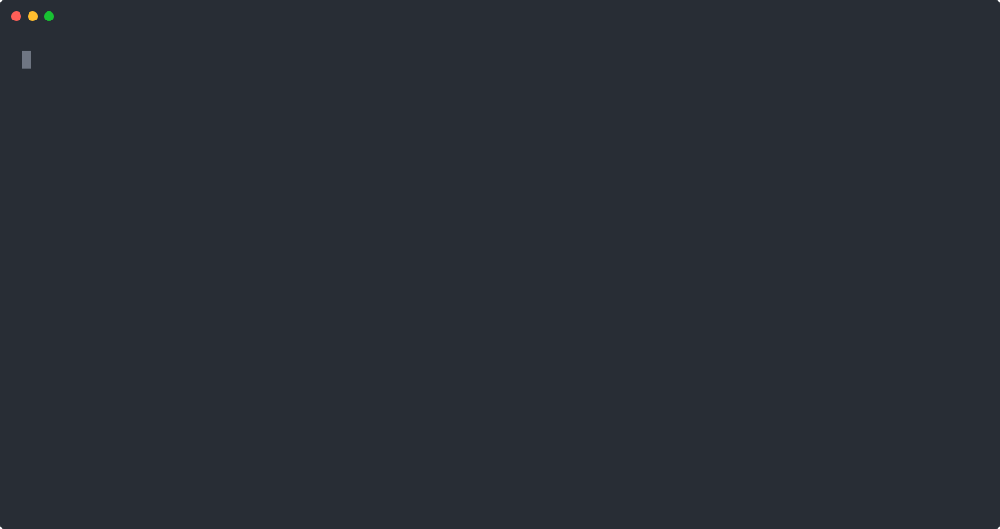
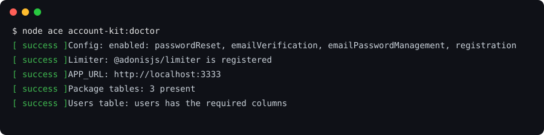
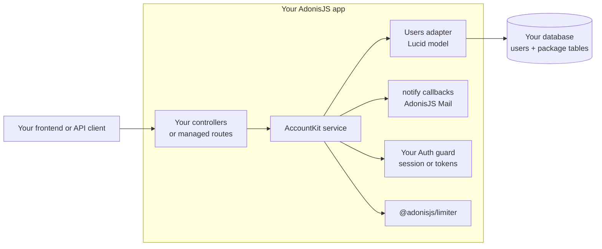

# Account Kit for AdonisJS

[](https://github.com/Kevinjohn/oss-adonisjs-account-kit/actions/workflows/checks.yml)
[](https://www.npmjs.com/package/adonisjs-account-kit)
[](LICENSE.md)
[](package.json)
[](https://adonisjs.com)
[](CONTRIBUTING.md#checks)

Password reset, email verification, invitations and account settings for AdonisJS 7, with the
security details handled. You keep your user model, your routes and your policies.



## What you get

- **Forgot password** with single-use, hashed, expiring links and the same response for known and
  unknown addresses.
- **Email verification and signup**, open, closed, or behind your own admission rule.
- **Invitations** with roles, resend, revoke and paged listing.
- **Account settings**: change password, change email with confirmation, update profile.
- **Login** with sessions or access tokens through your existing Auth guard. Every credential
  change signs out older sessions and tokens.
- **Google and GitHub sign-in** through Ally (optional).
- **Emails** for AdonisJS Mail out of the box, or your own templates.
- **Rate limits** on password reset, verification resend, invitations, login and account changes.
- **Managed JSON routes** (optional), if you would rather not write the controllers.
- **Ace commands**: `account-kit:doctor`, `account-kit:setup`, `account-kit:prune`.
- Tested on **SQLite, PostgreSQL 16 and MySQL 8.4**.

## Install

```sh
node ace add @adonisjs/limiter
node ace add adonisjs-account-kit
node ace migration:run
node ace account-kit:doctor
```

`node ace add` writes `config/account_kit.ts`, generates the migrations and registers the provider
and commands. The doctor checks the config, limiter, `APP_URL` and database:



The generated `notify` callbacks throw until you choose how to send email, and the doctor cannot
run them; the [getting started tutorial](docs/getting-started.md#3-print-emails-to-the-terminal)
sets them up.

Requirements: Node.js 24+, AdonisJS 7 with Lucid, `@adonisjs/limiter`, a stable `APP_KEY` of at
least 32 characters and an `APP_URL`.

## A forgot-password flow in two routes

```ts
// app/controllers/password_resets_controller.ts
import app from '@adonisjs/core/services/app'
import type { HttpContext } from '@adonisjs/core/http'
import { AccountKit, DeliveryError, PostCommitError } from 'adonisjs-account-kit'

export default class PasswordResetsController {
  async request({ request, response, logger }: HttpContext) {
    const kit = await app.container.make(AccountKit)
    try {
      await kit.passwordReset.request({ email: request.input('email'), clientKey: request.ip() })
    } catch (error) {
      // Only known addresses get an email, so a failed send must not change the response.
      if (!(error instanceof DeliveryError || error instanceof PostCommitError)) throw error
      logger.error({ err: error }, 'password reset email failed')
    }
    return response.accepted({ message: 'If the account exists, instructions will be sent.' })
  }

  async complete({ request, params, logger }: HttpContext) {
    const kit = await app.container.make(AccountKit)
    try {
      await kit.passwordReset.reset({ token: params.token, password: request.input('password') })
    } catch (error) {
      // The password has already changed; only the follow-up email failed.
      if (!(error instanceof DeliveryError || error instanceof PostCommitError)) throw error
      logger.error({ err: error }, 'password reset notice failed')
    }
    return { message: 'Password reset.' }
  }
}
```

The [getting started tutorial](docs/getting-started.md) takes you from a new API starter app to a
working reset, with the email printed to your terminal, in about ten minutes.

## How it fits together



Account Kit owns the account transaction: tokens, locking, revocation and events. Your app owns the
HTTP layer, validation, authorization and the user model.

## Features at a glance

| Operation               | Service API                                  | Managed route                           | Email sent                                  | Rate limit                    |
| ----------------------- | -------------------------------------------- | --------------------------------------- | ------------------------------------------- | ----------------------------- |
| Request password reset  | `passwordReset.request`                      | `POST /auth/password-reset`             | `passwordResetProvision`                    | Per client and per address    |
| Complete password reset | `passwordReset.reset`                        | `POST /auth/password-reset/:token`      | `passwordResetCompleted`                    | Per client (managed route)    |
| Sign up                 | `registration.register`                      | `POST /auth/signup`                     | `accountActivationProvision`                | Per client (managed route)    |
| Resend verification     | `emailVerification.send`                     | `POST /account/email-verification/send` | `accountActivationProvision`                | Per user                      |
| Confirm email           | `emailVerification.complete`                 | `POST /auth/email-verification/:token`  | none                                        | Per client (managed route)    |
| Log in                  | `authentication.login`                       | `POST /auth/login`                      | none                                        | Per client and per identity   |
| Change password         | `emailPasswordManagement.changePassword`     | `POST /account/password`                | `passwordChanged`                           | Per user                      |
| Change email            | `emailPasswordManagement.requestEmailChange` | `PATCH /account/profile`                | `emailChangeProvision`, then `emailChanged` | Per user                      |
| Invite                  | `invitations.send`                           | `POST /account/invitations`             | `invitationProvision`                       | Per inviter and per recipient |
| Accept invitation       | `invitations.accept`                         | `POST /auth/invitations/:token`         | none                                        | Per client (managed route)    |

The full lists are in [usage](docs/usage.md) and the [endpoint reference](docs/reference/endpoints.md).

## Security

- Tokens are 40 random bytes by default. Only their SHA-256 hash is stored, and each works once.
- Reset requests return the same response and take at least 300 ms whether or not the address
  exists. Failed logins return one generic error.
- Links are built only from configured origins, never from the request `Host` header.
- Rate-limit keys are HMAC digests, so the limiter store never holds an email address or IP.
- Every account change runs in one transaction with the user row locked.

The [security model](docs/security.md) lists every defence and its default, what your app must still
do, and what is out of scope. Report vulnerabilities privately: see [SECURITY.md](SECURITY.md).

## Before production

- Configure trusted proxies before passing `request.ip()` as `clientKey`.
- Store email addresses trimmed and lowercase, with a single-column unique index.
- Keep `APP_KEY` identical on every instance that shares a limiter store.
- Do not wrap Account Kit calls in your own transaction; each operation owns its transaction and
  passes `trx` to your callbacks.
- On SQLite, enable foreign keys on every connection.
- Schedule `node ace account-kit:prune` to delete expired tokens.
- Keep proof links out of access logs and analytics.

Details: [operations](docs/operations.md), [custom user model](docs/recipes/custom-user-model.md)
and [usage](docs/usage.md#transactions-and-callbacks).

## When to use it

- **Use Account Kit** when you want the standard account flows in an AdonisJS app that already has
  its own user model, and you want to keep your own routes and frontend.
- **Use [AdonisJS Plus](https://plus.adonisjs.com)** for two-factor authentication and passkeys.
  Account Kit uses the same vocabulary as Plus and the AdonisJS starter kits.
- **Write it yourself** when your flows differ from email-and-password accounts. The
  [security model](docs/security.md) is a useful checklist either way.

## Testing your app

```ts
import { captureNotifications } from 'adonisjs-account-kit/testing/notifications'

const mail = captureNotifications() // pass mail.notify as Account Kit's notify config in tests
// ...request a reset, then:
const token = mail.tokenFor('passwordResetProvision', 'someone@example.com')
```

See [testing your account flows](docs/recipes/testing.md).

## Bring your own ORM

Users live behind a small `UsersAdapter` interface. Lucid, Drizzle, Prisma and plain SQL adapters
ship with the package; see [users adapters](docs/adapters.md). For anything else, `adonisjs-account-kit/testing/adapter_contract` runs the same behaviour checks the
Lucid adapter passes, so you can prove your adapter is correct. See
[custom adapter](docs/recipes/custom-adapter.md).

## Documentation

- [Getting started](docs/getting-started.md)
- [Inertia React example app](examples/inertia-react/README.md): the starter kit with signup,
  email confirmation, forgot password and change password
- [Recipes](docs/README.md#how-to-guides): tokens, sessions, Inertia, social sign-in, email
  templates, multi-tenant and more
- [Reference](docs/README.md#reference): configuration, errors, endpoints, glossary
- [Security model](docs/security.md)
- [Changelog](CHANGELOG.md)

## Verifying a release

Releases are published from GitHub Actions with npm provenance. Run `npm audit signatures` in your
app to check that the installed package was built from this repository.

## Contributing

Bug reports, docs fixes, recipes and adapters are welcome. Read [CONTRIBUTING.md](CONTRIBUTING.md)
to get the test suite running, or start with no local setup:

[](https://codespaces.new/Kevinjohn/oss-adonisjs-account-kit)

## License

[MIT](LICENSE.md)
