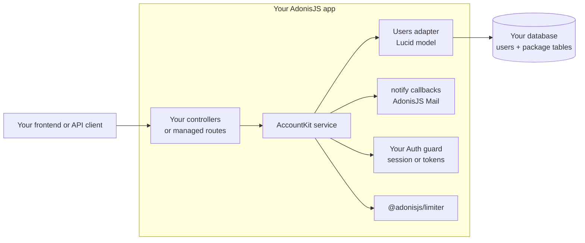

# Account Kit for AdonisJS

[](https://github.com/Kevinjohn/oss-adonisjs-account-kit/actions/workflows/checks.yml)
[](https://www.npmjs.com/package/adonisjs-account-kit)
[](LICENSE.md)
[](package.json)
[](https://adonisjs.com)
[](CONTRIBUTING.md#checks)

Password reset, email verification, invitations and account settings for AdonisJS 7, with the
security details handled. You keep your user model, your routes and your policies.

For example, a controller can request a reset without learning whether the address is registered:

```ts
await kit.passwordReset.request({ email, clientKey: ctx.request.ip() })
```


Watch selected flows in [short terminal recordings](docs/recordings.md).

## Choose a path

Choose how Account Kit should fit into your app before installing it or generating files:

- **Keep your own controllers and routes:** call the service API and keep HTTP validation, access
  policy, and response handling in your application. The recommended
  [complete API walkthrough](docs/guides/core-api.md) builds signup, protected settings, and reset.
- **Use managed JSON routes:** mount the package routes under your chosen prefix and keep your
  application's authentication and authorization policy. See [managed HTTP](docs/managed-http.md).
- **Generate an integration:** use [guided setup](docs/setup.md) to inspect and generate selected
  configuration, middleware, and route files. It is an alternative to writing those files by hand.
- **Explore a browser app:** the maintained [Inertia React example](examples/inertia-react/README.md)
  demonstrates its implemented signup, verification, password, profile, and email screens. Email
  is printed to the development server log.


## What you get

Common account flows for AdonisJS applications:

- **Forgot password** with single-use, expiring links and the same response for known and unknown
  addresses.
- **Signup and email verification**, open, closed, or behind your own signup rule.
- **Login** with sessions or access tokens through your existing Auth guard. Changing a password or
  email signs out older sessions and tokens.
- **Account settings**: change password, change email with confirmation, update profile.
- **Invitations** with roles, resend and revoke.

Account Kit includes notification templates, rate limits for sensitive operations, and helpers for
testing account flows. Call its services from your controllers, or mount the managed JSON routes.

## Additional features

Additional account flows are opt-in; enable only those your application uses. The commands, OpenAPI
generator, and ORM adapters are available for the integrations you choose:

- **Magic-link sign-in**: a one-use email link that only works in the browser or app that asked
  for it.
- **Signed-in devices**: list sign-ins, sign out one device, every other device, or everywhere.
- **Account export and deletion**: export package-held data with application-supplied data and
  remove the account and package-owned rows. These helpers do not determine your legal obligations.
- **Admission**: keep signed-in accounts out of your data until an allowed domain, an invitation
  or an approval admits them.
- **Google and GitHub sign-in** through Ally.
- **Operator commands**: `account-kit:invite` and `account-kit:reset-link` from the shell.
- **OpenAPI 3.1 document** for the managed routes.
- **Drizzle, Prisma and plain SQL** users adapters, as well as Lucid.

[All features](docs/features.md) has the details of each.

## Install

```sh
node ace add @adonisjs/limiter
node ace add adonisjs-account-kit
node ace migration:run
node ace account-kit:doctor
```

`node ace add` writes `config/account_kit.ts`, generates the migrations and registers the provider
and commands. The doctor checks the config, limiter, `APP_URL`, required package tables and user
columns. It also checks that the password column permits `NULL` when selected social registration
can create an account without a password:


Green installation checks end with an **Unverified** summary. Doctor does not send mail, invoke
callbacks, check application policy, or prove credential revocation. Follow its smoke-test prompt
with a disposable account; the [getting started tutorial](docs/getting-started.md#3-print-emails-to-the-terminal)
sets up development notifications.

Account Kit errors carry a `status` and `code` but do not render themselves. Map them in
`app/exceptions/handler.ts` with `accountErrorResponse`, which returns a safe status, headers
(`Retry-After` when throttled) and body, or `null` for any other error:

```ts
import { accountErrorResponse } from 'adonisjs-account-kit'

export default class HttpExceptionHandler extends ExceptionHandler {
  async handle(error: unknown, ctx: HttpContext) {
    const mapped = accountErrorResponse(error)
    if (mapped) {
      for (const [name, value] of Object.entries(mapped.headers)) ctx.response.header(name, value)
      const { code, message } = mapped.body
      return ctx.response.status(mapped.status).send({ errors: [{ code, message }] })
    }
    return super.handle(error, ctx)
  }
}
```

[Keep HTTP policy in the application](docs/application-owned-integration.md#keep-http-policy-in-the-application)
explains the status codes and the `committed` marker.

`node ace add` gives you a starter config. You write the controllers, or mount the
[managed JSON routes](docs/managed-http.md) yourself. Start with
[getting started](docs/getting-started.md).

To have the config, guard adapter, middleware and managed route file generated from your answers
instead, follow [guided setup](docs/setup.md) in place of `node ace add adonisjs-account-kit`.

Requirements: Node.js 24+, AdonisJS 7 with Lucid, `@adonisjs/limiter`, a stable `APP_KEY` of at
least 32 characters and an `APP_URL`. See [database compatibility](docs/compatibility.md) for the
tested SQLite, PostgreSQL and MySQL versions.

## How it fits together



Account Kit owns the account transaction: tokens, locking, revocation and events. Your app owns the
HTTP layer, validation, authorization and the user model.

## Security

Account flows are where attackers look first. What Account Kit does by default:

- **Links can't be rebuilt from your database.** Only a SHA-256 hash of each token is stored, and
  each link works once and expires. [Proof tokens](docs/security.md#proof-tokens)
- **No account lookup by side channel.** Reset and magic-link requests answer the same way, in at
  least 300 ms, whether or not the address exists. [Enumeration](docs/security.md#account-enumeration)
- **Rate limits** on every request that sends mail or checks a password, keyed by HMAC digests so
  the limiter never stores an email or IP. [Rate limits](docs/security.md#rate-limits)
- **Changing a password signs out everywhere else.** Older sessions and tokens stop working on
  their next request. [Sessions and tokens](docs/security.md#sessions-and-tokens)
- **Links come from your config,** never from request headers, and must be HTTPS in production.
  [Links in emails](docs/security.md#links-in-emails)
- **No half-finished changes.** Each operation runs in one transaction with the user row locked.
  [Transactions](docs/security.md#transactions-and-races)
- **Verifiable releases.** Published with npm provenance. [Supply chain](docs/security.md#supply-chain)
  explains release verification.

The [security model](docs/security.md) names the code and the test behind each defense, what your
app must still do, and what is out of scope. Report vulnerabilities privately: see
[SECURITY.md](SECURITY.md).

## Before production

- Configure trusted proxies before passing `request.ip()` as `clientKey`.
- Store email addresses trimmed and lowercase, with a single-column unique index.
- Keep `APP_KEY` identical on every instance that shares a limiter store.
- Do not wrap Account Kit calls in your own transaction; each operation owns its transaction and
  passes `trx` to your callbacks.
- On SQLite, enable foreign keys on every connection.
- Schedule `node ace account-kit:prune` to delete expired tokens.
- Keep proof links out of access logs and analytics.

Details: [operations](docs/operations.md), [custom user model](docs/recipes/custom-user-model.md)
and [usage](docs/usage.md#transactions-and-callbacks).

## When to use it

- **Use Account Kit** when you want the standard account flows in an AdonisJS app that already has
  its own user model, and you want to keep your own routes and frontend.
- **Use [AdonisJS Plus](https://plus.adonisjs.com)** for two-factor authentication and passkeys.
  Account Kit uses the same vocabulary as Plus and the AdonisJS starter kits.
- **Write it yourself** when your flows differ from email-and-password accounts. The
  [security model](docs/security.md) is a useful checklist either way.

Deciding with an AI coding agent? [README-AGENTS.md](README-AGENTS.md) gives it the requirements,
invariants and file map in one place.

## Testing your app

```ts
import { captureNotifications } from 'adonisjs-account-kit/testing/notifications'

const mail = captureNotifications() // pass mail.notify as Account Kit's notify config in tests
// ...request a reset, then:
const token = mail.tokenFor('passwordResetProvision', 'someone@example.com')
```

See [testing your account flows](docs/recipes/testing.md).

## Bring your own ORM

- **Lucid** model: the default.
- **Drizzle** or **Prisma** schema: Account Kit reads your existing table definition.
- **Plain SQL**: just a table name, no model.
- **Anything else**: write a small adapter and prove it with the bundled contract tests.

See [users adapters](docs/adapters.md) and [custom adapter](docs/recipes/custom-adapter.md).

## Documentation

- [Getting started](docs/getting-started.md)
- [Recipes](docs/recipes/index.md): integration guides for sessions, tokens, Inertia, adapters,
  email, testing, and multi-tenant apps
- [Reference](docs/reference/index.md): configuration, operations, errors, endpoints, and
  compatibility
- [Security model](docs/security.md)
- [Changelog](CHANGELOG.md)

## Contributing

Bug reports, docs fixes, recipes and adapters are welcome. Read [CONTRIBUTING.md](CONTRIBUTING.md)
to get the test suite running, or start with no local setup:

[](https://codespaces.new/Kevinjohn/oss-adonisjs-account-kit)

## License

[MIT](LICENSE.md)
