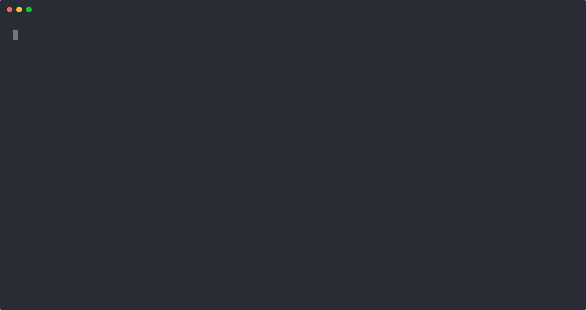

# Account Kit for AdonisJS

[](https://github.com/Kevinjohn/oss-adonisjs-account-kit/actions/workflows/checks.yml)
[](package.json)
[](https://adonisjs.com)

> Pre-release. Installed from GitHub releases; not on npm.

## What you get

Password reset, email verification, invitations and account settings for AdonisJS 7. You keep your
user model, routes and frontend; Account Kit handles tokens, rate limits, session revocation and
transactions that are easy to get wrong.



- **Forgot password** with single-use, expiring links and the same response for known and unknown
  addresses.
- **Signup and email verification**, open, closed or behind your own rule.
- **Account settings**: change password, change email with confirmation, update profile. Changing a
  password signs out older sessions and tokens.
- **Invitations** with roles, resend and revoke.
- **Opt-in extras**: magic links, signed-in devices, account export and deletion, Google and GitHub
  sign-in, admission rules and OpenAPI. See [all features](docs/guide/features.md).
- **Your ORM**: Lucid by default, or Drizzle, Prisma and plain SQL adapters.

## Install

Requires Node.js 24+, AdonisJS 7 with Lucid, and `@adonisjs/limiter`. Install the archive from
[GitHub releases](https://github.com/Kevinjohn/oss-adonisjs-account-kit/releases):

```sh
node ace add @adonisjs/limiter
pnpm add https://github.com/Kevinjohn/oss-adonisjs-account-kit/releases/download/v0.2.0/kevinjohn-adonisjs-account-kit-0.2.0.tgz
node ace configure @kevinjohn/adonisjs-account-kit
node ace migration:run
node ace account-kit:doctor
```

Prefer generated files? Use [guided setup](docs/guide/setup.md) instead of
`node ace configure`.

### Dynamic providers

If configure cannot inspect providers in `adonisrc.ts`, make sure the dynamic list registers
Account Kit exactly once. Keep an existing `@kevinjohn/adonisjs-account-kit/account_kit_provider` entry;
add the export below only when it is not already present:

```ts
const applicationProviders = () => [
  // Keep your existing provider entries here.
  () => import('@kevinjohn/adonisjs-account-kit/account_kit_provider'),
]
```

If you pass a config variable to `defineConfig`, expose its settings, existing commands and provider
list in an object literal first. This keeps the existing command entries while giving configure a
static commands array to extend:

```ts
export default defineConfig({
  ...applicationConfig,
  commands: [...(applicationConfig.commands ?? [])],
  providers: applicationConfig.providers,
})
```

Keep the rest of your provider logic, then rerun:

```sh
node ace configure @kevinjohn/adonisjs-account-kit --provider-registered
```

This flag confirms that you registered the provider yourself. Configure then preserves the dynamic
provider expression and completes the remaining setup. Running it again is safe.

## Quick example

A forgot-password action. The [getting started tutorial](docs/guide/getting-started.md) adds
validation, error mapping and the reset action.

```ts
import app from '@adonisjs/core/services/app'
import type { HttpContext } from '@adonisjs/core/http'
import { AccountKit, DeliveryError, PostCommitError } from '@kevinjohn/adonisjs-account-kit'

export default class PasswordResetsController {
  async request({ request, response, logger }: HttpContext) {
    const kit = await app.container.make(AccountKit)
    try {
      await kit.passwordReset.request({ email: request.input('email'), clientKey: request.ip() })
    } catch (error) {
      // Mail is sent after commit. Keep one response for known and unknown addresses.
      if (!(error instanceof DeliveryError || error instanceof PostCommitError)) throw error
      logger.error({ code: error.code }, 'password reset email failed')
    }
    return response.accepted({ message: 'If the account exists, instructions will be sent.' })
  }
}
```

## Tested against

|                         | Every pull request | Weekly and before each release          |
| ----------------------- | ------------------ | --------------------------------------- |
| Node.js                 | 24                 | 24                                      |
| AdonisJS core           | locked version     | lowest supported (7.0.0) and latest 7.x |
| Lucid                   | locked version     | lowest supported and latest 22.x        |
| SQLite (better-sqlite3) | yes                | yes                                     |
| PostgreSQL 16           | yes                | yes                                     |
| MySQL 8.4               | no (experimental)  | experimental                            |

## Documentation

- [Getting started](docs/guide/getting-started.md): install and add password reset to an API
  starter.
- [Troubleshooting](docs/guide/troubleshooting.md) and [reference](docs/reference/README.md).
- [Generated API reference](https://kevinjohn.github.io/oss-adonisjs-account-kit/reference/api/).
- [Recipes](docs/recipes/index.md).
- [Security model](docs/guide/security.md) and [operations](docs/guide/operations.md), including
  the production checklist.
- [README-AGENTS.md](README-AGENTS.md): requirements, invariants and the source map for coding
  agents.

Need two-factor authentication or passkeys? Use [AdonisJS Plus](https://plus.adonisjs.com).

## Contributing

Bug reports, docs fixes, recipes and adapters are welcome: read [CONTRIBUTING.md](CONTRIBUTING.md).
Report vulnerabilities privately as described in [SECURITY.md](SECURITY.md). Changes are listed in
the [changelog](CHANGELOG.md).

## License

[MIT](LICENSE.md)
