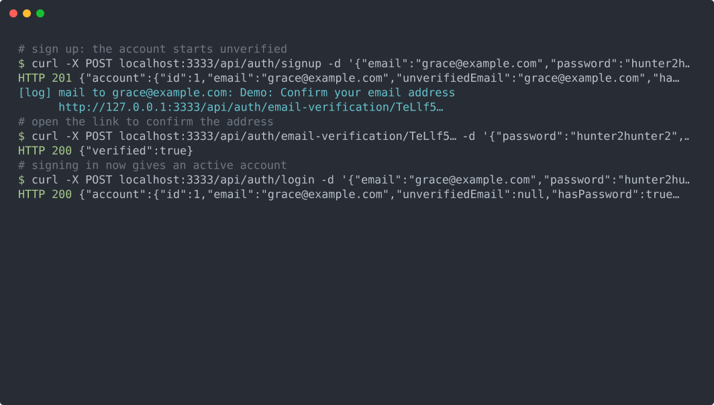

# Account Kit for AdonisJS

[](https://github.com/Kevinjohn/oss-adonisjs-account-kit/actions/workflows/checks.yml)
[](package.json)
[](https://adonisjs.com)

> Pre-release. Installed from GitHub releases; not on npm.

## What you get

Password reset, email verification, invitations and account settings for AdonisJS 7. You keep your
user model, routes and frontend; Account Kit handles tokens, rate limits, session revocation and
transactions that are easy to get wrong.



[Watch the signup and verification recording, with animation controls](https://kevinjohn.github.io/oss-adonisjs-account-kit/guide/recordings#signup-and-email-verification).

- **Forgot password** with single-use, expiring links and the same response for known and unknown
  addresses.
- **Signup and email verification**, open, closed or behind your own rule.
- **Account settings**: change password, change email with confirmation, update profile. Changing a
  password signs out older sessions and tokens.
- **Invitations** with roles, resend and revoke.
- **Opt-in extras**: magic links, signed-in devices, account export and deletion, Google and GitHub
  sign-in, admission rules and OpenAPI. See [all features](docs/guide/features.md).
- **Your ORM**: Lucid by default, or Drizzle, Prisma and plain SQL adapters.

## Install

Requires Node.js 24+, AdonisJS 7 with Lucid, and `@adonisjs/limiter`. Install the archive from
[GitHub releases](https://github.com/Kevinjohn/oss-adonisjs-account-kit/releases):

```sh
node ace add @adonisjs/limiter
pnpm add https://github.com/Kevinjohn/oss-adonisjs-account-kit/releases/download/v0.7.0/kevinjohn-adonisjs-account-kit-0.7.0.tgz
```

Choose an integration path before configuring the package or running its migrations:

- **Guided setup** generates the integration files. Follow the [guided setup guide](docs/guide/setup.md).
- **Application-owned integration** configures the package while you wire the routes and policies. Run:

  ```sh
  node ace configure @kevinjohn/adonisjs-account-kit
  node ace migration:run
  node ace account-kit:doctor
  ```

### Dynamic providers

If configure cannot inspect providers in `adonisrc.ts`, make sure the dynamic list registers
Account Kit exactly once. Keep an existing `@kevinjohn/adonisjs-account-kit/account_kit_provider` entry;
add the export below only when it is not already present:

```ts
const applicationProviders = () => [
  // Keep your existing provider entries here.
  () => import('@kevinjohn/adonisjs-account-kit/account_kit_provider'),
]
```

If you pass a config variable to `defineConfig`, expose its settings, existing commands and provider
list in an object literal first. This keeps the existing command entries while giving configure a
static commands array to extend:

```ts
export default defineConfig({
  ...applicationConfig,
  commands: [...(applicationConfig.commands ?? [])],
  providers: applicationConfig.providers,
})
```

Keep the rest of your provider logic, then rerun:

```sh
node ace configure @kevinjohn/adonisjs-account-kit --provider-registered
```

This flag confirms that you registered the provider yourself. Configure then preserves the dynamic
provider expression and completes the remaining setup. Running it again is safe.

## Session guard

`accountKitSessionGuard({ provider })` from `@kevinjohn/adonisjs-account-kit/auth` is an AdonisJS
Auth session guard for `config/auth.ts` that authenticates through Account Kit, so `auth.user` is
the signed-in model and the Auth Japa plugin's `loginAs(user)` works in tests (register both
`sessionApiClient` and `authApiClient`). `createManagedGuard` stays available. See
[the session guard guide](docs/guide/authentication.md#account-kit-session-guard).

## Registering callbacks from a provider

`config/account_kit.ts` and `config/admission.ts` may leave out the callbacks that call
application code. Register them from an application provider instead, listed in `adonisrc.ts`
before `@kevinjohn/adonisjs-account-kit/account_kit_provider`. Call `register` in `boot()`. The
factory runs while `AccountKit` or `AccountAdmission` is being built, the first time that service
is resolved.

```ts
import type { ApplicationService } from '@adonisjs/core/types'

export default class PackageCallbacksProvider {
  constructor(protected app: ApplicationService) {}

  async boot() {
    const accountKit = await this.app.container.make('account_kit.callbacks')
    accountKit.register(async () => {
      const { users } = await import('#services/account_kit/users')
      return { users, onInvitationAccepted: async (user, invitation, trx) => {} }
    })
    const admission = await this.app.container.make('account_admission.callbacks')
    admission.register(() => {
      const rules = async () => {
        const { default: AdmissionRules } = await import('#services/account_kit/admission_rules')
        return this.app.container.make(AdmissionRules)
      }
      return {
        approvalAuthorize: {
          decide: async (actor, subject, context) => {
            const service = await rules()
            return service.decide(actor, subject, context)
          },
          list: async (actor, context) => {
            const service = await rules()
            return service.list(actor, context)
          },
        },
      }
    })
  }
}
```

Resolve application services inside the callbacks, not in the factory body. The factory runs
before the package service exists, so a service built there must not take `AccountKit` or
`AccountAdmission` through its constructor, directly or through another service. If it does,
resolving the package service never settles and no error is raised: the container has no cycle
detection. A callback runs after the package service is built, so resolving the application service
there is safe. The cost is that a failure to build the application service appears when a callback
first runs, not when the package service is resolved. A plain module with no constructor
dependencies, as in the `account_kit.callbacks` half of the example, can be imported in the factory
body.

Account Kit accepts `users`, `authorize`, `mapRegistrationFields` (`registration.mapFields`),
`onInvitationAccepted`, `onCredentialsChangedTransaction` and `onAccountDeletingTransaction`;
admission accepts `approvalAuthorize` (`approval.authorize`) and `onAdmissionEvent`. A field set in
both the config file and the registry, a second `register` call, or a call after the service was
first resolved throws `E_ACCOUNT_KIT_INVALID_CONFIGURATION`. A config file that passes every callback keeps
working with nothing registered.

## User stories

See the [user story catalogue](user-stories/README.md) for source-reviewed account journeys, opt-in capabilities and operator surfaces.

## Quick example

A forgot-password action. The [getting started tutorial](docs/guide/getting-started.md) adds
validation, error mapping and the reset action.

```ts
import app from '@adonisjs/core/services/app'
import type { HttpContext } from '@adonisjs/core/http'
import {
  AccountKit,
  E_ACCOUNT_KIT_DELIVERY,
  E_ACCOUNT_KIT_POST_COMMIT,
} from '@kevinjohn/adonisjs-account-kit'

export default class PasswordResetsController {
  async request({ request, response, logger }: HttpContext) {
    const kit = await app.container.make(AccountKit)
    try {
      await kit.passwordReset.request({ email: request.input('email'), clientKey: request.ip() })
    } catch (error) {
      // Both errors follow a committed reset. Keep one response for known and unknown addresses,
      // and log no address or link.
      if (!(error instanceof E_ACCOUNT_KIT_DELIVERY || error instanceof E_ACCOUNT_KIT_POST_COMMIT))
        throw error
      logger.error(
        { code: error.code },
        error instanceof E_ACCOUNT_KIT_DELIVERY
          ? 'reset email failed'
          : 'reset follow-up failed; the email may have been sent'
      )
    }
    return response.accepted({ message: 'If the account exists, instructions will be sent.' })
  }
}
```

## Errors

Account Kit throws AdonisJS exceptions with stable codes and HTTP statuses. Use the constructor
export to recognise a specific cause.

```ts
import { errors } from '@kevinjohn/adonisjs-account-kit'

if (error instanceof errors.E_ACCOUNT_KIT_INVALID_TOKEN) {
  return response.badRequest({ message: 'This link is invalid or expired.' })
}
```

The [error reference](docs/reference/errors.md) lists the constructors and shows how to use
`accountErrorResponse` for the managed routes' response shape and translation keys.

## Tested against

This table describes configured CI coverage, not the result of a pending workflow run.

| Check                          | Checks workflow (pull requests) | Compatibility workflow (scheduled, pre-release, matching pull requests)            |
| ------------------------------ | ------------------------------- | ---------------------------------------------------------------------------------- |
| Node.js                        | 24                              | 24                                                                                 |
| AdonisJS core, Lucid and peers | Locked versions                 | Minimum and latest peer versions                                                   |
| Package test suite             | SQLite and PostgreSQL 16        | PostgreSQL 16 and the SQLite transaction suite at minimum and latest peer versions |
| Built exports and setup        | SQLite leg after build          | —                                                                                  |
| Packed consumers               | —                               | Fresh/latest, minimum, and service-only on SQLite and PostgreSQL 16                |
| MySQL 8.4                      | —                               | Experimental                                                                       |

## Documentation

- [Getting started](docs/guide/getting-started.md): install and add password reset to an API
  starter.
- [Troubleshooting](docs/guide/troubleshooting.md) and [reference](docs/reference/README.md).
- [Generated API reference](https://kevinjohn.github.io/oss-adonisjs-account-kit/reference/api/).
- [Account Kit recipes](docs/recipes/index.md) and the [four-package starter cookbook](https://github.com/Kevinjohn/oss-adonisjs-starter-examples/tree/v0.13.0/docs/cookbook).
- [Security model](docs/guide/security.md) and [operations](docs/guide/operations.md), including
  the production checklist.
- [README-AGENTS.md](README-AGENTS.md): requirements, invariants and the source map for coding
  agents.

Need two-factor authentication or passkeys? Use [AdonisJS Plus](https://plus.adonisjs.com).

## Contributing

Bug reports, docs fixes, recipes and adapters are welcome: read [CONTRIBUTING.md](CONTRIBUTING.md).
Report vulnerabilities privately as described in [SECURITY.md](SECURITY.md). Changes are listed in
the [changelog](CHANGELOG.md).

## License

[MIT](LICENSE.md)
