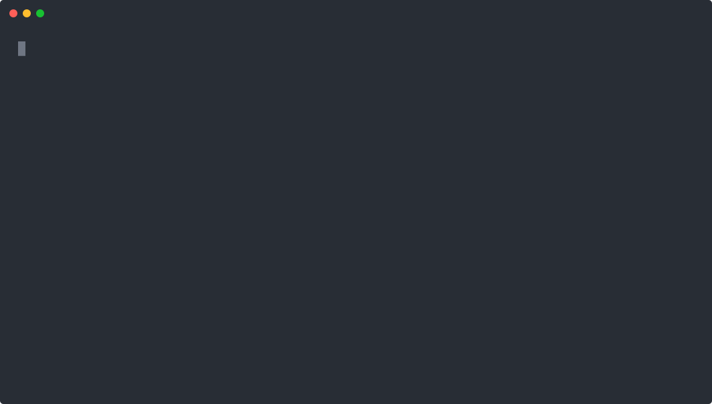

# Guided setup

This guide walks through `account-kit:setup` from the first preview to an active managed route
mount. The [setup choices reference](reference/setup-choices.md) lists every pillar field and
generated file; [how setup works](how-setup-works.md) explains the preview, recovery and readiness
model.

## Run setup

After installing the package, add `() => import('adonisjs-account-kit/commands')` to the application's `adonisrc.ts` `commands` array. Do this before running setup; the basic `configure` command creates its own starter config and is a separate path. Setup requires a separately installed TypeScript 5.9.3 or newer 5.x, or 6.0.3 or newer 6.x, to inspect executable application configuration without running it; install the supported version explicitly with `pnpm add -D typescript@^5.9.3` if missing. Other Account Kit entry points do not load TypeScript. Run `node ace account-kit:setup` for the interactive choices, or copy the [session example choices](setup_choices.example.json) or [API starter token choices](setup_choices.api.example.json) into the application and pass `--input=path/to/choices.json`. The session example expects an existing `web` session guard; the API example expects an existing `api` access-tokens guard. Both examples select authentication, so they require an application-owned `accountKitPolicy.canAccess` callback before preview or apply. Inspect your application's `config/auth.ts` and choose its actual guard. Both paths produce the same typed setup choices. `--apply` writes the proposal; without it the command previews. `--check` reads the persisted choices and diagnoses the current application without writing. Add `--production` to check public origin and session security requirements for deployment.



Leave `authentication.applicationRouteRevocation` false for the first apply. Setup generates the account-access middleware and an inert managed-route file; no managed endpoints are mounted. Review and run the generated migrations, then prove revocation on an application-owned route as described below. Only after that check passes should you set `applicationRouteRevocation` true and rerun setup to activate the managed route mount. A generated file or successful typecheck does not establish runtime revocation, and setup continues to report workflow verification as incomplete until the application flows are exercised.

### Prove revocation before route activation

The first apply writes `config/account_kit.ts` for the selected service policy, `app/services/account_kit_guard.ts` exporting `accountKitGuard` for the existing named guard, and `app/middleware/account_kit_access_middleware.ts` for application-owned routes. Register the generated middleware in your `start/kernel.ts` named middleware map and attach it to a temporary application-owned protected route outside the managed prefix. The maintained [kernel](../examples/api/start/kernel.ts) and [profile route](../examples/api/start/routes.ts) show the registration and route placement; substitute `#middleware/account_kit_access_middleware` for the example's `#middleware/account_access_middleware`. Keep an application-owned login route available while the managed mount is inert.

In that login route, resolve the configured service with `const kit = await app.container.make(AccountKit)` (`AccountKit` comes from `adonisjs-account-kit`), then call `kit.authentication.login({ email, password, clientKey: request.ip() }, accountKitGuard.forRequest(ctx))`. The generated guard adapter establishes the real selected session or token and records the package credential revision. For a token selection, return `accountKitGuard.publicCredential(result.credential)` from the login result as an opaque bearer value. For a session selection, retain the regenerated HTTP-only session cookie. Adapt the maintained [token](../examples/api/app/controllers/access_tokens_controller.ts) or [session](../examples/api/app/controllers/session_controller.ts) login controller to the generated guard; the [guard example](../examples/api/app/services/account_kit_guards.ts) shows the equivalent adapter behavior. Native guard login or a test helper such as `loginAs` alone does not enroll this revision.

Create a test account with a known password through the application's model or fixture, satisfying the selected access policy and verified-email requirement if enabled. Request the **same** generated-middleware-protected route with the new credential and require success. Then exercise a public operation selected by your setup choices:

- With `emailPasswordManagement`, change the password through `kit.emailPasswordManagement.changePassword({ actorId, currentPassword, newPassword })`, as in the maintained [password controller](../examples/api/app/controllers/account_password_controller.ts).
- With `passwordReset` but no password-management capability, request a reset through `kit.passwordReset.request({ email, clientKey })`, deliver its proof through the configured notification callback, and complete it with `kit.passwordReset.reset({ token, password })`, as in the maintained [reset controller](../examples/api/app/controllers/password_resets_controller.ts) and [reset test](../examples/api/tests/functional/auth_safety.spec.ts).
- With authentication alone, use `kit.authentication.changeRestriction({ userId, change })` to update your application-owned access-policy state in its transaction so the account is restricted, then call it again to restore access. The [session restriction test](../examples/api/tests/functional/authentication_session.spec.ts) and [service test](https://github.com/Kevinjohn/oss-adonisjs-account-kit/blob/main/tests/authentication.spec.ts) demonstrate the public operation. After restoration, log in again and require a fresh credential to succeed on the protected route; then require the **original** credential to fail there. This checks revocation after policy denial ends.

For each path, require the **original** credential to receive a 401 on the same protected route after the change. A credential that was never accepted, or a request denied only while the account remains restricted, proves only universal denial. Record the initial success and the post-change rejection; for restriction changes also record success with a fresh credential after restoration.

For tokens, send the login result in `Authorization: Bearer …` on protected requests; the maintained [revocation test](../examples/api/tests/functional/token_reference.spec.ts) shows the password-change variant. For sessions while the managed mount is inert, expose an application-owned CSRF bootstrap route using the maintained [session controller's `csrf` method](../examples/api/app/controllers/session_controller.ts) and [route registration](../examples/api/start/routes.ts). Fetch its CSRF token before login, retain the cookie across login and protected access, send `x-csrf-token` on login and any state-changing HTTP request, and retry the protected route with the original cookie; the maintained [session test](../examples/api/tests/functional/authentication_session.spec.ts) shows this sequence. The setup report points to the managed CSRF endpoint only when that endpoint is active; an excluded CSRF route still needs an application-owned bootstrap. The session store must be server-side. These tests exercise the application integration; the static setup report cannot attest to their result.

### Use your own notification transport

To use your own notification transport, set `mail.integration` to `custom`, `mail.senderEnv` and `mail.transportEnv` to `null`, and provide `app/services/account_kit_notifications.ts` exporting `accountKitNotifications: Partial<NotificationCallbacks>` from the package root. Implement `passwordResetProvision`, `accountActivationProvision`, `emailChangeProvision`, `emailChanged`, `passwordResetCompleted`, and `passwordChanged` for the five-service examples; invitations also require `invitationProvision`. `magicLinkLogin` requires `magicLinkProvision`, an existing guard, and a `magicLink` destination (default `account/magic-link`); see [magic-link sign-in](magic-link.md). Provision callbacks receive an action URL and must hand it to a real delivery transport. A local file capture can help inspect links in development, but it is not message delivery or a production-ready transport. `delivery: durable` additionally requires an application-owned queue or outbox with a verified worker, retries, and terminal-failure handling.

The following complete callback shape writes a **development-only** private capture file. Use it to inspect links locally, then replace `capture` with your configured delivery operation before deployment. Do not commit the capture file or treat it as sent mail. The `NotificationCallbacks` import supplies the parameter types: provision callbacks receive `(user, url)`, except invitation `(invitation, url)` and email change `(user, newEmail, url)`; the notice callbacks receive `(previousEmail, user)` for `emailChanged` and `(user, context)` for password notices.

```ts
// app/services/account_kit_notifications.ts
import { open, mkdir } from 'node:fs/promises'
import { constants } from 'node:fs'
import { dirname } from 'node:path'
import app from '@adonisjs/core/services/app'
import type { NotificationCallbacks } from 'adonisjs-account-kit'

async function capture(kind: keyof NotificationCallbacks, recipient: string, url?: string) {
  if (app.inProduction) throw new Error('Configure account message delivery before production')
  const path = app.makePath('tmp', 'account-kit-notifications.jsonl')
  await mkdir(dirname(path), { recursive: true })
  const file = await open(
    path,
    constants.O_WRONLY | constants.O_APPEND | constants.O_CREAT | constants.O_NOFOLLOW,
    0o600
  )
  try {
    if (!(await file.stat()).isFile()) throw new Error('Capture path must be a regular file')
    await file.chmod(0o600) // Also tighten permissions when the file already exists.
    await file.writeFile(JSON.stringify({ kind, recipient, url }) + '\n')
  } finally {
    await file.close()
  }
}

export const accountKitNotifications: NotificationCallbacks = {
  passwordResetProvision: (user, url) => capture('passwordResetProvision', user.email, url),
  accountActivationProvision: (user, url) =>
    capture('accountActivationProvision', user.unverifiedEmail ?? user.email, url),
  invitationProvision: (invitation, url) => capture('invitationProvision', invitation.email, url),
  emailChangeProvision: (_user, newEmail, url) => capture('emailChangeProvision', newEmail, url),
  emailChanged: (previousEmail, _user) => capture('emailChanged', previousEmail),
  passwordResetCompleted: (user, _context) => capture('passwordResetCompleted', user.email),
  passwordChanged: (user, _context) => capture('passwordChanged', user.email),
}
```

## After setup

1. Explicitly install any reported missing packages with `pnpm add`. Setup does not install dependencies. If `@adonisjs/limiter` is missing, also run `pnpm exec node ace configure @adonisjs/limiter`; check that its provider is registered and `config/limiter.ts` uses `defineConfig` with a selected, configured store. A package install alone does not configure its runtime service.
2. Review migration content and apply it with `node ace migration:run` during the chosen deployment window. Application startup does not run migrations.
3. Review the generated route mount and configure the selected guard's application model. Implement application-owned notification callbacks or configure maintained Mail. No application-authored controller is needed for an enabled managed endpoint.
4. Supply and validate deployment environment values, the user adapter and model contract, invitation permission, restricted-account policy, and any frontend pages that collect passwords or complete email actions. Attach the generated account access middleware to application-owned protected routes so credential revocation applies there as well. For a session guard, select a configured server-side session store, apply its table migration when using the database store, and verify logout rejects replay of the old cookie. Cookie-only storage cannot enforce this revocation. Managed sessions require `protectManagedSessionConfig` in `config/session.ts` before SessionMiddleware starts; setup wires a conventional inspected database or development memory store. If your config uses a custom syntax or store, integrate the public helper yourself and provide a verifier that establishes central destroy and revocation on the actual selected store. A method-shape check alone does not establish that for a custom store. Also verify cookie security, CSRF bootstrap, trusted origin/proxy configuration and session persistence. If the application's Shield config enables CSRF conditionally, set its condition for the selected session guard (the conventional example uses `ACCOUNT_KIT_AUTH_STRATEGY=session`), then exercise the CSRF bootstrap and a protected POST against the running application. Middleware registration alone does not prove CSRF is enabled. For a token guard, verify issuance, lifetime, abilities, revocation and safe client storage.
5. When social is selected, install and configure Ally, register each exact callback URL in its provider console, supply only selected credential environment values, verify token-client callback forwarding, and exercise matching-email, missing-email, closed-registration, linking, unlinking, PKCE replay, and D14 first-password reset, password login, and password re-entry. Review any existing Ally config manually. Retire a provider only after a read-only inventory proves affected accounts retain another usable login method.
6. Run `node ace account-kit:setup --check --production` after the application integration and exercise the selected workflows over HTTP. The command's static report cannot substitute for those end-to-end checks.
