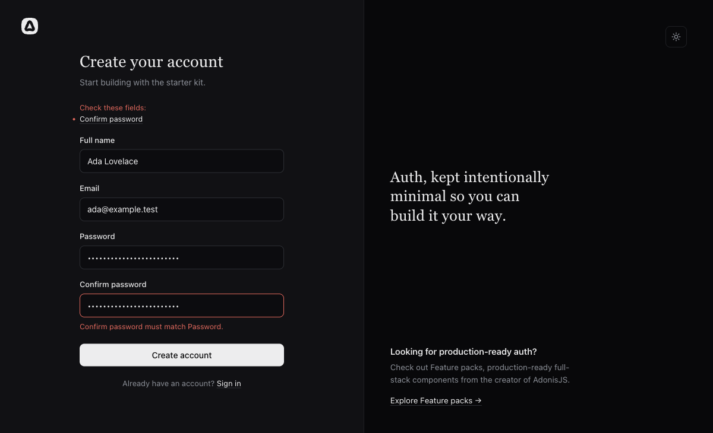

# Inertia and React example

The AdonisJS 7 Inertia React starter kit with Account Kit added. It shows the account flows a
browser app needs, each as a plain controller and React page you can copy:

| Flow                  | Pages                                        | Controller                                          |
| --------------------- | -------------------------------------------- | --------------------------------------------------- |
| Sign up               | `/signup`                                    | `app/controllers/new_account_controller.ts`         |
| Confirm email address | `/verify-email/:token`, dashboard banner     | `app/controllers/email_verifications_controller.ts` |
| Log in and out        | `/login`                                     | `app/controllers/session_controller.ts`             |
| Forgot password       | `/forgot-password`, `/reset-password/:token` | `app/controllers/password_resets_controller.ts`     |
| Change password       | `/settings/password`                         | `app/controllers/passwords_controller.ts`           |
| Edit profile          | `/settings/profile`                          | `app/controllers/profile_controller.ts`             |
| Change email          | `/settings/email`, `/confirm-email/:token`   | `app/controllers/email_changes_controller.ts`       |

Emails are printed to the dev server log instead of being sent.

## Explore the browser example

Start with the [local run instructions](#run-it), then visit `/signup`. The screenshot shows the
signup form's field-error summary and confirmation-password message; it is one validation state from
the maintained app.



## Transplant into an existing app

Add the shared browser foundation once, then copy only the files for each flow you enable. These
links point to the reviewed example source so you can compare each file while adapting it.

### Shared foundation

- **Dependencies and registration:** Add `adonisjs-account-kit` and `@adonisjs/limiter` to your
  existing AdonisJS 7 Inertia React app. Keep its existing `@adonisjs/auth`, `@adonisjs/session`,
  `@adonisjs/shield`, `@adonisjs/lucid`, `@adonisjs/inertia`, and `@vinejs/vine` integrations.
  Add the limiter first with `node ace add @adonisjs/limiter`, then add Account Kit with
  `node ace add adonisjs-account-kit`. The latter registers its provider and commands and generates
  the base config and migrations; preserve existing entries in
  [`adonisrc.ts`](https://github.com/Kevinjohn/oss-adonisjs-account-kit/blob/5f1543fc63731c6135102dfa139d6d204f33eb2b/examples/inertia-react/adonisrc.ts).
- **User adapter and application policy:** Adapt
  [`config/account_kit.ts`](https://github.com/Kevinjohn/oss-adonisjs-account-kit/blob/5f1543fc63731c6135102dfa139d6d204f33eb2b/examples/inertia-react/config/account_kit.ts)
  and [`app/models/user.ts`](https://github.com/Kevinjohn/oss-adonisjs-account-kit/blob/5f1543fc63731c6135102dfa139d6d204f33eb2b/examples/inertia-react/app/models/user.ts)
  to your user table and key type. The example maps the form's `fullName`, allows open registration,
  and permits sign-in; choose your own registration and access policy. The application owns field
  validation and every user-facing message. Configure `createActionUrls` with the real backend
  origin and the pages that receive reset and verification links.
- **Shared validators and failure helper:**
  [`app/validators/user.ts`](https://github.com/Kevinjohn/oss-adonisjs-account-kit/blob/5f1543fc63731c6135102dfa139d6d204f33eb2b/examples/inertia-react/app/validators/user.ts)
  provides the email/password rules and messages used by signup, login, and the shared
  [`app/validators/account.ts`](https://github.com/Kevinjohn/oss-adonisjs-account-kit/blob/5f1543fc63731c6135102dfa139d6d204f33eb2b/examples/inertia-react/app/validators/account.ts)
  for verification, reset, and password changes. Keep both modules when transplanting any flow.
  Signup and reset also use
  [`app/services/delivery_failure.ts`](https://github.com/Kevinjohn/oss-adonisjs-account-kit/blob/5f1543fc63731c6135102dfa139d6d204f33eb2b/examples/inertia-react/app/services/delivery_failure.ts)
  to recognize committed delivery or post-commit failures; include it when adding either flow and
  keep the response consistent with the operation's committed outcome.
- **Guard and server-side sessions:** Adapt
  [`config/auth.ts`](https://github.com/Kevinjohn/oss-adonisjs-account-kit/blob/5f1543fc63731c6135102dfa139d6d204f33eb2b/examples/inertia-react/config/auth.ts),
  [`config/session.ts`](https://github.com/Kevinjohn/oss-adonisjs-account-kit/blob/5f1543fc63731c6135102dfa139d6d204f33eb2b/examples/inertia-react/config/session.ts),
  and [`app/services/session_guard.ts`](https://github.com/Kevinjohn/oss-adonisjs-account-kit/blob/5f1543fc63731c6135102dfa139d6d204f33eb2b/examples/inertia-react/app/services/session_guard.ts).
  The example uses the existing `web` session guard, disables remember-me tokens, and stores
  sessions in the database. Set `SESSION_DRIVER=database`, `APP_KEY`, `APP_URL`, and your existing
  database variables. Choose `LIMITER_STORE` to match your configured limiter store. Use HTTPS for
  production action links. The example uses `APP_URL` for both `backendOrigin` and `appFrontendUrl`;
  set each to its real origin if they differ. Add the session table with `node ace make:session-table`.
- **Environment schema:** Update [`start/env.ts`](https://github.com/Kevinjohn/oss-adonisjs-account-kit/blob/5f1543fc63731c6135102dfa139d6d204f33eb2b/examples/inertia-react/start/env.ts)
  to validate the selected `SESSION_DRIVER` and `LIMITER_STORE`, and document those values in the
  environment-file example. The example sets both to `database`.
- **Middleware order:** In [`start/kernel.ts`](https://github.com/Kevinjohn/oss-adonisjs-account-kit/blob/5f1543fc63731c6135102dfa139d6d204f33eb2b/examples/inertia-react/start/kernel.ts), keep Shield/CSRF and session initialization before
  authentication, then run the app's
  [`silent_auth_middleware.ts`](https://github.com/Kevinjohn/oss-adonisjs-account-kit/blob/5f1543fc63731c6135102dfa139d6d204f33eb2b/examples/inertia-react/app/middleware/silent_auth_middleware.ts)
  before
  [`session_revision_middleware.ts`](https://github.com/Kevinjohn/oss-adonisjs-account-kit/blob/5f1543fc63731c6135102dfa139d6d204f33eb2b/examples/inertia-react/app/middleware/session_revision_middleware.ts).
  Both run before route-level guest/auth checks. This checks the stored credential revision on every
  authenticated request. Keep Shield enabled for CSRF protection and keep the Inertia middleware in
  the server stack so it shares form errors and flash data.
- **Routes and migrations:** Adapt [`start/routes.ts`](https://github.com/Kevinjohn/oss-adonisjs-account-kit/blob/5f1543fc63731c6135102dfa139d6d204f33eb2b/examples/inertia-react/start/routes.ts)
  and the app's [`auth_middleware.ts`](https://github.com/Kevinjohn/oss-adonisjs-account-kit/blob/5f1543fc63731c6135102dfa139d6d204f33eb2b/examples/inertia-react/app/middleware/auth_middleware.ts)
  and [`guest_middleware.ts`](https://github.com/Kevinjohn/oss-adonisjs-account-kit/blob/5f1543fc63731c6135102dfa139d6d204f33eb2b/examples/inertia-react/app/middleware/guest_middleware.ts)
  at the flow paths below. Keep verification and reset proof routes public and password settings
  inside the authenticated group. Also add the authenticated `/dashboard` route (signup and login
  redirect there) and POST `/logout` (the app layout and invalid-reset state sign out through it).
  Keep `guest` middleware on `/signup`, `/login`, and `/forgot-password`. The signup and login pages
  link to one another; login links to forgot-password; forgot-password links to login; and the
  invalid-reset page links to forgot-password and login, or submits logout when a user is signed in.
  If transplanting only part of that route set, update each affected link/form to a route your app
  exposes. Retain the complete generated migration set unless supported pruning is established;
  disabled routes can still have required internal tables. The example's
  [`account columns`](https://github.com/Kevinjohn/oss-adonisjs-account-kit/blob/5f1543fc63731c6135102dfa139d6d204f33eb2b/examples/inertia-react/database/migrations/1792342506854_account_kit_add_account_columns_to_users.ts),
  [`account sessions`](https://github.com/Kevinjohn/oss-adonisjs-account-kit/blob/5f1543fc63731c6135102dfa139d6d204f33eb2b/examples/inertia-react/database/migrations/1792342506864_account_kit_create_account_sessions.ts),
  [`transaction lock`](https://github.com/Kevinjohn/oss-adonisjs-account-kit/blob/5f1543fc63731c6135102dfa139d6d204f33eb2b/examples/inertia-react/database/migrations/1792342506858_account_kit_create_account_transaction_lock.ts),
  [`login-link tokens`](https://github.com/Kevinjohn/oss-adonisjs-account-kit/blob/5f1543fc63731c6135102dfa139d6d204f33eb2b/examples/inertia-react/database/migrations/1792342506863_account_kit_create_login_link_tokens.ts),
  [`reset proofs`](https://github.com/Kevinjohn/oss-adonisjs-account-kit/blob/5f1543fc63731c6135102dfa139d6d204f33eb2b/examples/inertia-react/database/migrations/1792342506855_account_kit_create_password_reset_tokens.ts),
  and [`verification proofs`](https://github.com/Kevinjohn/oss-adonisjs-account-kit/blob/5f1543fc63731c6135102dfa139d6d204f33eb2b/examples/inertia-react/database/migrations/1792342506856_account_kit_create_email_verification_tokens.ts)
  show tables touched by these flows. Keep `login_link_tokens` even when magic-link sign-in is off:
  credential changes delete outstanding sign-in links. Add `rate_limits` only when
  `LIMITER_STORE=database`. Run `node ace migration:run` after reviewing
  the generated migrations, then run `node ace account-kit:doctor` to check the config and schema.
- **Errors, flash, and proof pages:** Adapt
  [`app/exceptions/handler.ts`](https://github.com/Kevinjohn/oss-adonisjs-account-kit/blob/5f1543fc63731c6135102dfa139d6d204f33eb2b/examples/inertia-react/app/exceptions/handler.ts)
  to turn known Account Kit errors into application-owned safe flash messages, and adapt
  [`app/middleware/inertia_middleware.ts`](https://github.com/Kevinjohn/oss-adonisjs-account-kit/blob/5f1543fc63731c6135102dfa139d6d204f33eb2b/examples/inertia-react/app/middleware/inertia_middleware.ts)
  to share validation errors and expose flash messages to React. Preserve
  [`app/services/token_page_headers.ts`](https://github.com/Kevinjohn/oss-adonisjs-account-kit/blob/5f1543fc63731c6135102dfa139d6d204f33eb2b/examples/inertia-react/app/services/token_page_headers.ts)
  on pages that render a proof from a URL; it sets `Referrer-Policy: same-origin`.
- **Shared React form props:** The Inertia middleware imports
  [`user_transformer.ts`](https://github.com/Kevinjohn/oss-adonisjs-account-kit/blob/5f1543fc63731c6135102dfa139d6d204f33eb2b/examples/inertia-react/app/transformers/user_transformer.ts)
  and shares validation errors, transformed `user`, `emailVerified`, and the app's other shared
  props; keep the matching client contract in
  [`inertia/types.ts`](https://github.com/Kevinjohn/oss-adonisjs-account-kit/blob/5f1543fc63731c6135102dfa139d6d204f33eb2b/examples/inertia-react/inertia/types.ts).
  Its `flash()` method puts messages in Inertia's dedicated flash payload. Keep its
  [`app/middleware/inertia_middleware.ts`](https://github.com/Kevinjohn/oss-adonisjs-account-kit/blob/5f1543fc63731c6135102dfa139d6d204f33eb2b/examples/inertia-react/app/middleware/inertia_middleware.ts)
  for these shared values and run `node ace codegen` to refresh generated shared-prop types. The pages below import
  [`form_error_summary.tsx`](https://github.com/Kevinjohn/oss-adonisjs-account-kit/blob/5f1543fc63731c6135102dfa139d6d204f33eb2b/examples/inertia-react/inertia/components/form_error_summary.tsx);
  adapt the app's auth and app layouts (the example's
  [`auth layout`](https://github.com/Kevinjohn/oss-adonisjs-account-kit/blob/5f1543fc63731c6135102dfa139d6d204f33eb2b/examples/inertia-react/inertia/layouts/auth.tsx)
  and [`app layout`](https://github.com/Kevinjohn/oss-adonisjs-account-kit/blob/5f1543fc63731c6135102dfa139d6d204f33eb2b/examples/inertia-react/inertia/layouts/app.tsx)) to render
  [`flash_toasts.tsx`](https://github.com/Kevinjohn/oss-adonisjs-account-kit/blob/5f1543fc63731c6135102dfa139d6d204f33eb2b/examples/inertia-react/inertia/components/flash_toasts.tsx)
  so controller flash feedback is visible. It uses `sonner` and `lucide-react`; keep those
  dependencies or replace it with your own flash UI, and adapt auth/app layouts to render that UI.
  Adapt the example layouts' imports, shared props, route links, and components to your existing
  layout rather than replacing its visual design.
- **Notifications:** `createLogNotifications` is a development/test fixture and refuses to run in
  production. Configure your own transport and message copy; `@adonisjs/mail` and
  `createMailNotifications` are optional when you choose Adonis Mail.
- **Verified-account policy:** Route-level `auth` middleware only requires a signed-in user. Add
  your own verified-account check on routes that require confirmed email and choose its message in
  your application; a session guard does not imply a verified-account policy.

### Add each flow

**Signup and login**

- Adapt [`new_account_controller.ts`](https://github.com/Kevinjohn/oss-adonisjs-account-kit/blob/5f1543fc63731c6135102dfa139d6d204f33eb2b/examples/inertia-react/app/controllers/new_account_controller.ts),
  [`session_controller.ts`](https://github.com/Kevinjohn/oss-adonisjs-account-kit/blob/5f1543fc63731c6135102dfa139d6d204f33eb2b/examples/inertia-react/app/controllers/session_controller.ts),
  and the `signupValidator` and `loginValidator` from the shared
  [`app/validators/user.ts`](https://github.com/Kevinjohn/oss-adonisjs-account-kit/blob/5f1543fc63731c6135102dfa139d6d204f33eb2b/examples/inertia-react/app/validators/user.ts),
  [`inertia/pages/auth/signup.tsx`](https://github.com/Kevinjohn/oss-adonisjs-account-kit/blob/5f1543fc63731c6135102dfa139d6d204f33eb2b/examples/inertia-react/inertia/pages/auth/signup.tsx),
  [`inertia/pages/auth/login.tsx`](https://github.com/Kevinjohn/oss-adonisjs-account-kit/blob/5f1543fc63731c6135102dfa139d6d204f33eb2b/examples/inertia-react/inertia/pages/auth/login.tsx),
  and the GET/POST `/signup` and `/login` routes inside your guest-only route group. Keep the
  authenticated dashboard and POST `/logout` routes from the shared foundation. Enable
  `registration` and session `authentication` in `config/account_kit.ts`; the controller uses the
  shared session guard to sign in after account creation.
- For signup failures after the account was committed, use the shared `delivery_failure.ts` helper
  and exception handler. Keep the response honest that the account may already exist and let
  the person sign in to request another verification message; do not repeat registration.
- Focused check: run `pnpm test --files=tests/browser/signup_recovery.spec.ts` in the example, or
  verify one signup, sign-in, and resend in your app.

**Email verification**

- Adapt [`email_verifications_controller.ts`](https://github.com/Kevinjohn/oss-adonisjs-account-kit/blob/5f1543fc63731c6135102dfa139d6d204f33eb2b/examples/inertia-react/app/controllers/email_verifications_controller.ts),
  `verifyEmailValidator` from [`app/validators/account.ts`](https://github.com/Kevinjohn/oss-adonisjs-account-kit/blob/5f1543fc63731c6135102dfa139d6d204f33eb2b/examples/inertia-react/app/validators/account.ts),
  [`inertia/pages/auth/verify_email.tsx`](https://github.com/Kevinjohn/oss-adonisjs-account-kit/blob/5f1543fc63731c6135102dfa139d6d204f33eb2b/examples/inertia-react/inertia/pages/auth/verify_email.tsx),
  and [`inertia/components/verify_email_notice.tsx`](https://github.com/Kevinjohn/oss-adonisjs-account-kit/blob/5f1543fc63731c6135102dfa139d6d204f33eb2b/examples/inertia-react/inertia/components/verify_email_notice.tsx),
  rendered on the dashboard. Add public
  GET/POST `/verify-email/:token` and authenticated POST `/email-verification` for resend. Enable
  `emailVerification` and keep
  verification-page headers from the shared foundation. Verification asks the address owner to
  choose a password; sign in with it after completion.
- Focused check: request a verification link from a limited signed-in account, complete it, and
  confirm that the verified state is shared with the dashboard and verified routes.

**Password reset**

- Adapt [`password_resets_controller.ts`](https://github.com/Kevinjohn/oss-adonisjs-account-kit/blob/5f1543fc63731c6135102dfa139d6d204f33eb2b/examples/inertia-react/app/controllers/password_resets_controller.ts),
  `forgotPasswordValidator` and `resetPasswordValidator` from [`app/validators/account.ts`](https://github.com/Kevinjohn/oss-adonisjs-account-kit/blob/5f1543fc63731c6135102dfa139d6d204f33eb2b/examples/inertia-react/app/validators/account.ts), and the
  [`inertia/pages/auth/forgot_password.tsx`](https://github.com/Kevinjohn/oss-adonisjs-account-kit/blob/5f1543fc63731c6135102dfa139d6d204f33eb2b/examples/inertia-react/inertia/pages/auth/forgot_password.tsx)
  and [`inertia/pages/auth/reset_password.tsx`](https://github.com/Kevinjohn/oss-adonisjs-account-kit/blob/5f1543fc63731c6135102dfa139d6d204f33eb2b/examples/inertia-react/inertia/pages/auth/reset_password.tsx)
  pages. Add GET/POST `/forgot-password` and
  `/reset-password/:token`; enable `passwordReset`. The request route is guest-only, while the proof
  route remains usable regardless of the current browser's signed-in account. Its invalid-link
  state links to forgot-password and login, or offers POST `/logout` when signed in; include those
  routes or adapt those links when transplanting this flow alone. Keep the same generic response for known
  and unknown email addresses, and keep the token-page header.
- Reuse `app/services/delivery_failure.ts` to distinguish a committed delivery or post-commit
  failure from a failed reset. Preserve success after reset completion and end any old signed-in
  session.
- Focused check: run `pnpm test --files=tests/browser/reset_proof_browser.spec.ts`, then verify a
  fresh reset link can be used once and the new password can sign in.

**Password settings**

- Adapt [`passwords_controller.ts`](https://github.com/Kevinjohn/oss-adonisjs-account-kit/blob/5f1543fc63731c6135102dfa139d6d204f33eb2b/examples/inertia-react/app/controllers/passwords_controller.ts),
  `changePasswordValidator` from [`app/validators/account.ts`](https://github.com/Kevinjohn/oss-adonisjs-account-kit/blob/5f1543fc63731c6135102dfa139d6d204f33eb2b/examples/inertia-react/app/validators/account.ts),
  and [`inertia/pages/settings/password.tsx`](https://github.com/Kevinjohn/oss-adonisjs-account-kit/blob/5f1543fc63731c6135102dfa139d6d204f33eb2b/examples/inertia-react/inertia/pages/settings/password.tsx),
  adapting its app and settings layouts to your navigation.
  Add GET/POST `/settings/password` inside authenticated routes. The controller requires the
  current password, changes it through `emailPasswordManagement`, then signs the caller back in;
  enable `emailPasswordManagement` and keep the shared revision middleware so sessions on other
  devices are rejected.
- Focused check: change the password while signed in, confirm this browser remains signed in, and
  confirm a second pre-existing browser session is rejected.

**Profile settings**

- Adapt [`profile_controller.ts`](https://github.com/Kevinjohn/oss-adonisjs-account-kit/blob/3ca4874577a7c806817e20a90c76d0b362e498fa/examples/inertia-react/app/controllers/profile_controller.ts),
  [`profile.ts` validator](https://github.com/Kevinjohn/oss-adonisjs-account-kit/blob/3ca4874577a7c806817e20a90c76d0b362e498fa/examples/inertia-react/app/validators/profile.ts), and
  [`settings/profile.tsx`](https://github.com/Kevinjohn/oss-adonisjs-account-kit/blob/3ca4874577a7c806817e20a90c76d0b362e498fa/examples/inertia-react/inertia/pages/settings/profile.tsx).
  Add GET/POST `/settings/profile` inside the authenticated group in
  [`start/routes.ts`](https://github.com/Kevinjohn/oss-adonisjs-account-kit/blob/3ca4874577a7c806817e20a90c76d0b362e498fa/examples/inertia-react/start/routes.ts), and add Profile to
  [`settings.tsx` navigation](https://github.com/Kevinjohn/oss-adonisjs-account-kit/blob/3ca4874577a7c806817e20a90c76d0b362e498fa/examples/inertia-react/inertia/layouts/settings.tsx).
  The controller reads the signed-in user, validates only `fullName` and current password, and
  passes the authenticated ID to `updateProfile`; the name saves immediately. Keep the shared
  account form error summary and the app's `registration.mapFields`/adapter mapping for `fullName`.
- Focused check: save a name with the current password in one browser; a missing or wrong password
  leaves it unchanged, and another account's profile cannot be targeted by form data.

**Email settings**

- Adapt [`email_changes_controller.ts`](https://github.com/Kevinjohn/oss-adonisjs-account-kit/blob/3ca4874577a7c806817e20a90c76d0b362e498fa/examples/inertia-react/app/controllers/email_changes_controller.ts),
  [`email_change.ts` validators](https://github.com/Kevinjohn/oss-adonisjs-account-kit/blob/3ca4874577a7c806817e20a90c76d0b362e498fa/examples/inertia-react/app/validators/email_change.ts),
  [`settings/email.tsx`](https://github.com/Kevinjohn/oss-adonisjs-account-kit/blob/3ca4874577a7c806817e20a90c76d0b362e498fa/examples/inertia-react/inertia/pages/settings/email.tsx), and
  [`auth/confirm_email_change.tsx`](https://github.com/Kevinjohn/oss-adonisjs-account-kit/blob/3ca4874577a7c806817e20a90c76d0b362e498fa/examples/inertia-react/inertia/pages/auth/confirm_email_change.tsx).
  Add authenticated GET/POST `/settings/email` and POST `/settings/email/cancel`, plus public
  GET/POST `/confirm-email/:token` as shown in the pinned routes. Set the `emailChange` action URL
  destination to `confirm-email`, enable `emailPasswordManagement` and `emailVerification`, and keep
  the shared revision middleware, proof-page headers, session guard, and delivery-failure helper.
  Add Email to the settings navigation.
- The example accepts requests only after the current address is confirmed. This app policy keeps
  an active account's address usable until the new owner confirms the link; Account Kit itself
  immediately changes an inactive account's address. The request needs the current password;
  submitting the current address is rejected in this form, while the separate cancellation form
  uses `updateProfile` with that address and fresh password proof. Inspection is a read-only GET,
  completion is POST and ends the current browser session. Use generic copy for address conflicts
  and invalid, used, or expired links. Do not derive the actor from a submitted user ID.
- Focused check: request a change, cancel it and verify the first proof no longer works; request
  again, inspect in another signed-in browser without changing its identity, complete once, and
  confirm both sessions end. The owner signs in with the new address; the other account keeps its
  own sign-in address.

Forms, route authorization, account policy, and English text are application decisions. Adapt the
shared form summary, flash renderer, user transformer, middleware, and layouts to the existing
application. The complete example styles, verification mail logger, invitation and social-provider
code are fixtures or unrelated features; copy them only if your application needs them.

## Run it

The current source package manifest is `0.0.0`; there is no matching public npm release and
repository tag for a consumer install yet. The published-package path is blocked on that release.
This contributor path builds an archive from the current repository and does not establish a
released-package install. Use Node.js 24 and pnpm 11.23.0 from the repository root:

```sh
pnpm install --frozen-lockfile
pnpm build
pnpm pack --out examples/inertia-react/vendor/adonisjs-account-kit.tgz
cd examples/inertia-react
pnpm install
cp .env.example .env
node ace generate:key
node ace codegen
node ace migration:run
pnpm dev
```

Open http://localhost:3333/signup, create an account, then copy the verification link from the
server log. Use the link once, sign in, then visit the dashboard and password settings. The
development logger exposes the proof URL in the local terminal; it does not send email or prove
recipient delivery.

The root install provides the build tools to build Account Kit. Packing creates
`vendor/adonisjs-account-kit.tgz`, which is ignored by Git. The committed example lockfile pins every
other dependency. After installing the example once, `pnpm kit:pack` refreshes the archive after
source changes. Run `pnpm install` again in the example after each re-pack to install the new archive
and update its integrity entry; this refresh install cannot use `--frozen-lockfile`.

The archive contains the built package and `CHANGELOG.md`, so its checksum changes whenever the
source or the changelog changes. That is why the example install omits `--frozen-lockfile`: it keeps the locked versions and
rewrites only the archive's integrity line in `pnpm-lock.yaml`. Commit that line only when you
refresh the lockfile for a dependency change; keep the generated `vendor/` archive ignored. The
normal consumer path will use an exact published package version and its matching lockfile, and will
skip packing after that release exists. Do not describe this archive install as the consumer path.

### Expected result and common startup issues

The server listens at <http://localhost:3333>. A successful signup reaches the dashboard and prints
the verification link to the server log. Confirm the address, then check that the dashboard reports
the verified state; change the password from settings and verify that the current session stays
signed in. These steps exercise the example's account flow, not email delivery to an inbox.

If `kit:pack` cannot find the root build tools, run the frozen root install first. If package
installation cannot find `vendor/adonisjs-account-kit.tgz`, pack from the example directory before
installing there. If startup reports missing environment values or a database table, copy
`.env.example`, generate `APP_KEY`, and run the migrations before starting the server.

## What was added to the starter kit

- `@adonisjs/limiter` and `adonisjs-account-kit`, each added with `node ace add`.
- A database session store (`node ace make:session-table`, `SESSION_DRIVER=database`). Session
  login needs a server-side store so that signing out cannot be undone by replaying an old cookie.
- `config/account_kit.ts`: session authentication through the existing `web` guard, open
  registration that keeps the starter's full name field, `createActionUrls` for links to the pages
  above, and `createLogNotifications` for email.
- `app/services/session_guard.ts`: lets Account Kit sign users in through the `web` guard and
  stores the credential revision in the session.
- `app/middleware/session_revision_middleware.ts`: runs after the starter's silent auth middleware
  and signs out sessions that started before the latest
  password change, on every request, so changing a password signs out every other device.
- `app/exceptions/handler.ts`: turns Account Kit errors into flash messages and sends signed-out
  sessions to the login page.
- New pages under `inertia/pages/auth` and `inertia/pages/settings`, and a verification banner on
  the dashboard.

## Before you deploy

- Add `@adonisjs/mail` and replace `createLogNotifications` with `createMailNotifications`. The log
  notifications refuse to start in production.
- Configure trusted proxies so `request.ip()` is the client address.
- Keep the reset and verification page URLs out of access logs and analytics. The pages already
  send `Referrer-Policy: same-origin`, so the token never reaches another site in a Referer.

See [Inertia and React](../../docs/recipes/inertia-react.md) and
[browser login with sessions](../../docs/recipes/sessions.md) for the reasoning behind each step.
