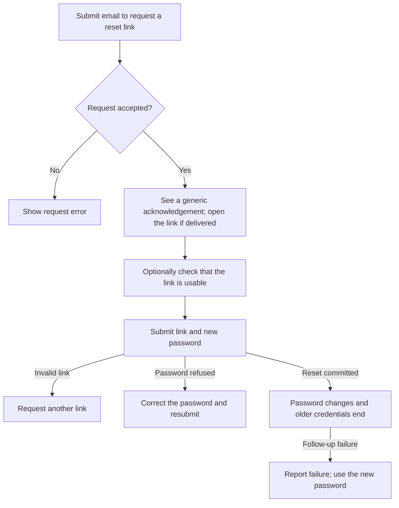
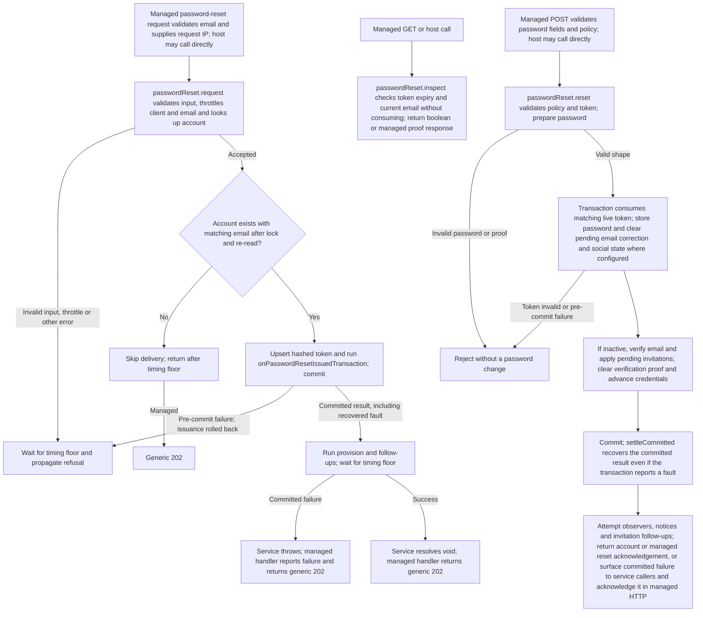

# US-ACCOUNT-01 — Request and complete password recovery

As an account holder, I want to request a password reset and use its one-time link so that I can regain access without revealing whether an address has an account.

**Status:** Current when `passwordReset` is enabled
**Access:** Anyone may request; only a valid reset-token holder may complete. Host owns HTTP response and delivery configuration.
**Entry:** Host calls `passwordReset.request`, optional `passwordReset.inspect`, and `passwordReset.reset`. The managed equivalents are POST `auth/password-reset` and GET/POST `auth/password-reset/:token`.
**Documentation:** [getting-started.md](../docs/guide/getting-started.md)
**Source:** [`src/password_reset.ts`](../src/password_reset.ts)
**Coverage:** [`tests/password_reset_request.spec.ts`](../tests/password_reset_request.spec.ts), [`tests/password_reset_redeem.spec.ts`](../tests/password_reset_redeem.spec.ts)

## Acceptance criteria

- **Inputs and result:** `passwordReset.request({ email, clientKey })` returns `void`; `inspect({ token })` is read-only and returns a boolean; `reset({ token, password })` returns the updated account. When delivery and follow-up callbacks succeed, the request returns the same acknowledgement after the same minimum delay for known and unknown addresses. A known-address delivery or follow-up callback failure may surface as a service error after issuance commits.
- Resetting an inactive account confirms its email and applies live matching invitation grants when invitations are enabled.
- Issuing a fresh reset link invalidates the older reset link for that account. A pre-commit issuance or reset failure rolls back that transaction. A fault after commit preserves the issued proof or changed password; the service still attempts the relevant follow-ups before surfacing the committed failure.
- Managed request validates `email`, supplies the request IP as `clientKey`, and returns 202 with the generic message, reporting any committed issuance failure separately. Managed inspection returns `{ valid: true }` or an invalid-proof response. Managed completion requires the [password and confirmation fields](REFERENCE.md#managed-password-fields) and returns `{ reset: true }`.
- If the managed write recognises a committed follow-up failure, it returns 202 with `{ committed: true }`.
  The reset-request endpoint instead returns its generic 202 message.

## User flow

## Code flow

**Code references:** [implementation](../src/password_reset.ts), [`tests/password_reset_request.spec.ts`](../tests/password_reset_request.spec.ts), [`tests/password_reset_redeem.spec.ts`](../tests/password_reset_redeem.spec.ts), [request implementation](../src/password_reset_request.ts), [managed password reset](../src/http/handlers_password_reset.ts), [managed committed-failure response](../src/http/managed.ts)
