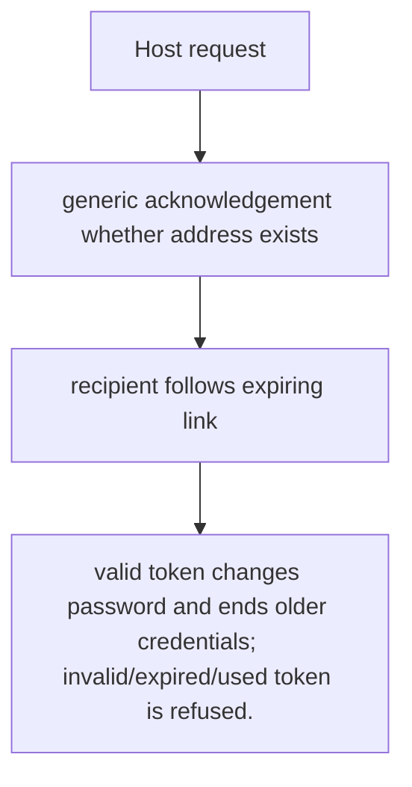
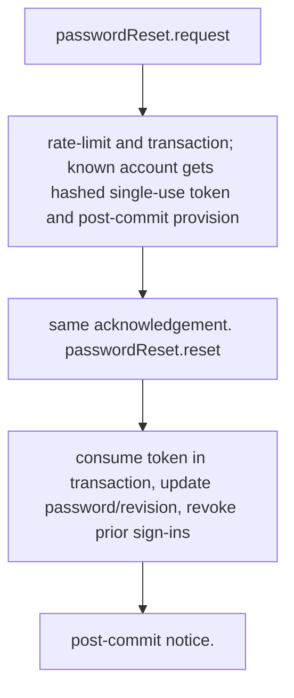

# US-ACCOUNT-01 — Request and complete password recovery

As an account holder, I want to request a password reset and use its one-time link so that I can regain access without revealing whether an address has an account.

**Status:** Current
**Access:** Anyone may request; only a valid reset-token holder may complete. Host owns HTTP response and delivery configuration.
**Entry:** Host calls `passwordReset.request({ email, clientKey })` then `passwordReset.reset({ token, password })`; managed routes are optional.
**Documentation:** [getting-started.md](../docs/guide/getting-started.md)
**Source:** [`src/password_reset.ts`](../src/password_reset.ts)
**Coverage:** [`tests/password_reset_request.spec.ts`](../tests/password_reset_request.spec.ts), [`tests/password_reset_redeem.spec.ts`](../tests/password_reset_redeem.spec.ts)

## Acceptance criteria

- **Inputs and result:** request email + client key; completion token + policy-valid password. The host owns any screen, request parsing and presentation unless the entry explicitly names a managed route or command.
- valid token changes password and ends older credentials; invalid/expired/used token is refused.
- Refusal, expiry, stale state or post-commit delivery behavior follows the linked service contract; a committed mutation is not described as rolled back because a follow-up failed.

## User flow

## Code flow

Scope: this is the Account Kit service/command path. Host UI, route policy and external systems remain host-owned unless named.

**Code references:** [implementation](../src/password_reset.ts), [`tests/password_reset_request.spec.ts`](../tests/password_reset_request.spec.ts), [`tests/password_reset_redeem.spec.ts`](../tests/password_reset_redeem.spec.ts)
