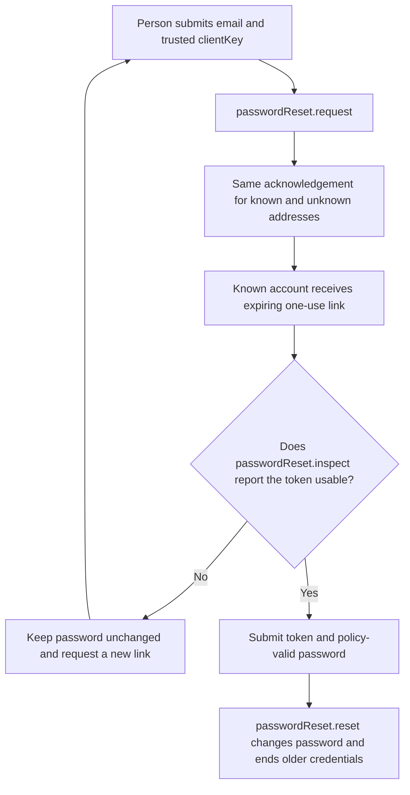
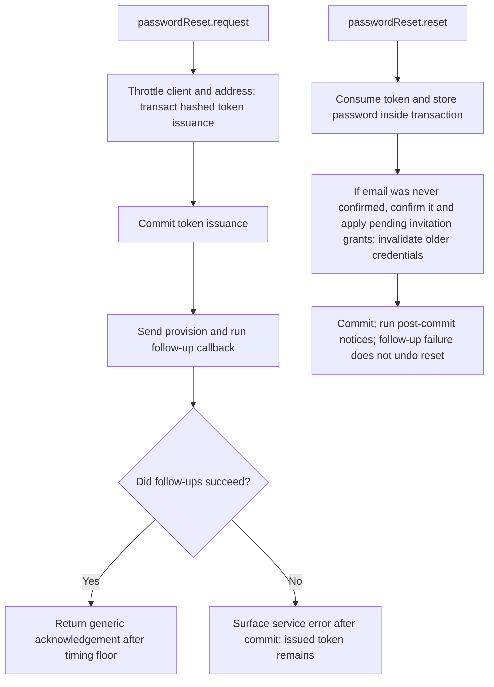

# US-ACCOUNT-01 — Request and complete password recovery

As an account holder, I want to request a password reset and use its one-time link so that I can regain access without revealing whether an address has an account.

**Status:** Current
**Access:** Anyone may request; only a valid reset-token holder may complete. Host owns HTTP response and delivery configuration.
**Entry:** Host calls `passwordReset.request({ email, clientKey })` then `passwordReset.reset({ token, password })`; the optional managed reset route also requires the confirmation field in the [managed password fields reference](REFERENCE.md#managed-password-fields).
**Documentation:** [getting-started.md](../docs/guide/getting-started.md)
**Source:** [`src/password_reset.ts`](../src/password_reset.ts)
**Coverage:** [`tests/password_reset_request.spec.ts`](../tests/password_reset_request.spec.ts), [`tests/password_reset_redeem.spec.ts`](../tests/password_reset_redeem.spec.ts)

## Acceptance criteria

- **Inputs and result:** `passwordReset.request({ email, clientKey })` returns `void`; `inspect({ token })` is read-only and returns a boolean; `reset({ token, password })` returns the updated account. When delivery and follow-up callbacks succeed, the request returns the same acknowledgement after the same minimum delay for known and unknown addresses. A known-address delivery or follow-up callback failure may surface as a service error after issuance commits.
- Resetting an account that has never confirmed its email can confirm it and apply pending invitations for that address, like activation.
- Issuing a fresh reset link invalidates the older reset link for that account.

## User flow

## Code flow

Scope: this is the Account Kit service/command path. Host UI, route policy and external systems remain host-owned unless named.

**Code references:** [implementation](../src/password_reset.ts), [`tests/password_reset_request.spec.ts`](../tests/password_reset_request.spec.ts), [`tests/password_reset_redeem.spec.ts`](../tests/password_reset_redeem.spec.ts)
