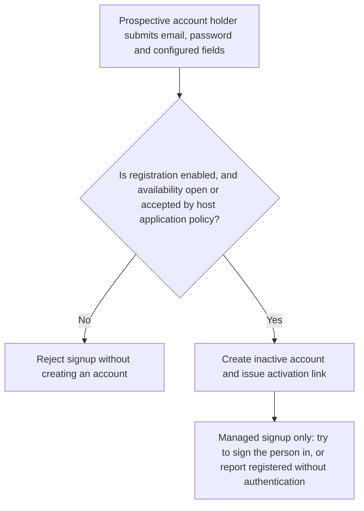
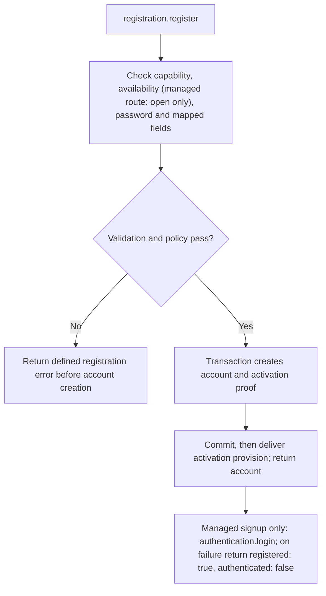

# US-ACCOUNT-02 — Register an account

As a prospective account holder, I want to register so that the application creates an account according to its signup policy.

**Status:** Current when `registration` is enabled and its availability allows signup
**Access:** The opt-in `registration` capability must be listed in `enabled` (it is off by default; the generated config enables it). Signup availability is `open`, `closed`, or `application`; `closed` throws `AuthorizationError`, and the host owns the application-mode decision and field mapping. The managed `auth.signup` route accepts only `open`.
**Entry:** Host calls `registration.register`, or mounts the managed public `auth.signup` route (`POST auth/signup`), which refuses unless availability is `open` (so `application` mode is refused) and then attempts to sign the person in with the same credentials; verification is the separate action in [US-ACCOUNT-38](US-ACCOUNT-38-complete-email-verification.md).
**Documentation:** [registration.md](../docs/guide/registration.md)
**Source:** [`src/registration.ts`](../src/registration.ts)
**Coverage:** [`tests/registration.spec.ts`](../tests/registration.spec.ts), [`tests/registration_claim.spec.ts`](../tests/registration_claim.spec.ts)

## Acceptance criteria

- **Inputs and result:** `registration.register({ email, password, registrationData? })` returns the created account when `registration` is enabled; a disabled capability throws `CapabilityDisabledError`, and a taken address throws `RegistrationEmailAlreadyRegisteredError`. `registrationData` is untrusted and is passed through configured `registration.mapFields`; availability and password rules come from config.
- **Managed `auth.signup`:** after a successful `register`, the handler attempts a login. When it succeeds the response carries the signed-in account and credential; when the login fails the response is `registered: true, authenticated: false` and the account still exists.

## User flow

## Code flow

Scope: this is the Account Kit service/command path. Host UI, route policy and external systems remain host-owned unless named.

**Code references:** [implementation](../src/registration.ts), [`managed signup handler`](../src/http/handlers_registration.ts), [`assertPublicRegistration`](../src/managed_http_service.ts), [`tests/registration.spec.ts`](../tests/registration.spec.ts), [`tests/registration_claim.spec.ts`](../tests/registration_claim.spec.ts)
