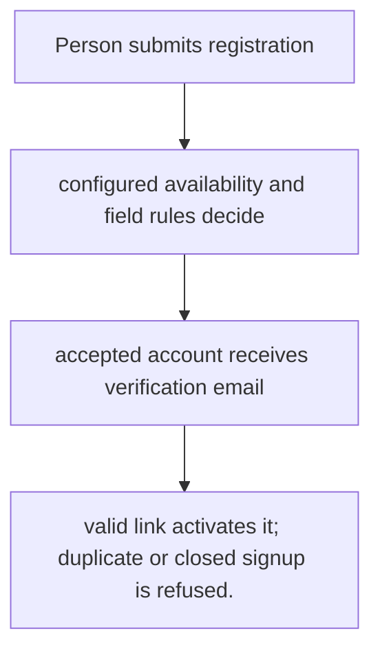
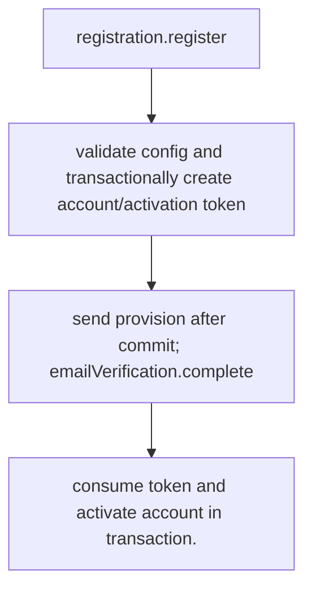

# US-ACCOUNT-02 — Register and verify an account

As a prospective account holder, I want to register and confirm the email address so that I can activate an account only after the configured signup and verification rules pass.

**Status:** Current; availability depends on registration config
**Access:** Signup availability is `open`, `closed`, or `application`; host owns application-mode decision and field mapping.
**Entry:** Host calls `registration.register`; account holder follows email verification link; managed routes are optional.
**Documentation:** [registration.md](../docs/guide/registration.md)
**Source:** [`src/registration.ts`](../src/registration.ts)
**Coverage:** [`tests/registration.spec.ts`](../tests/registration.spec.ts), [`tests/registration_claim.spec.ts`](../tests/registration_claim.spec.ts)

## Acceptance criteria

- **Inputs and result:** registration fields allowed by host config and password policy; verification token for completion. The host owns any screen, request parsing and presentation unless the entry explicitly names a managed route or command.
- valid link activates it; duplicate or closed signup is refused.
- Refusal, expiry, stale state or post-commit delivery behavior follows the linked service contract; a committed mutation is not described as rolled back because a follow-up failed.

## User flow

## Code flow

Scope: this is the Account Kit service/command path. Host UI, route policy and external systems remain host-owned unless named.

**Code references:** [implementation](../src/registration.ts), [`tests/registration.spec.ts`](../tests/registration.spec.ts), [`tests/registration_claim.spec.ts`](../tests/registration_claim.spec.ts)
