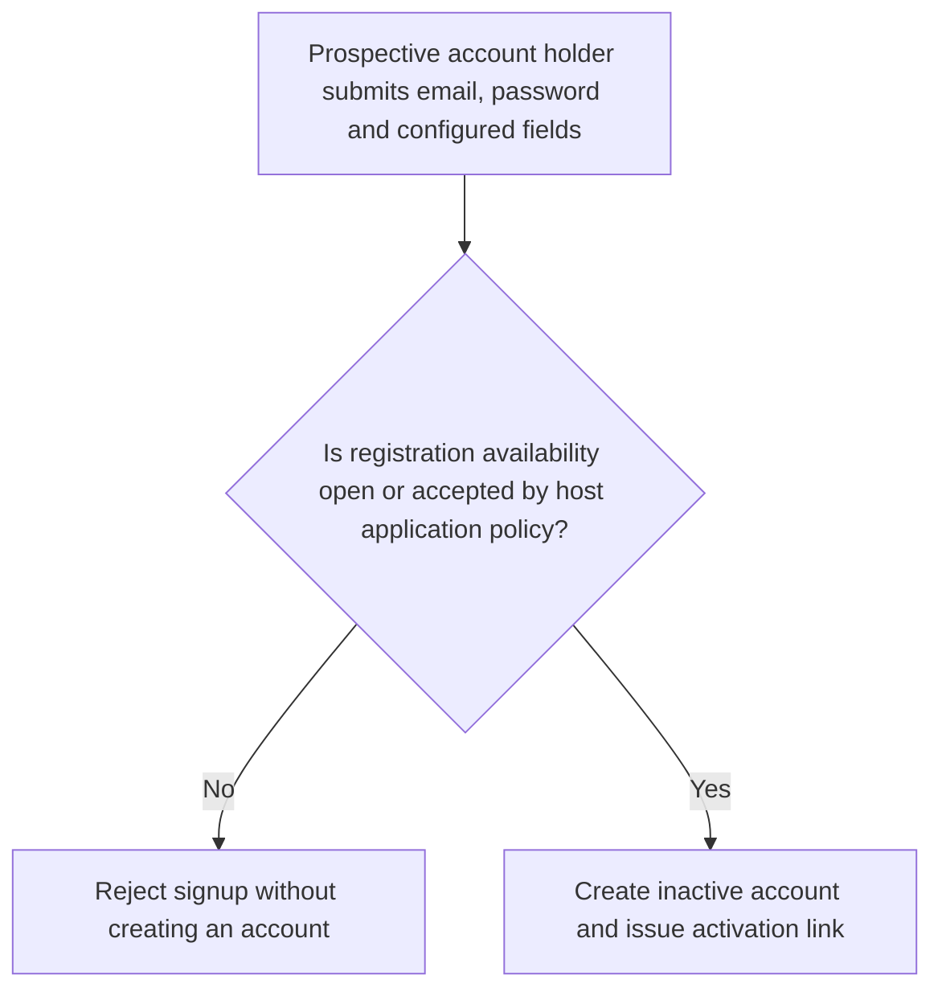
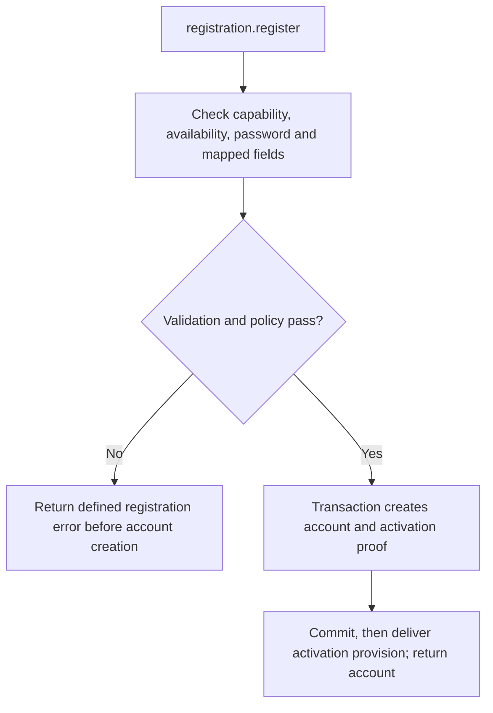

# US-ACCOUNT-02 — Register an account

As a prospective account holder, I want to register so that the application creates an account according to its signup policy.

**Status:** Current; availability depends on registration config
**Access:** Signup availability is `open`, `closed`, or `application`; host owns application-mode decision and field mapping.
**Entry:** Host calls `registration.register`; verification is the separate action in [US-ACCOUNT-38](US-ACCOUNT-38-complete-email-verification.md).
**Documentation:** [registration.md](../docs/guide/registration.md)
**Source:** [`src/registration.ts`](../src/registration.ts)
**Coverage:** [`tests/registration.spec.ts`](../tests/registration.spec.ts), [`tests/registration_claim.spec.ts`](../tests/registration_claim.spec.ts)

## Acceptance criteria

- **Inputs and result:** `registration.register({ email, password, registrationData? })` returns the created account when registration is enabled. `registrationData` is untrusted and is passed through configured `registration.mapFields`; availability and password rules come from config.

## User flow

## Code flow

Scope: this is the Account Kit service/command path. Host UI, route policy and external systems remain host-owned unless named.

**Code references:** [implementation](../src/registration.ts), [`tests/registration.spec.ts`](../tests/registration.spec.ts), [`tests/registration_claim.spec.ts`](../tests/registration_claim.spec.ts)
