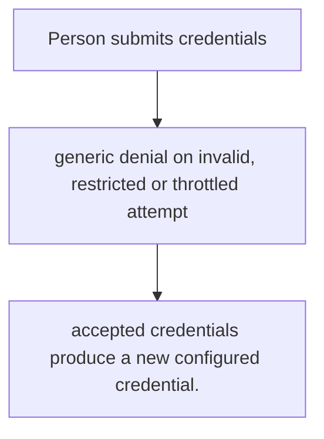
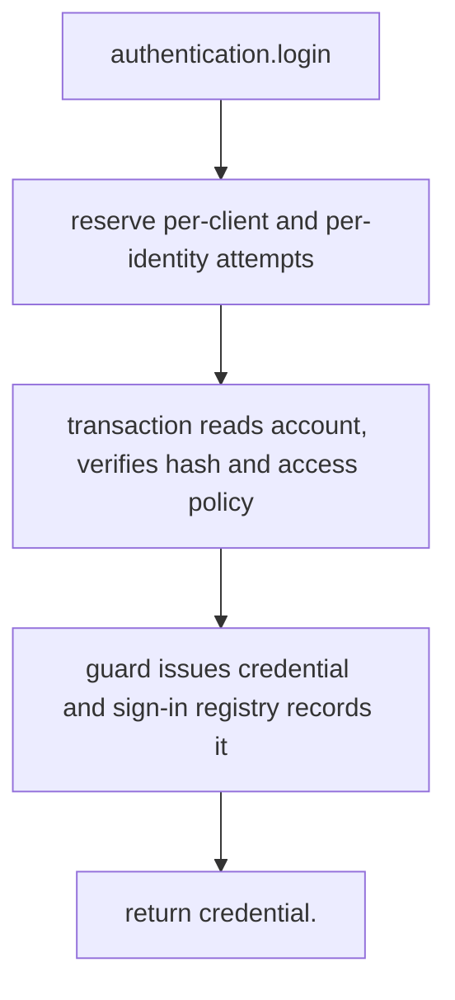

# US-ACCOUNT-03 — Sign in with configured credentials

As an existing account holder, I want to sign in with email and password so that I can receive the configured session or access token.

**Status:** Current
**Access:** Account must satisfy configured credential, verification and access policy; limiter budgets apply.
**Entry:** Host calls `authentication.login` with email, password, client key and selected guard; optional managed login route.
**Documentation:** [authentication.md](../docs/guide/authentication.md)
**Source:** [`src/authentication.ts`](../src/authentication.ts)
**Coverage:** [`tests/authentication.spec.ts`](../tests/authentication.spec.ts), [`tests/authentication_throttle.spec.ts`](../tests/authentication_throttle.spec.ts)

## Acceptance criteria

- **Inputs and result:** email, password, clientKey; guard adapter chosen by host. The host owns any screen, request parsing and presentation unless the entry explicitly names a managed route or command.
- accepted credentials produce a new configured credential.
- Refusal, expiry, stale state or post-commit delivery behavior follows the linked service contract; a committed mutation is not described as rolled back because a follow-up failed.

## User flow

## Code flow

Scope: this is the Account Kit service/command path. Host UI, route policy and external systems remain host-owned unless named.

**Code references:** [implementation](../src/authentication.ts), [`tests/authentication.spec.ts`](../tests/authentication.spec.ts), [`tests/authentication_throttle.spec.ts`](../tests/authentication_throttle.spec.ts)
