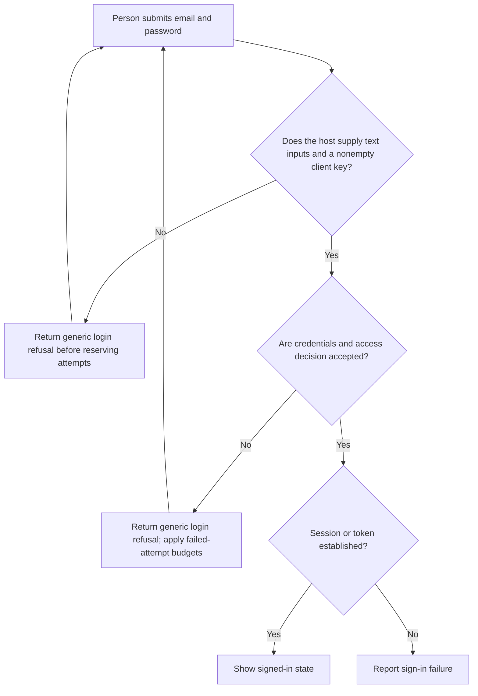
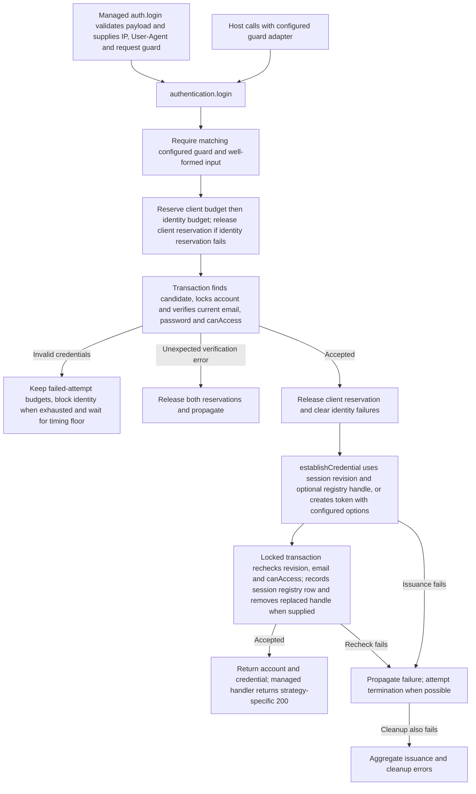

# US-ACCOUNT-03 — Sign in with configured credentials

As an existing account holder, I want to sign in with email and password so that I can receive the configured session or access token.

**Status:** Current
**Access:** Credentials and the `canAccess` decision must pass; limiter budgets apply. Account Kit does not require an active account for password login. The host may enforce activation in `canAccess` or with `requireActive` on protected routes.
**Entry:** Host calls `authentication.login(input, guard)` or mounts `auth.login` (POST `auth/login`). An application using `accountKitSessionGuard` may obtain its request adapter with `ctx.auth.use(name).forRequest()`.
**Documentation:** [authentication.md](../docs/guide/authentication.md)
**Source:** [`src/authentication.ts`](../src/authentication.ts)
**Coverage:** [`tests/authentication.spec.ts`](../tests/authentication.spec.ts), [`tests/authentication_throttle.spec.ts`](../tests/authentication_throttle.spec.ts)

## Acceptance criteria

- **Inputs and result:** `authentication.login({ email, password, clientKey, sessionLabel? }, guard)` returns the safe current account and issued credential through the configured guard. `sessionLabel` is untrusted display text truncated to 255 characters; the guard strategy and access policy are configured by the host.

- Access-token issuance requires a usable identifier and a releasable bearer value. A malformed result raises an adapter contract error. On release failure the guard attempts cleanup when it has an identifier. If cleanup also fails it preserves both causes in an AggregateError. See [guard contract cases](../tests/managed_guard.spec.ts).
- If the `canAccess` decision or returned token violates its adapter contract, the managed route logs the mapped failure and returns a generic 500 with `E_ACCOUNT_KIT_OPERATION_FAILED`.
- Managed login validates `email` and `password`, takes the client key from the request IP and the label from `User-Agent`, and returns 200 with the represented account. The access-token strategy also returns the bearer `token`. The session strategy establishes browser session state.

## User flow

## Code flow

**Code references:** [implementation](../src/authentication.ts), [`tests/authentication.spec.ts`](../tests/authentication.spec.ts), [`tests/authentication_throttle.spec.ts`](../tests/authentication_throttle.spec.ts), [managed login](../src/http/handlers_authentication.ts), [credential issuance](../src/credential_issuance.ts), [token guard](../src/http/managed_token_guard.ts), [session guard adapter](../src/auth/session_guard.ts), [access decision contract](../src/account_access_decision.ts), [managed error mapping](../src/http/managed.ts)
