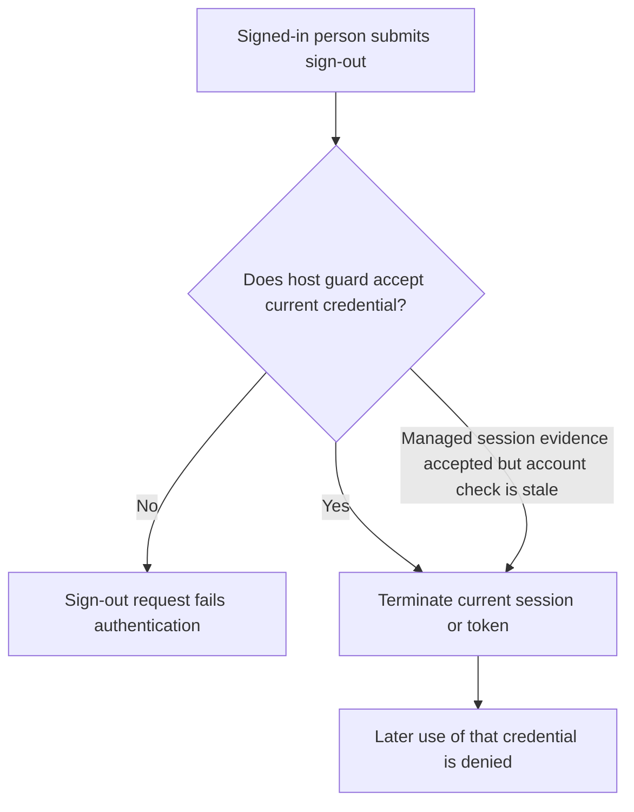
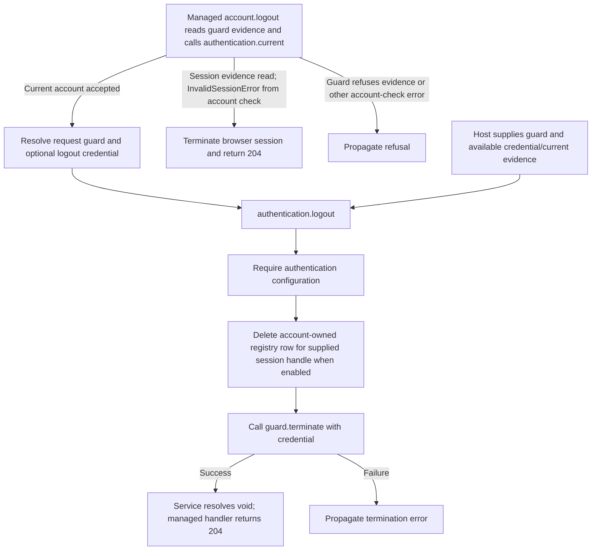

# US-ACCOUNT-04 — Sign out the current credential

As a signed-in account holder, I want to sign out of the current session or token so that I can end access through the credential used for this request.

**Status:** Current
**Access:** Host authenticates the current request and passes its credential/guard context.
**Entry:** Host calls `authentication.logout` or mounts `account.logout` (POST `account/logout`). An application using `accountKitSessionGuard` can obtain the request adapter with `ctx.auth.use(name).forRequest()`.
**Documentation:** [authentication.md](../docs/guide/authentication.md)
**Source:** [`src/authentication.ts`](../src/authentication.ts)
**Coverage:** [`tests/authentication.spec.ts`](../tests/authentication.spec.ts)

## Acceptance criteria

- **Inputs and result:** `authentication.logout(guard, credential?, current?)` returns `void`. The host authenticates the request and supplies its guard; a session registry row is removed when a current session handle is supplied and session management is enabled.
- Managed session logout specifically terminates a session whose guard evidence was read but whose current account check raises `InvalidSessionError`, returning 204. If the guard itself refuses evidence, the route cannot enter that recovery branch.

## User flow

## Code flow

**Code references:** [implementation](../src/authentication.ts), [`tests/authentication.spec.ts`](../tests/authentication.spec.ts), [managed request and stale-session branch](../src/http/managed_execution.ts), [managed logout](../src/http/handlers_authentication.ts), [session guard adapter](../src/auth/session_guard.ts)
