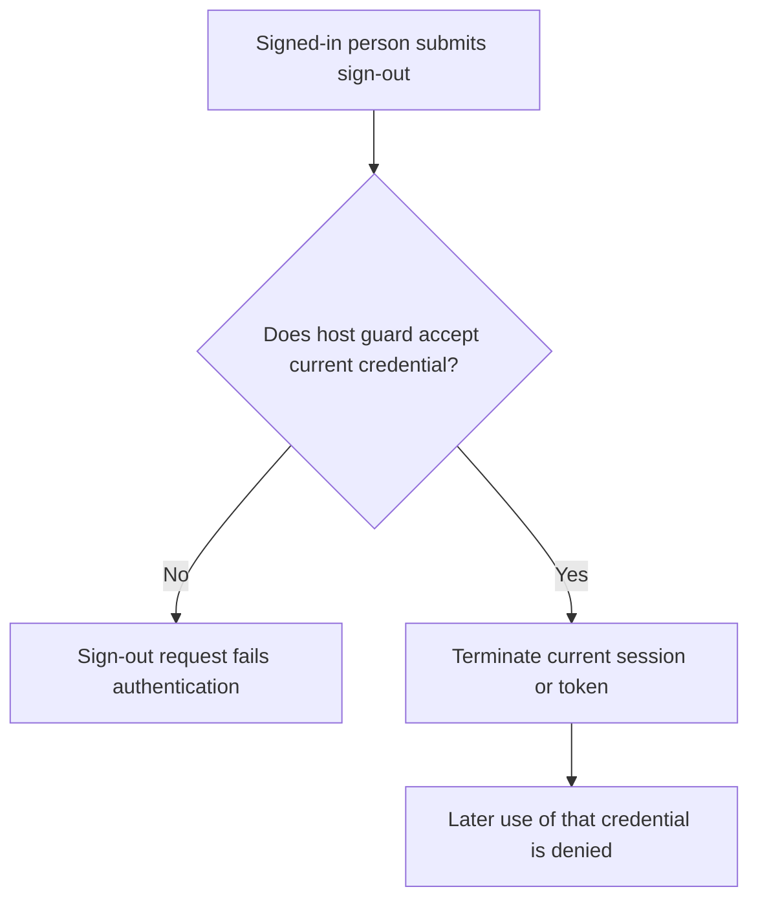
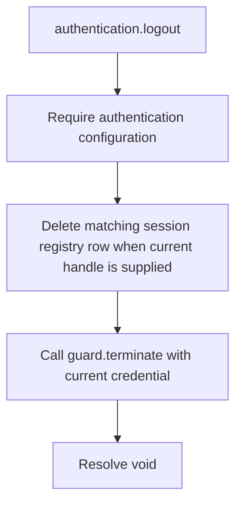

# US-ACCOUNT-04 — Sign out the current credential

As a signed-in account holder, I want to sign out of the current session or token so that I can end access through the credential used for this request.

**Status:** Current
**Access:** Host authenticates the current request and passes its credential/guard context.
**Entry:** Host calls `authentication.logout`; optional managed logout route.
**Documentation:** [authentication.md](../docs/guide/authentication.md)
**Source:** [`src/authentication.ts`](../src/authentication.ts)
**Coverage:** [`tests/authentication.spec.ts`](../tests/authentication.spec.ts)

## Acceptance criteria

- **Inputs and result:** `authentication.logout(guard, credential?, current?)` returns `void`. The host authenticates the request and supplies its guard; a session registry row is removed when a current session handle is supplied and session management is enabled.

## User flow

## Code flow

Scope: this is the Account Kit service/command path. Host UI, route policy and external systems remain host-owned unless named.

**Code references:** [implementation](../src/authentication.ts), [`tests/authentication.spec.ts`](../tests/authentication.spec.ts)
