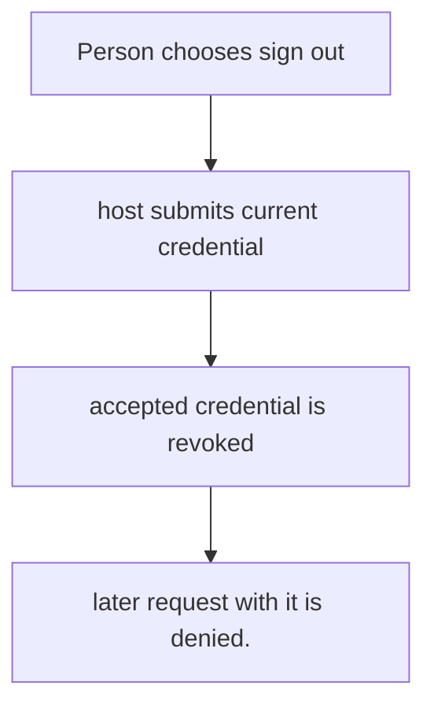
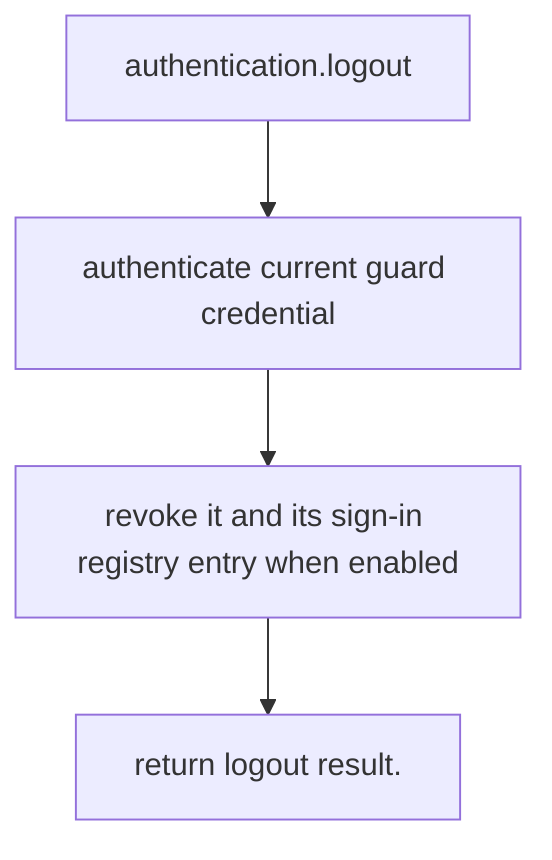

# US-ACCOUNT-04 — Sign out the current credential

As a signed-in account holder, I want to sign out of the current session or token so that I can end access through the credential used for this request.

**Status:** Current
**Access:** Host authenticates the current request and passes its credential/guard context.
**Entry:** Host calls `authentication.logout`; optional managed logout route.
**Documentation:** [authentication.md](../docs/guide/authentication.md)
**Source:** [`src/authentication.ts`](../src/authentication.ts)
**Coverage:** [`tests/authentication.spec.ts`](../tests/authentication.spec.ts)

## Acceptance criteria

- **Inputs and result:** current account and selected guard credential; result is logout completion. The host owns any screen, request parsing and presentation unless the entry explicitly names a managed route or command.
- later request with it is denied.
- Refusal, expiry, stale state or post-commit delivery behavior follows the linked service contract; a committed mutation is not described as rolled back because a follow-up failed.

## User flow

## Code flow

Scope: this is the Account Kit service/command path. Host UI, route policy and external systems remain host-owned unless named.

**Code references:** [implementation](../src/authentication.ts), [`tests/authentication.spec.ts`](../tests/authentication.spec.ts)
