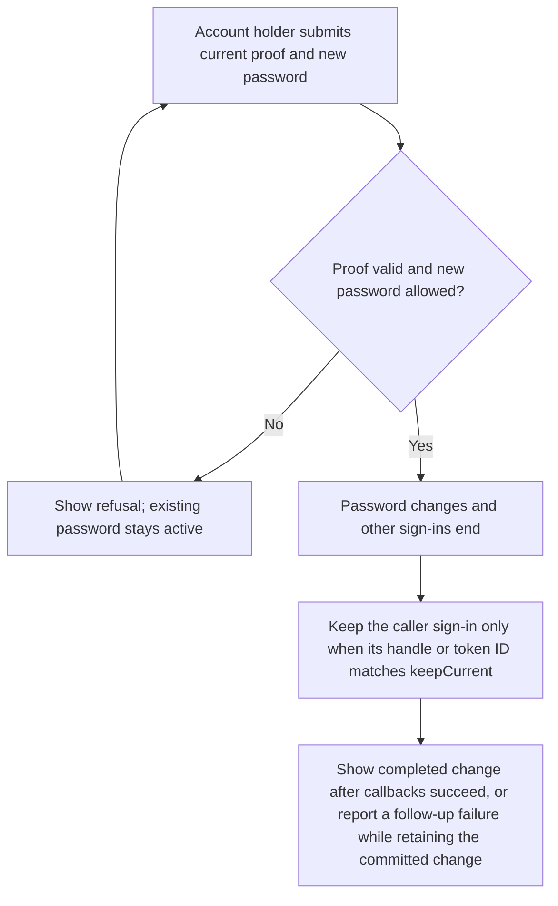
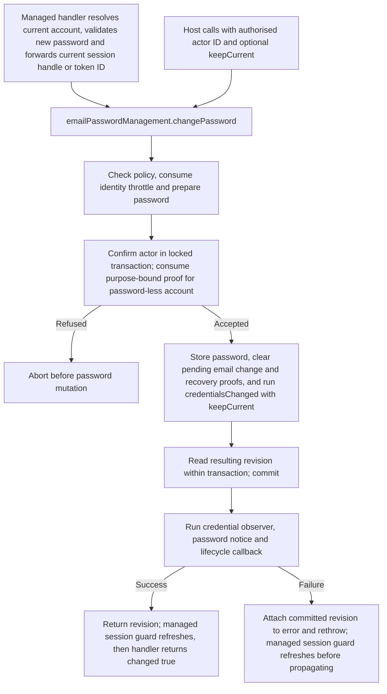

# US-ACCOUNT-05 — Change the current password

As a signed-in account holder, I want to replace my password so that I can protect the account and invalidate older sign-ins.

**Status:** Current when `emailPasswordManagement` is enabled
**Access:** `actorId` identifies the signed-in user. A password account must prove `currentPassword`; a social-only account may provide a purpose-bound `recentProof`. The host decides which caller may invoke the service.
**Entry:** Host calls `emailPasswordManagement.changePassword` or mounts `account.password.change` (POST `account/password`). See the [managed password fields](REFERENCE.md#managed-password-fields).
**Documentation:** [Account operations](../docs/guide/account-operations.md)
**Source:** [`src/change_password.ts`](../src/change_password.ts)
**Coverage:** [`tests/credentials_password_change.spec.ts`](../tests/credentials_password_change.spec.ts)

## Acceptance criteria

- Service input requires `actorId` and `newPassword`; `currentPassword` is required for a password account, while a social-only account uses `recentProof`. `keepCurrent` is optional and identifies the caller's own session handle or token ID to preserve. The new password must be 8–256 characters and satisfy configured password policy.
- A wrong or missing proof, unknown actor, or disallowed new password leaves the existing password unchanged.
- An accepted change stores the new password, clears applicable recovery proofs, advances credential state, ends other credentials according to `keepCurrent`, and runs observers/notification callbacks after commit. For a preserved session, the caller must refresh the stored revision. The service returns the resulting revision; post-commit failure does not undo the change.

- The social proof is bound to `password_change` and requires `socialAuthentication`. Managed password changes use an active account check by default, forward current credential evidence as `keepCurrent`, and return 200 with `{ changed: true }`. The managed session handler refreshes the guard revision on success or on a recognised committed follow-up error.
- If the managed write recognises a committed follow-up failure, it returns 202 with `{ committed: true }`.

## User flow

## Code flow

**Code references:** [`changePassword`](../src/change_password.ts), [`confirmActor`](../src/actor_confirmation.ts), [`credentialsChanged`](../src/credential_revision.ts), [`managed password handler`](../src/http/handlers_email_password_management.ts), [`password change tests`](../tests/credentials_password_change.spec.ts), [managed committed-failure response](../src/http/managed.ts)
