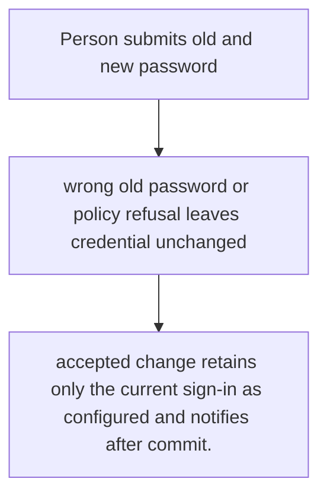
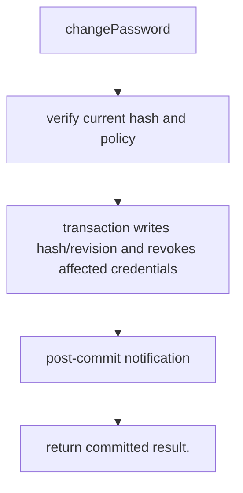

# US-ACCOUNT-05 — Change the current password

As a signed-in account holder, I want to replace the password after proving the current password so that I can protect the account and invalidate older sign-ins.

**Status:** Current when `emailPasswordManagement` is enabled
**Access:** Current account and correct current password required; host owns password input validation UX.
**Entry:** Host calls `emailPasswordManagement.changePassword({ actorId, currentPassword, newPassword })`; optional managed route.
**Documentation:** [account-operations.md](../docs/guide/account-operations.md)
**Source:** [`src/change_password.ts`](../src/change_password.ts)
**Coverage:** [`tests/credentials_password_change.spec.ts`](../tests/credentials_password_change.spec.ts)

## Acceptance criteria

- **Inputs and result:** actorId, newPassword, and currentPassword or a supported recent proof; password policy comes from service config. The host owns any screen, request parsing and presentation unless the entry explicitly names a managed route or command.
- accepted change retains only the current sign-in as configured and notifies after commit.
- Refusal, expiry, stale state or post-commit delivery behavior follows the linked service contract; a committed mutation is not described as rolled back because a follow-up failed.

## User flow

## Code flow

Scope: this is the Account Kit service/command path. Host UI, route policy and external systems remain host-owned unless named.

**Code references:** [implementation](../src/change_password.ts), [`tests/credentials_password_change.spec.ts`](../tests/credentials_password_change.spec.ts)
