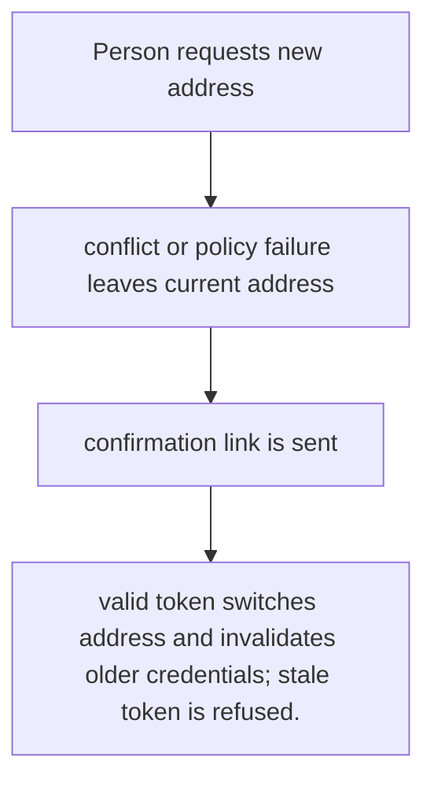
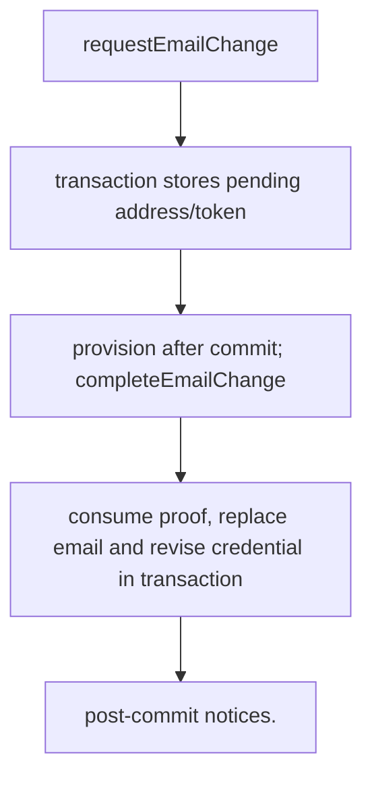

# US-ACCOUNT-06 — Change and confirm the account email

As a signed-in account holder, I want to request a new email and confirm ownership so that I can keep the old address active until the new one is proven.

**Status:** Current when `emailPasswordManagement` is enabled
**Access:** Authenticated current account; new address must pass uniqueness and confirmation checks.
**Entry:** Host calls `requestEmailChange`, then the recipient follows the confirmation link consumed by `emailVerification.completeEmailChange`; optional managed profile route.
**Documentation:** [account-operations.md](../docs/guide/account-operations.md)
**Source:** [`src/profile_update.ts`](../src/profile_update.ts)
**Coverage:** [`tests/credentials_email_change_completion.spec.ts`](../tests/credentials_email_change_completion.spec.ts)

## Acceptance criteria

- **Inputs and result:** actorId, new email and currentPassword or supported recent proof; confirmation token for completion. The host owns any screen, request parsing and presentation unless the entry explicitly names a managed route or command.
- valid token switches address and invalidates older credentials; stale token is refused.
- Refusal, expiry, stale state or post-commit delivery behavior follows the linked service contract; a committed mutation is not described as rolled back because a follow-up failed.

## User flow

## Code flow

Scope: this is the Account Kit service/command path. Host UI, route policy and external systems remain host-owned unless named.

**Code references:** [implementation](../src/profile_update.ts), [`tests/credentials_email_change_completion.spec.ts`](../tests/credentials_email_change_completion.spec.ts)
