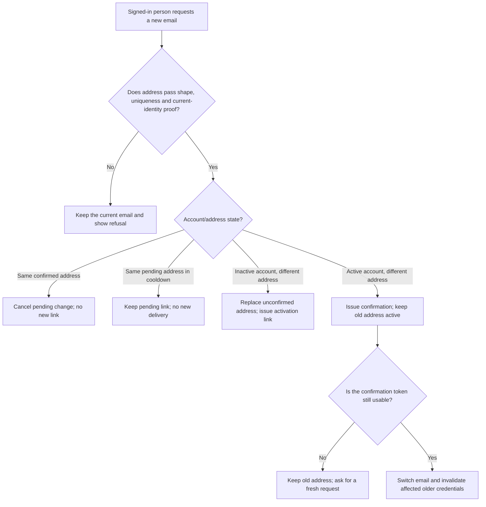
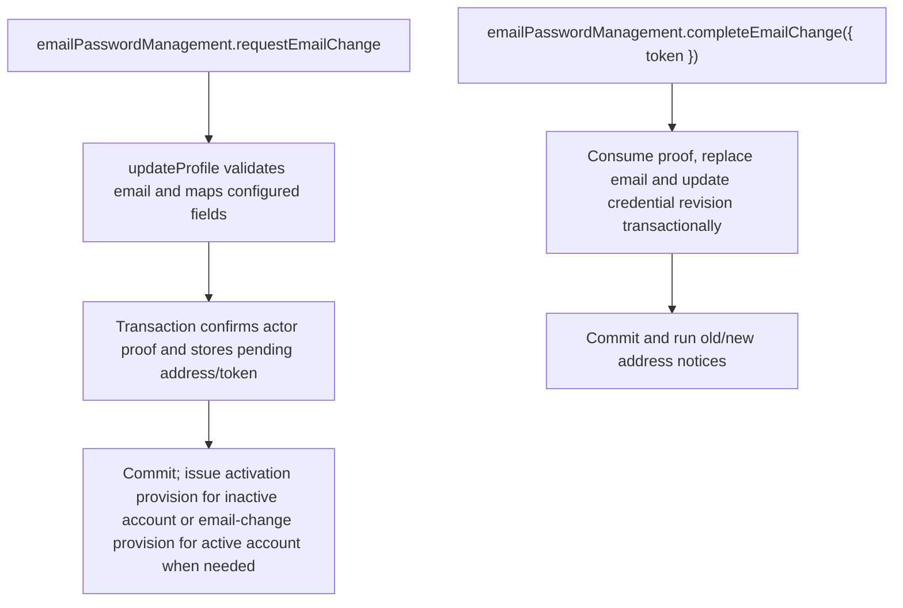

# US-ACCOUNT-06 — Change and confirm the account email

As a signed-in account holder, I want to request a new email and confirm ownership so that I can keep the old address active until the new one is proven.

**Status:** Current when `emailPasswordManagement` is enabled
**Access:** Authenticated current account; new address must pass uniqueness and confirmation checks.
**Entry:** Host calls `requestEmailChange`, then the recipient follows the confirmation link consumed by `emailPasswordManagement.completeEmailChange`; optional managed profile route.
**Documentation:** [account-operations.md](../docs/guide/account-operations.md)
**Source:** [`src/profile_update.ts`](../src/profile_update.ts), [email proof completion](../src/email_change.ts)
**Coverage:** [`tests/credentials_email_change_completion.spec.ts`](../tests/credentials_email_change_completion.spec.ts)

## Acceptance criteria

- **Inputs and result:** `emailPasswordManagement.requestEmailChange({ actorId, newEmail, currentPassword? , recentProof? })` returns `void`; password accounts prove the current password, social-only accounts use purpose-bound proof. `emailPasswordManagement.inspectEmailChange({ token })` is read-only; `completeEmailChange({ token })` returns the updated account.

- For an active account requesting a different address, keep the confirmed address until completion. Requesting the confirmed address cancels an existing pending change; a repeat for the same pending address within one minute does not send again.
- For an inactive account, requesting a different address changes both address fields and issues an activation link; it stays inactive until activation with a policy-valid password. This branch advances credentials immediately.
- Delivery happens after commit; a delivery failure leaves the saved address state in place and is surfaced to the caller.

## User flow

## Code flow

Scope: this is the Account Kit service/command path. Host UI, route policy and external systems remain host-owned unless named.

**Code references:** [request implementation](../src/profile_update.ts), [completion and inspection](../src/email_change.ts), [`tests/credentials_email_change_completion.spec.ts`](../tests/credentials_email_change_completion.spec.ts)
