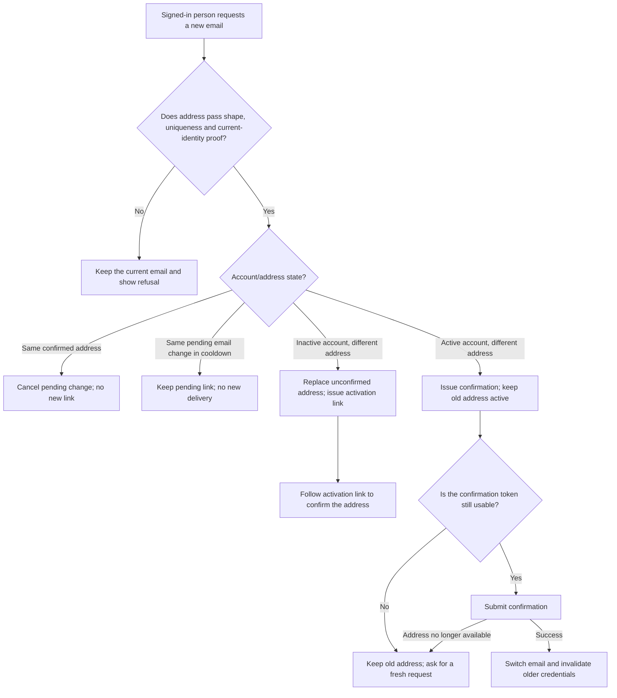
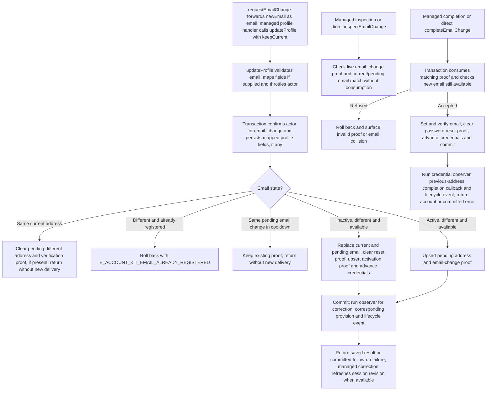

# US-ACCOUNT-06 — Change and confirm the account email

As a signed-in account holder, I want to request a new email and confirm ownership so that I can keep the old address active until the new one is proven.

**Status:** Current when `emailPasswordManagement` is enabled
**Access:** Authenticated current account; new address must pass uniqueness and confirmation checks.
**Entry:** Host calls `emailPasswordManagement.requestEmailChange`, or uses managed PATCH `account/profile` with `email`. Active-account confirmation uses the public GET/POST `auth/email-change/:token` managed routes or the equivalent service calls. Inactive-account correction leads to [verification](US-ACCOUNT-38-complete-email-verification.md).
**Documentation:** [account-operations.md](../docs/guide/account-operations.md)
**Source:** [`src/profile_update.ts`](../src/profile_update.ts), [email proof completion](../src/email_change.ts)
**Coverage:** [`tests/credentials_email_change_completion.spec.ts`](../tests/credentials_email_change_completion.spec.ts)

## Acceptance criteria

- **Inputs and result:** `emailPasswordManagement.requestEmailChange({ actorId, newEmail, currentPassword?, recentProof? })` returns `void`; password accounts prove the current password, password-less accounts use `email_change` proof when `socialAuthentication` is enabled. `emailPasswordManagement.inspectEmailChange({ token })` is read-only; `completeEmailChange({ token })` returns the updated account.

- For an active account requesting a different address, keep the confirmed address until completion. Requesting the confirmed address cancels an existing pending change; a repeat for the same pending address within one minute reuses a live matching email-change proof without another delivery.
- For an inactive account, requesting a different address changes both address fields and issues an activation link; it stays inactive until activation with a policy-valid password. This branch advances credentials immediately.
- Completion calls the configured `emailChanged(previousEmail, user)` callback; the built-in mail helper sends this completion notice to the previous address. New-address confirmation is a separate request provision. Delivery happens after commit. If the new-address provision fails, the service attempts to reopen the cooldown and the saved address state remains in place.
- The managed profile handler preserves its current credential on inactive-account correction, refreshing a session from the committed revision. Managed email-change inspection returns `{ valid: true }` or an invalid-proof response. Completion returns 200 with the represented account.
- If the managed write recognises a committed follow-up failure, it returns 202 with `{ committed: true }`.

## User flow

## Code flow

**Code references:** [request implementation](../src/profile_update.ts), [completion and inspection](../src/email_change.ts), [`tests/credentials_email_change_completion.spec.ts`](../tests/credentials_email_change_completion.spec.ts), [managed profile and email change](../src/http/handlers_email_password_management.ts), [actor proof](../src/actor_confirmation.ts), [managed committed-failure response](../src/http/managed.ts)
