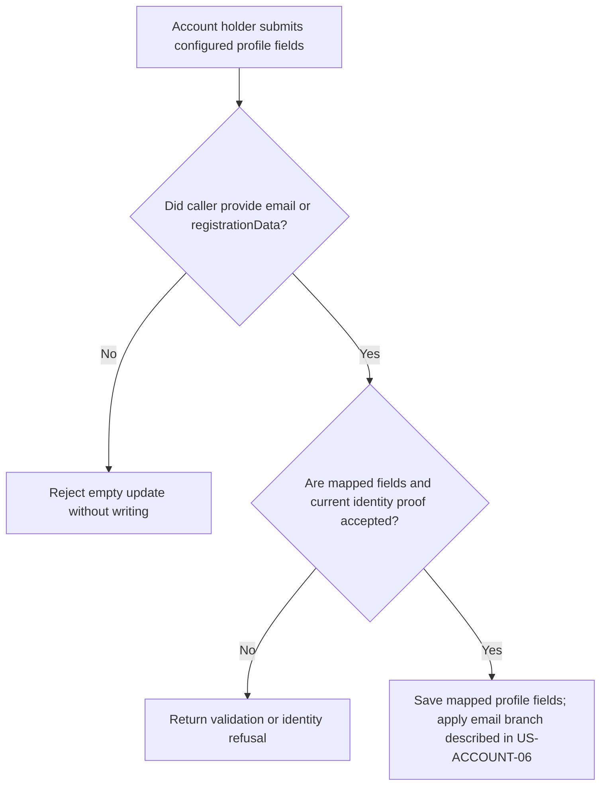
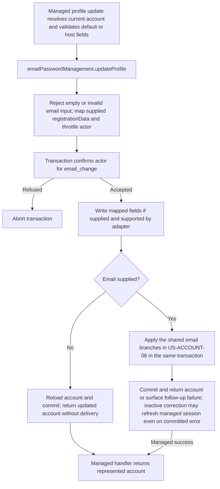

# US-ACCOUNT-07 — Update configured profile fields

As a signed-in account holder, I want to change profile fields accepted by the host configuration so that I can keep account details current.

**Status:** Current when `emailPasswordManagement` is enabled
**Access:** Current account; host defines allowed fields, mapping and request authorisation.
**Entry:** Host calls `emailPasswordManagement.updateProfile` or mounts `account.profile.update` (PATCH `account/profile`, limited access).
**Documentation:** [account-operations.md](../docs/guide/account-operations.md)
**Source:** [`src/profile_update.ts`](../src/profile_update.ts)
**Coverage:** [`tests/credentials_profile.spec.ts`](../tests/credentials_profile.spec.ts)

## Acceptance criteria

- **Inputs and result:** `emailPasswordManagement.updateProfile({ actorId, email?, registrationData?, currentPassword?, recentProof?, keepCurrent? })` returns the account. At least `email` or `registrationData` must be supplied; profile values are untrusted and mapped by configured registration fields. Every update requires current password or social-only recent proof, including a registrationData-only update. The proof purpose is `email_change` and the password-less path requires `socialAuthentication`. See [email branches](US-ACCOUNT-06-change-email.md) for updates that include email.
- The managed default validator accepts optional `email`, `registrationData`, `currentPassword` and `recentProof`. A host may replace the validator. Managed success returns 200 with the represented account.
- If the managed write recognises a committed follow-up failure, it returns 202 with `{ committed: true }`.

## User flow

## Code flow

**Code references:** [implementation](../src/profile_update.ts), [`tests/credentials_profile.spec.ts`](../tests/credentials_profile.spec.ts), [managed profile update](../src/http/handlers_email_password_management.ts), [managed committed-failure response](../src/http/managed.ts)
