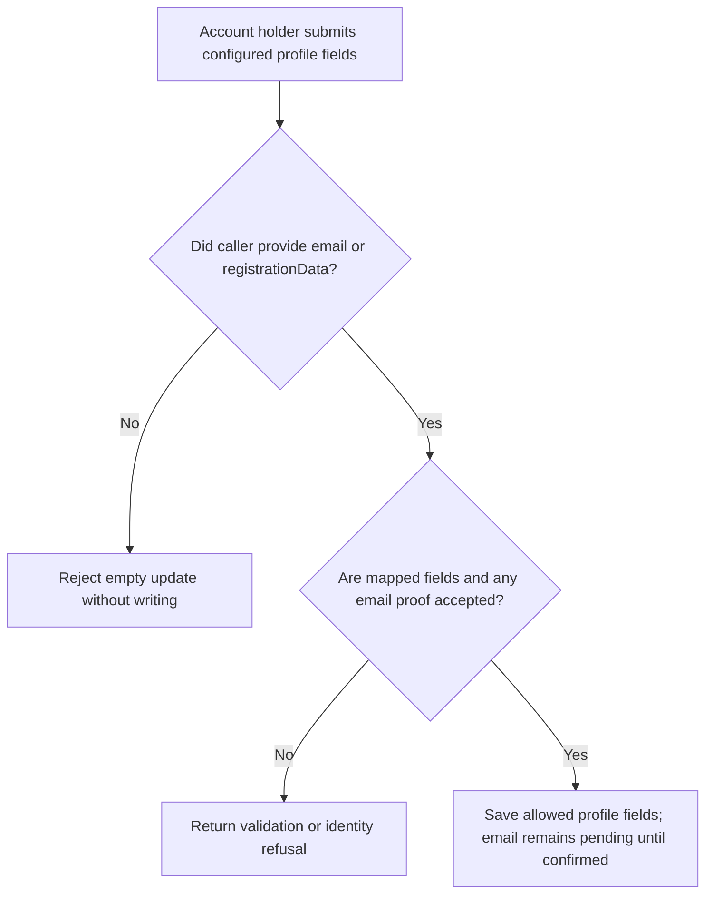
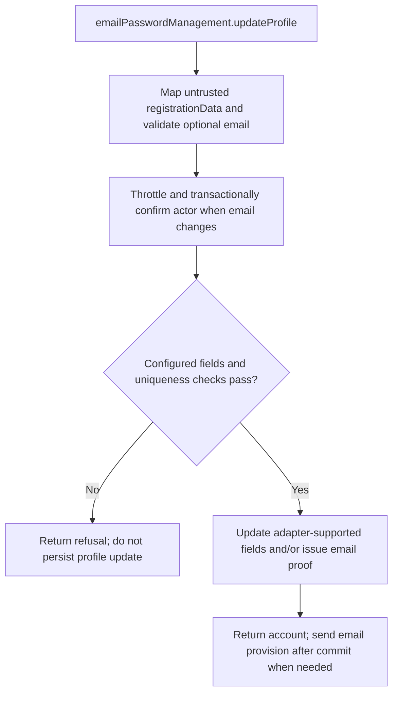

# US-ACCOUNT-07 — Update configured profile fields

As a signed-in account holder, I want to change profile fields accepted by the host configuration so that I can keep account details current.

**Status:** Current when `emailPasswordManagement` is enabled
**Access:** Current account; host defines allowed fields, mapping and request authorization.
**Entry:** Host calls `emailPasswordManagement.updateProfile`; optional managed profile route with configured validator/representation.
**Documentation:** [account-operations.md](../docs/guide/account-operations.md)
**Source:** [`src/profile_update.ts`](../src/profile_update.ts)
**Coverage:** [`tests/credentials_profile.spec.ts`](../tests/credentials_profile.spec.ts)

## Acceptance criteria

- **Inputs and result:** `emailPasswordManagement.updateProfile({ actorId, email?, registrationData?, currentPassword?, recentProof?, keepCurrent? })` returns the account. At least `email` or `registrationData` must be supplied; profile values are untrusted and mapped by configured registration fields. Changing email requires current password or social-only recent proof.

## User flow

## Code flow

Scope: this is the Account Kit service/command path. Host UI, route policy and external systems remain host-owned unless named.

**Code references:** [implementation](../src/profile_update.ts), [`tests/credentials_profile.spec.ts`](../tests/credentials_profile.spec.ts)
