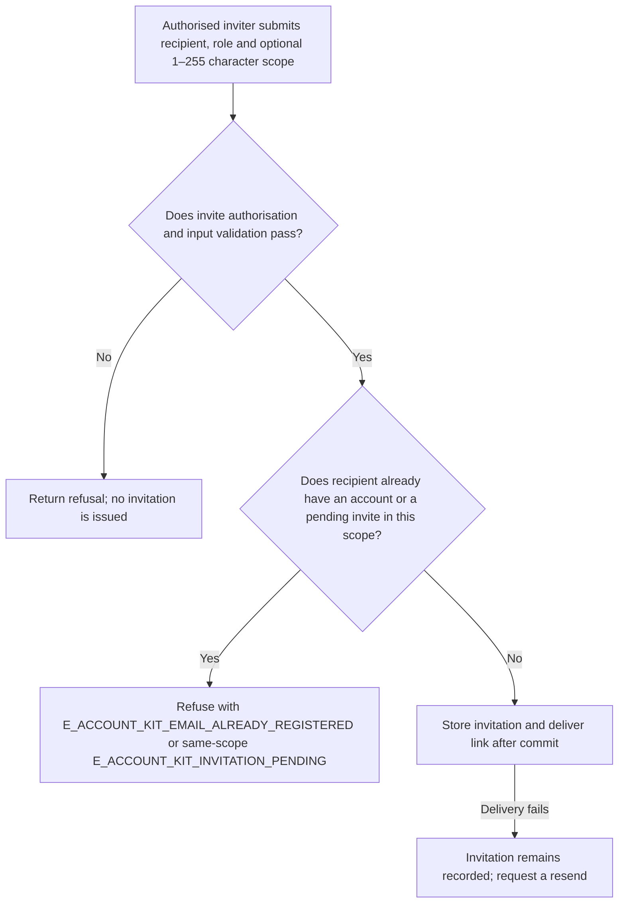
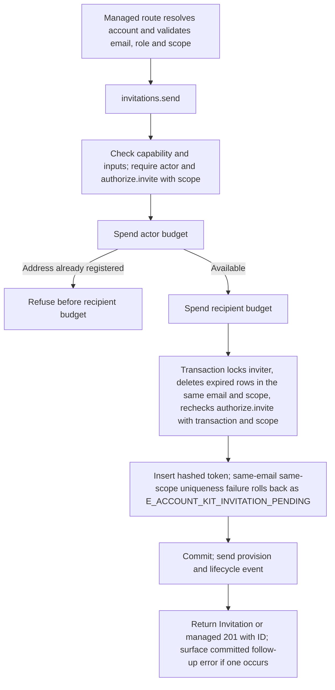

# US-ACCOUNT-08 — Invite a person to the application

As an authorised inviter, I want to send an invitation for a recipient and application role so that I can give the recipient a bounded invitation path.

**Status:** Current when the host explicitly enables the opt-in `invitations` capability
**Access:** Host `authorize.invite(actor, role, { scope, trx? })` authorises the inviter, role and scope. It receives no target email; recipient-specific policy is host-owned separately. The host decides what an invitation role means.
**Entry:** Host calls `invitations.send` or mounts `account.invitation.send` (POST `account/invitations`, active access by default).
**Documentation:** [Invitation input rules](../docs/guide/account-operations.md#invitation-input-rules)
**Source:** [`src/invitations.ts`](../src/invitations.ts)
**Coverage:** [`tests/invitations_send.spec.ts`](../tests/invitations_send.spec.ts)

## Acceptance criteria

- **Inputs and result:** `invitations.send({ actorId, email, role, scope? })` returns the invitation. Email must be email-shaped and is normalised. Direct send accepts 1–64 characters of exact role text and 1–255 characters of exact scope text. Omitted or `null` scope means unscoped. Host `authorize.invite(actor, role, { scope, trx? })` decides permission and role meaning, without receiving the target email.

- A registered recipient or an existing pending invitation for the same normalised email and scope is refused with its defined error; a pending invitation in another scope does not block this send. Delivery failure after commit leaves the new invitation recorded and is surfaced.
- Managed send trims the role before applying the same length limits and rejects a whitespace-only role. Omit scope or send `null` for an unscoped invitation. Managed success returns 201 with `{ id }`.
- If the managed write recognises a committed follow-up failure, it returns 202 with `{ committed: true }`.

## User flow

## Code flow

**Code references:** [implementation](../src/invitations.ts), [`tests/invitations_send.spec.ts`](../tests/invitations_send.spec.ts), [managed invitations](../src/http/handlers_invitations.ts), [scope validation](../src/invitation_scope.ts), [managed committed-failure response](../src/http/managed.ts)
