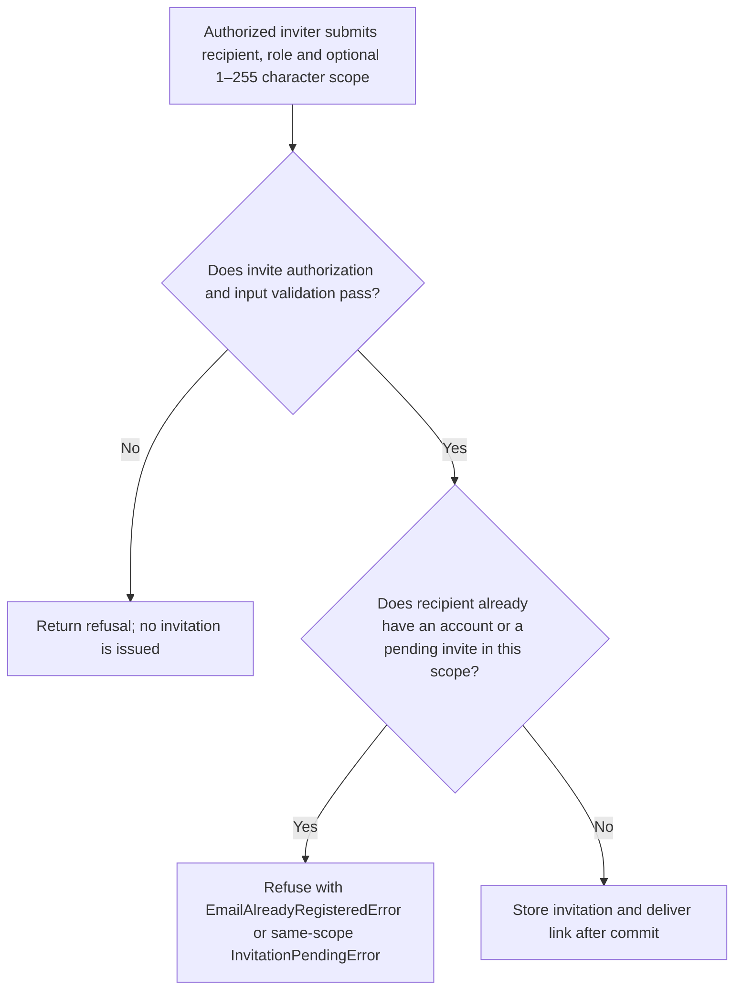
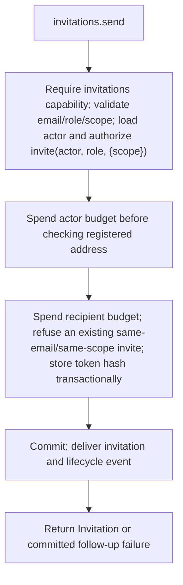

# US-ACCOUNT-08 — Invite a person to the application

As an authorized inviter, I want to send an invitation for a recipient and application role so that I can give the recipient a bounded invitation path.

**Status:** Current when the host explicitly enables the opt-in `invitations` capability
**Access:** Host `authorize.invite(actor, role, { scope, trx? })` authorizes the inviter, role and scope. It receives no target email; recipient-specific policy is host-owned separately. The host decides what an invitation role means.
**Entry:** Host calls `invitations.send`; optional managed invitation route.
**Documentation:** [usage.md](../docs/guide/usage.md)
**Source:** [`src/invitations.ts`](../src/invitations.ts)
**Coverage:** [`tests/invitations_send.spec.ts`](../tests/invitations_send.spec.ts)

## Acceptance criteria

- **Inputs and result:** `invitations.send({ actorId, email, role, scope? })` returns the invitation. Email must be email-shaped; role is a string of 1–64 characters; scope is an optional string of 1–255 characters, with omitted or `null` meaning unscoped. Host `authorize.invite(actor, role, { scope, trx? })` decides permission and role meaning, without receiving the target email.

- A registered recipient or an existing pending invitation for the same normalized email and scope is refused with its defined error; a pending invitation in another scope does not block this send. Delivery failure after commit leaves the new invitation recorded and is surfaced.

## User flow

## Code flow

Scope: this is the Account Kit service/command path. Host UI, route policy and external systems remain host-owned unless named.

**Code references:** [implementation](../src/invitations.ts), [`tests/invitations_send.spec.ts`](../tests/invitations_send.spec.ts)
