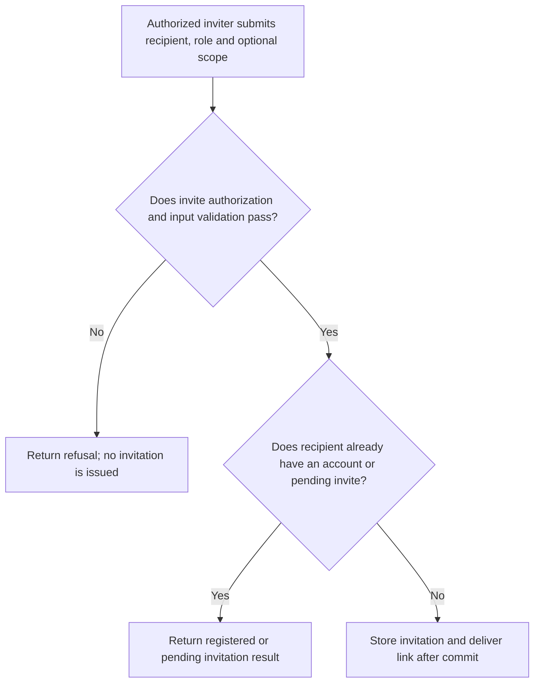
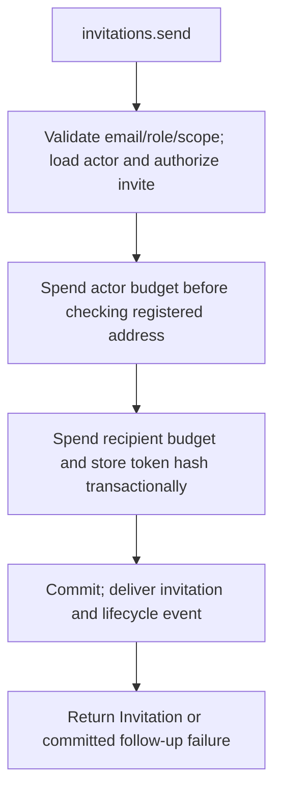

# US-ACCOUNT-08 — Invite a person to the application

As an authorized inviter, I want to send an invitation for a recipient and application role so that I can give the recipient a bounded invitation path.

**Status:** Current
**Access:** Host callback authorizes inviter, target email and role; host decides what invitation role means.
**Entry:** Host calls `invitations.send`; optional managed invitation route.
**Documentation:** [usage.md](../docs/guide/usage.md)
**Source:** [`src/invitations.ts`](../src/invitations.ts)
**Coverage:** [`tests/invitations_send.spec.ts`](../tests/invitations_send.spec.ts)

## Acceptance criteria

- **Inputs and result:** `invitations.send({ actorId, email, role, scope? })` returns the invitation. Email must be email-shaped; role is a string of 1–64 characters; omitted or `null` scope means unscoped. Host `authorize.invite` decides permission and role meaning.

## User flow

## Code flow

Scope: this is the Account Kit service/command path. Host UI, route policy and external systems remain host-owned unless named.

**Code references:** [implementation](../src/invitations.ts), [`tests/invitations_send.spec.ts`](../tests/invitations_send.spec.ts)
