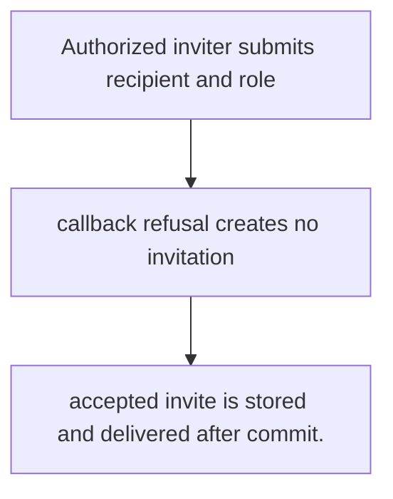
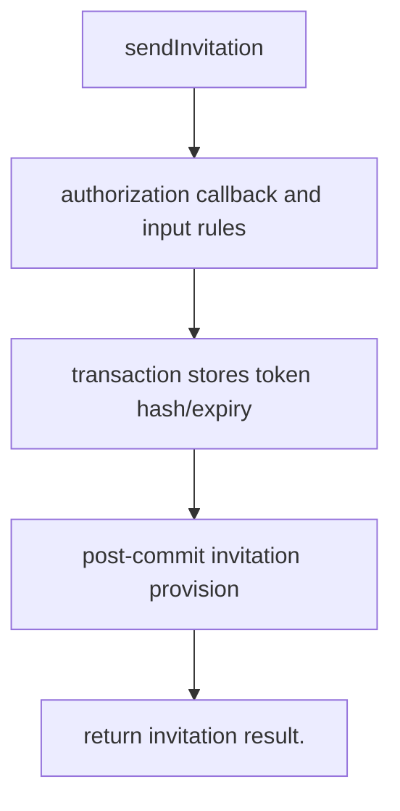

# US-ACCOUNT-08 — Invite a person to the application

As an authorized inviter, I want to send an invitation for a recipient and application role so that I can give the recipient a bounded invitation path.

**Status:** Current
**Access:** Host callback authorizes inviter, target email and role; host decides what invitation role means.
**Entry:** Host calls `invitations.send`; optional managed invitation route.
**Documentation:** [usage.md](../docs/guide/usage.md)
**Source:** [`src/invitations.ts`](../src/invitations.ts)
**Coverage:** [`tests/invitations_send.spec.ts`](../tests/invitations_send.spec.ts)

## Acceptance criteria

- **Inputs and result:** inviter/current context, recipient email, role and host-configured scope/data. The host owns any screen, request parsing and presentation unless the entry explicitly names a managed route or command.
- accepted invite is stored and delivered after commit.
- Refusal, expiry, stale state or post-commit delivery behavior follows the linked service contract; a committed mutation is not described as rolled back because a follow-up failed.

## User flow

## Code flow

Scope: this is the Account Kit service/command path. Host UI, route policy and external systems remain host-owned unless named.

**Code references:** [implementation](../src/invitations.ts), [`tests/invitations_send.spec.ts`](../tests/invitations_send.spec.ts)
