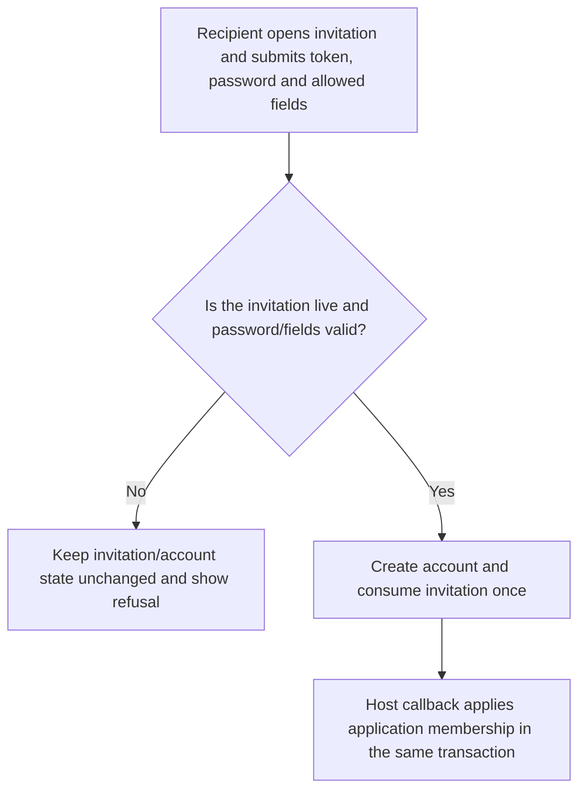
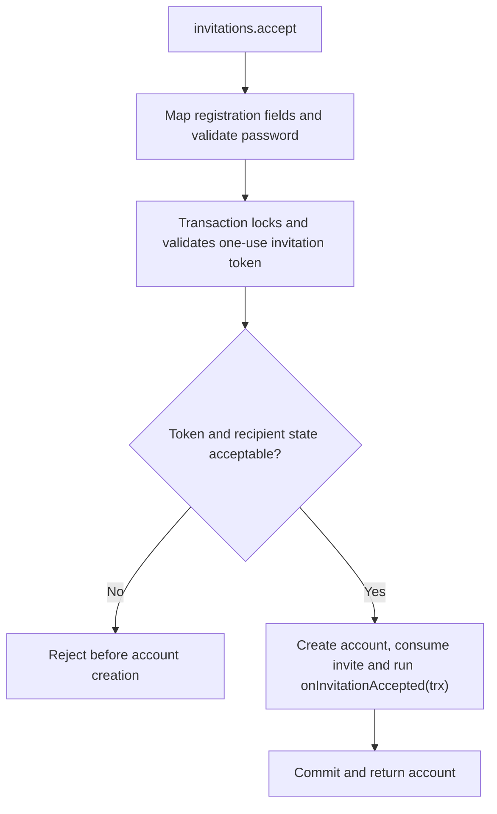

# US-ACCOUNT-09 — Accept an invitation

As an invited person, I want to redeem the invitation sent to their address so that I can join through the host-approved invitation path.

**Status:** Current
**Access:** Valid unused invitation token and matching recipient proof; host callback owns membership grant.
**Entry:** Host calls `invitations.accept`; optional managed acceptance route.
**Documentation:** [usage.md](../docs/guide/usage.md)
**Source:** [`src/invitations.ts`](../src/invitations.ts)
**Coverage:** [`tests/invitations_acceptance.spec.ts`](../tests/invitations_acceptance.spec.ts)

## Acceptance criteria

- **Inputs and result:** `invitations.accept({ token, password, registrationData? })` returns the created account. It consumes one valid invitation, checks password and mapped registration fields, and runs `onInvitationAccepted` in the same transaction; it does not invoke an inviter authorization callback.

## User flow

## Code flow

Scope: this is the Account Kit service/command path. Host UI, route policy and external systems remain host-owned unless named.

**Code references:** [implementation](../src/invitations.ts), [`tests/invitations_acceptance.spec.ts`](../tests/invitations_acceptance.spec.ts)
