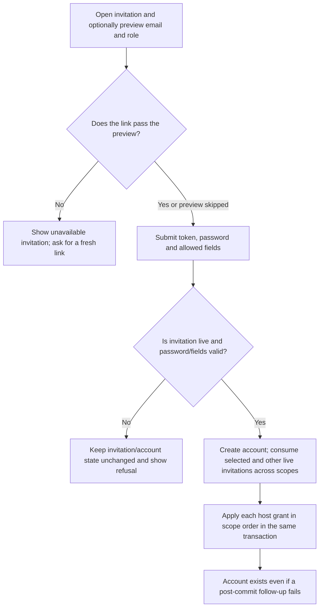
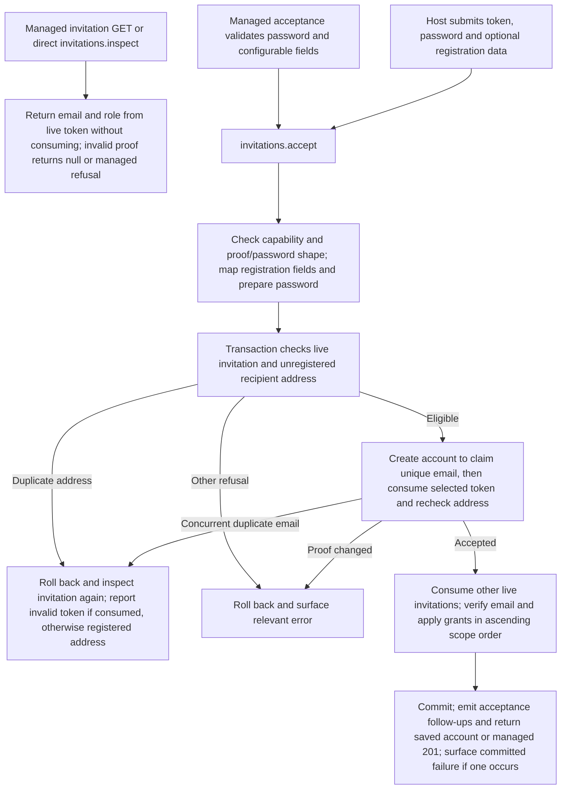

# US-ACCOUNT-09 — Accept an invitation

As an invited person, I want to redeem the invitation sent to my address so that I can join through the host-approved invitation path.

**Status:** Current when the host explicitly enables the opt-in `invitations` capability
**Access:** Enabled invitation capability and a valid token issued for the recipient email; host callbacks own membership grants.
**Entry:** Host calls `invitations.accept` or mounts GET/POST `auth/invitations/:token`. The managed acceptance default validator uses the [password fields](REFERENCE.md#managed-password-fields) and optional `registrationData`. A host replacement can supply its own HTTP schema.
**Documentation:** [usage.md](../docs/guide/usage.md)
**Source:** [`src/invitations.ts`](../src/invitations.ts)
**Coverage:** [`tests/invitations_acceptance.spec.ts`](../tests/invitations_acceptance.spec.ts)

## Acceptance criteria

- **Inputs and result:** `invitations.inspect({ token })` returns `{ email, role }` for a valid invitation or `null`, without consuming it. `invitations.accept({ token, password, registrationData? })` returns the created account, checks password and mapped registration fields, and consumes the selected invitation plus all other live invitations for that email across scopes in one transaction. It runs each `onInvitationAccepted` callback in ascending scope order and does not invoke an inviter authorisation callback.
- The managed preview returns the email and role or an invalid-proof response. Managed acceptance returns 201 with the represented account. A failed transaction rolls back the account and invitation consumption together. A post-commit follow-up failure leaves acceptance complete.
- After a duplicate-address failure, the service rechecks the invitation after rollback. If another acceptance has consumed it, the result is invalid token; if it remains live, the registered-address refusal remains.
- If the managed write recognises a committed follow-up failure, it returns 202 with `{ committed: true }`.

## User flow

## Code flow

**Code references:** [implementation](../src/invitations.ts), [`tests/invitations_acceptance.spec.ts`](../tests/invitations_acceptance.spec.ts), [managed invitation preview and acceptance](../src/http/handlers_invitations.ts), [invitation grant order](../src/invitation_match.ts), [managed committed-failure response](../src/http/managed.ts)
