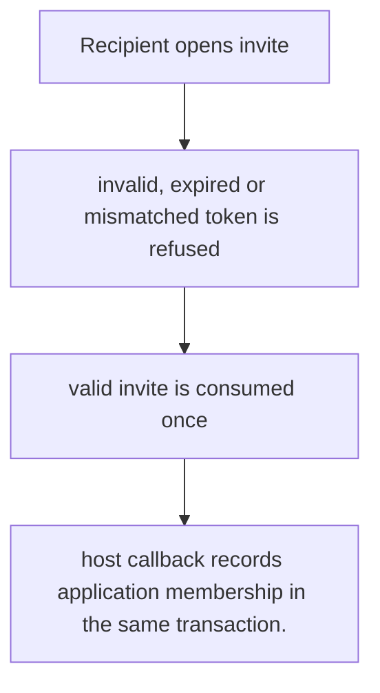
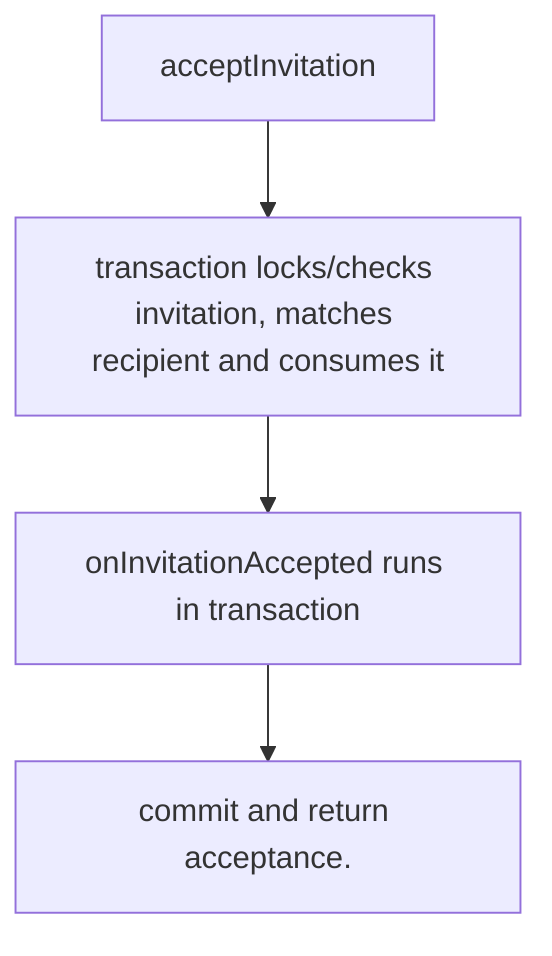

# US-ACCOUNT-09 — Accept an invitation

As an invited person, I want to redeem the invitation sent to their address so that I can join through the host-approved invitation path.

**Status:** Current
**Access:** Valid unused invitation token and matching recipient proof; host callback owns membership grant.
**Entry:** Host calls `invitations.accept`; optional managed acceptance route.
**Documentation:** [usage.md](../docs/guide/usage.md)
**Source:** [`src/invitations.ts`](../src/invitations.ts)
**Coverage:** [`tests/invitations_acceptance.spec.ts`](../tests/invitations_acceptance.spec.ts)

## Acceptance criteria

- **Inputs and result:** invitation token, recipient proof and registration fields/password where required by configured acceptance path. The host owns any screen, request parsing and presentation unless the entry explicitly names a managed route or command.
- host callback records application membership in the same transaction.
- Refusal, expiry, stale state or post-commit delivery behavior follows the linked service contract; a committed mutation is not described as rolled back because a follow-up failed.

## User flow

## Code flow

Scope: this is the Account Kit service/command path. Host UI, route policy and external systems remain host-owned unless named.

**Code references:** [implementation](../src/invitations.ts), [`tests/invitations_acceptance.spec.ts`](../tests/invitations_acceptance.spec.ts)
