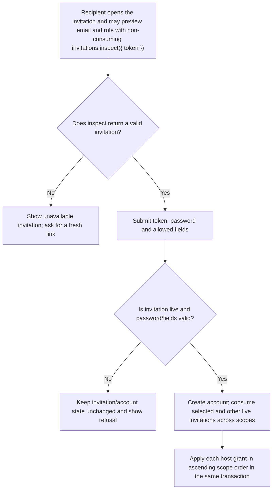
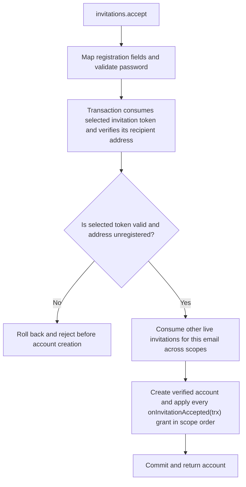

# US-ACCOUNT-09 — Accept an invitation

As an invited person, I want to redeem the invitation sent to my address so that I can join through the host-approved invitation path.

**Status:** Current when the host explicitly enables the opt-in `invitations` capability
**Access:** Enabled invitation capability and a valid token matching the recipient email; host callbacks own membership grants.
**Entry:** Host calls `invitations.accept`; optional managed acceptance route.
**Documentation:** [usage.md](../docs/guide/usage.md)
**Source:** [`src/invitations.ts`](../src/invitations.ts)
**Coverage:** [`tests/invitations_acceptance.spec.ts`](../tests/invitations_acceptance.spec.ts)

## Acceptance criteria

- **Inputs and result:** `invitations.inspect({ token })` returns `{ email, role }` for a valid invitation or `null`, without consuming it. `invitations.accept({ token, password, registrationData? })` returns the created account, checks password and mapped registration fields, and consumes the selected invitation plus all other live invitations for that email across scopes in one transaction. It runs each `onInvitationAccepted` callback in ascending scope order and does not invoke an inviter authorization callback.

## User flow

## Code flow

Scope: this is the Account Kit service/command path. Host UI, route policy and external systems remain host-owned unless named.

**Code references:** [implementation](../src/invitations.ts), [`tests/invitations_acceptance.spec.ts`](../tests/invitations_acceptance.spec.ts)
