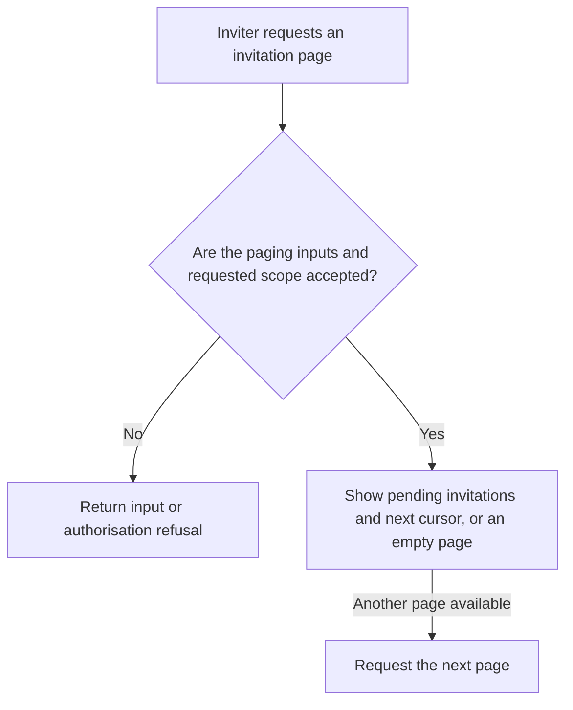
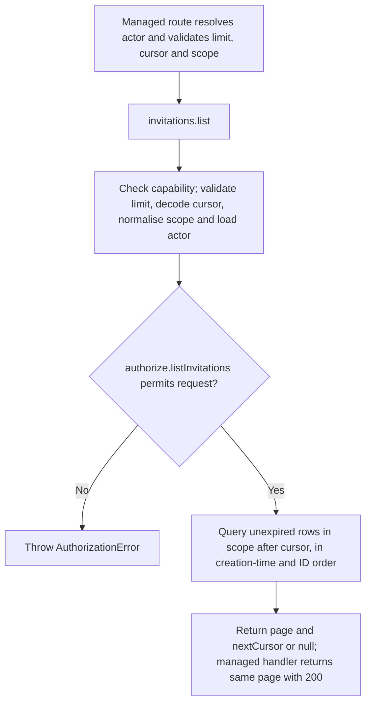

# US-ACCOUNT-10 — Review invitations

As an authorised inviter or operator, I want to list invitations visible under host authorisation so that I can see current invitation state before taking action.

**Status:** Current when the host explicitly enables the opt-in `invitations` capability
**Access:** Host list authorisation callback and the caller-supplied `limit` (default 25, maximum 100), `cursor` and `scope` inputs determine visible results.
**Entry:** Host calls `invitations.list` or mounts `account.invitation.list` (GET `account/invitations`, active access by default).
**Documentation:** [usage.md](../docs/guide/usage.md)
**Source:** [`src/invitation_management.ts`](../src/invitation_management.ts)
**Coverage:** [`tests/invitation_listing.spec.ts`](../tests/invitation_listing.spec.ts), [`tests/invitations_inspection.spec.ts`](../tests/invitations_inspection.spec.ts)

## Acceptance criteria

- **Inputs and result:** `invitations.list({ actorId, limit?, cursor?, scope? })` returns `{ items, nextCursor }`. `limit` defaults to 25 and cannot exceed 100; omitted scope lists every scope, while `null` selects unscoped invitations. `authorize.listInvitations` controls visibility.

- `authorize.listInvitations(actor, context)` receives an empty context for omitted scope or `{ scope }` for an explicit filter. Each page is ordered oldest first by creation time, then ID. Managed success returns 200 with the same page object.

## User flow

## Code flow

**Code references:** [implementation](../src/invitation_management.ts), [`tests/invitation_listing.spec.ts`](../tests/invitation_listing.spec.ts), [`tests/invitations_inspection.spec.ts`](../tests/invitations_inspection.spec.ts), [managed invitation list](../src/http/handlers_invitations.ts)
