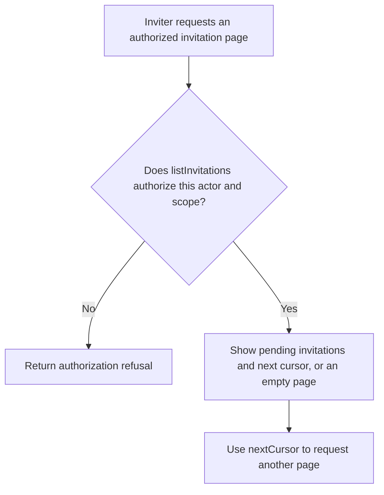
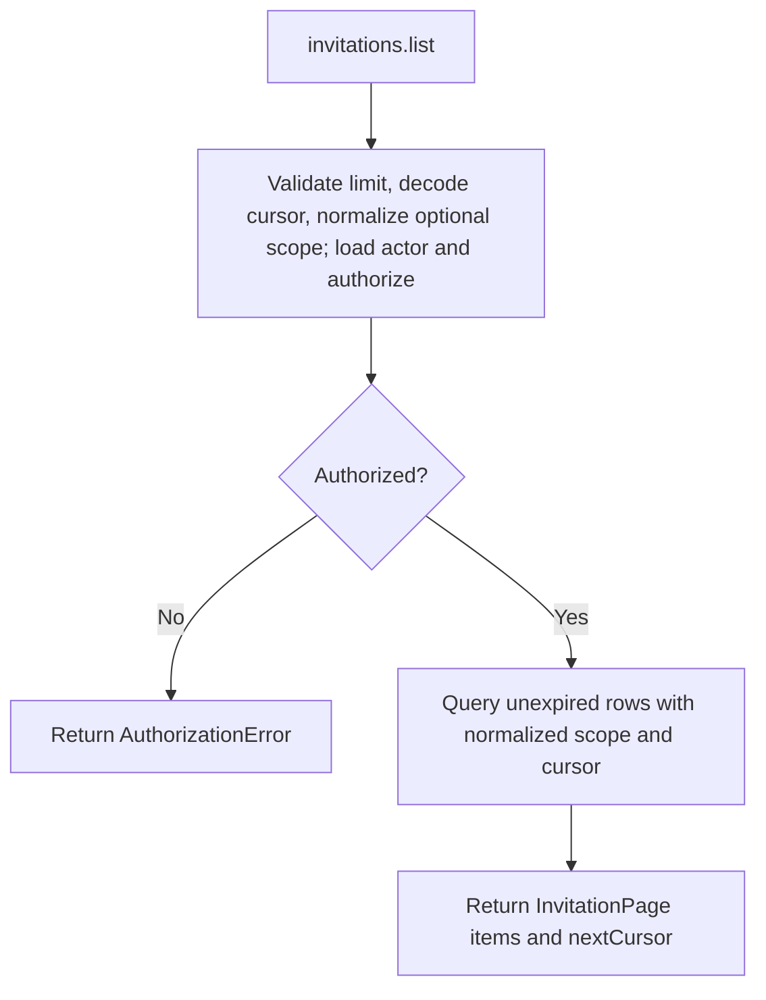

# US-ACCOUNT-10 — Review invitations

As an authorized inviter or operator, I want to list invitations visible under host authorization so that I can see current invitation state before taking action.

**Status:** Current when the host explicitly enables the opt-in `invitations` capability
**Access:** Host list authorization callback and configured page size/cursor determine visible results.
**Entry:** Host calls `invitations.list` with actor and paging inputs; no built-in invitation screen.
**Documentation:** [usage.md](../docs/guide/usage.md)
**Source:** [`src/invitations.ts`](../src/invitations.ts)
**Coverage:** [`tests/invitations_resend_revoke.spec.ts`](../tests/invitations_resend_revoke.spec.ts)

## Acceptance criteria

- **Inputs and result:** `invitations.list({ actorId, limit?, cursor?, scope? })` returns `{ items, nextCursor }`. `limit` defaults to 25 and cannot exceed 100; omitted scope lists every scope, while `null` selects unscoped invitations. `authorize.listInvitations` controls visibility.

## User flow

## Code flow

Scope: this is the Account Kit service/command path. Host UI, route policy and external systems remain host-owned unless named.

**Code references:** [implementation](../src/invitations.ts), [`tests/invitations_resend_revoke.spec.ts`](../tests/invitations_resend_revoke.spec.ts)
