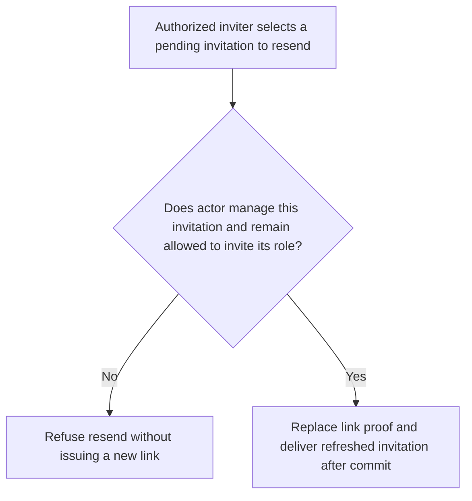
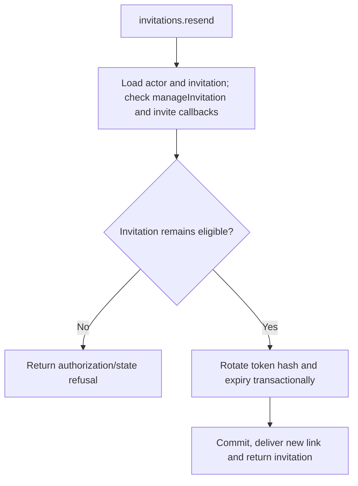

# US-ACCOUNT-11 — Resend an invitation

As an authorized inviter, I want to issue a fresh invitation delivery for an eligible recipient so that I can recover a link without changing host authorization.

**Status:** Current
**Access:** Host authorization callback and configured resend limits apply.
**Entry:** Host calls `invitations.resend`; no built-in resend UI.
**Documentation:** [usage.md](../docs/guide/usage.md)
**Source:** [`src/invitations.ts`](../src/invitations.ts)
**Coverage:** [`tests/invitations_resend_revoke.spec.ts`](../tests/invitations_resend_revoke.spec.ts)

## Acceptance criteria

- **Inputs and result:** `invitations.resend({ actorId, invitationId })` returns the refreshed invitation. `authorize.manageInvitation` and `authorize.invite` for its role must allow the action; the service rotates the link and follows configured limits.

## User flow

## Code flow

Scope: this is the Account Kit service/command path. Host UI, route policy and external systems remain host-owned unless named.

**Code references:** [implementation](../src/invitations.ts), [`tests/invitations_resend_revoke.spec.ts`](../tests/invitations_resend_revoke.spec.ts)
