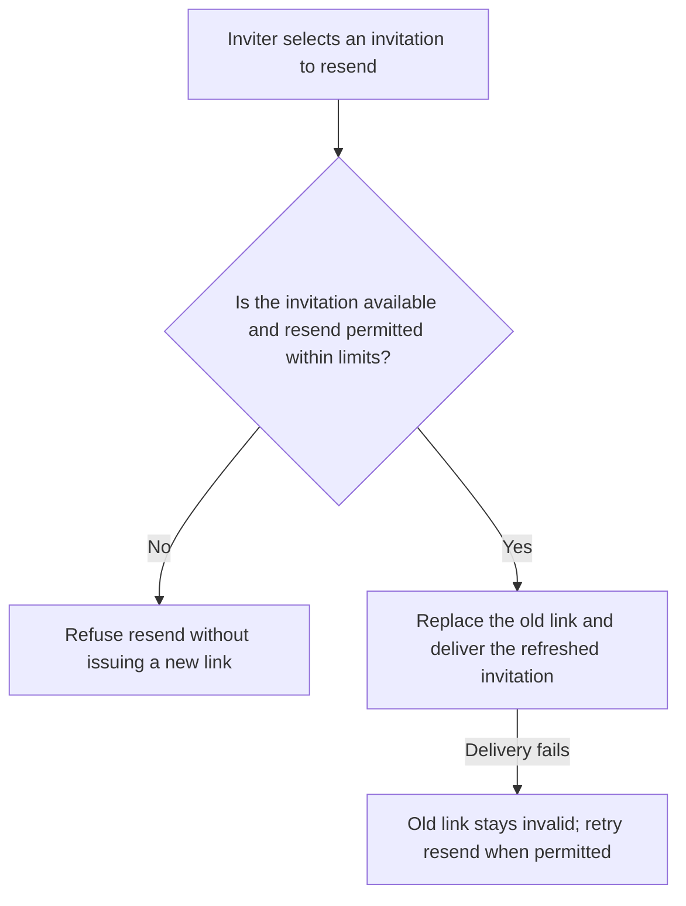
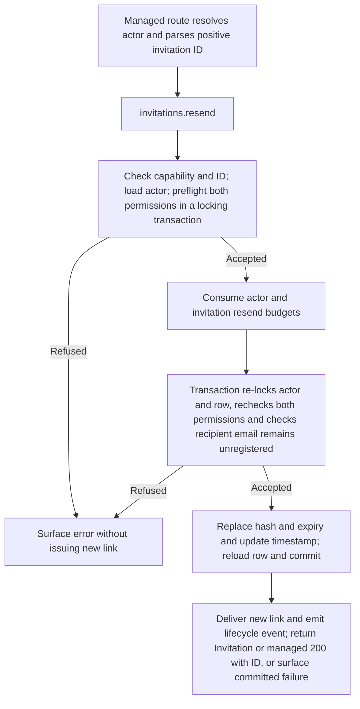

# US-ACCOUNT-11 — Resend an invitation

As an authorised inviter, I want to issue a fresh invitation delivery for an eligible recipient so that I can recover a link without changing host authorisation.

**Status:** Current when the host explicitly enables the opt-in `invitations` capability
**Access:** Host authorisation callback and configured resend limits apply.
**Entry:** Host calls `invitations.resend` or mounts `account.invitation.resend` (POST `account/invitations/:id/resend`, active access by default).
**Documentation:** [usage.md](../docs/guide/usage.md)
**Source:** [`src/invitation_management.ts`](../src/invitation_management.ts)
**Coverage:** [`tests/invitations_resend_revoke.spec.ts`](../tests/invitations_resend_revoke.spec.ts)

## Acceptance criteria

- **Inputs and result:** `invitations.resend({ actorId, invitationId })` returns the refreshed invitation. `authorize.manageInvitation` and `authorize.invite` for its role must allow the action; the service rotates the link and follows configured limits.

- The positive invitation ID can identify a still-pending or expired row. The service checks `manageInvitation(actor, invitation, { trx })` and `invite(actor, role, { scope, trx })` before spending resend budgets, then rechecks both before rotating the link. Once rotated, the old link is invalid even if delivery fails. Managed success returns 200 with `{ id }`.
- If the managed write recognises a committed follow-up failure, it returns 202 with `{ committed: true }`.

## User flow

## Code flow

**Code references:** [implementation](../src/invitation_management.ts), [`tests/invitations_resend_revoke.spec.ts`](../tests/invitations_resend_revoke.spec.ts), [managed resend](../src/http/handlers_invitations.ts), [managed committed-failure response](../src/http/managed.ts)
