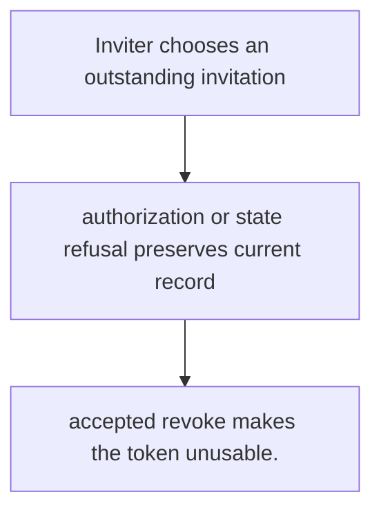
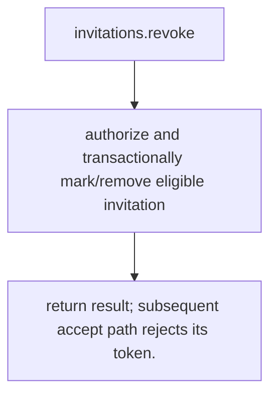

# US-ACCOUNT-12 — Revoke an invitation

As an authorized inviter, I want to cancel an outstanding invitation so that I can prevent its token from granting membership.

**Status:** Current
**Access:** Host authorization callback must permit managing this invitation.
**Entry:** Host calls `invitations.revoke`; no built-in revoke UI.
**Documentation:** [usage.md](../docs/guide/usage.md)
**Source:** [`src/invitations.ts`](../src/invitations.ts)
**Coverage:** [`tests/invitations_resend_revoke.spec.ts`](../tests/invitations_resend_revoke.spec.ts)

## Acceptance criteria

- **Inputs and result:** actor context and invitation identifier; result reports revocation outcome. The host owns any screen, request parsing and presentation unless the entry explicitly names a managed route or command.
- accepted revoke makes the token unusable.
- Refusal, expiry, stale state or post-commit delivery behavior follows the linked service contract; a committed mutation is not described as rolled back because a follow-up failed.

## User flow

## Code flow

Scope: this is the Account Kit service/command path. Host UI, route policy and external systems remain host-owned unless named.

**Code references:** [implementation](../src/invitations.ts), [`tests/invitations_resend_revoke.spec.ts`](../tests/invitations_resend_revoke.spec.ts)
