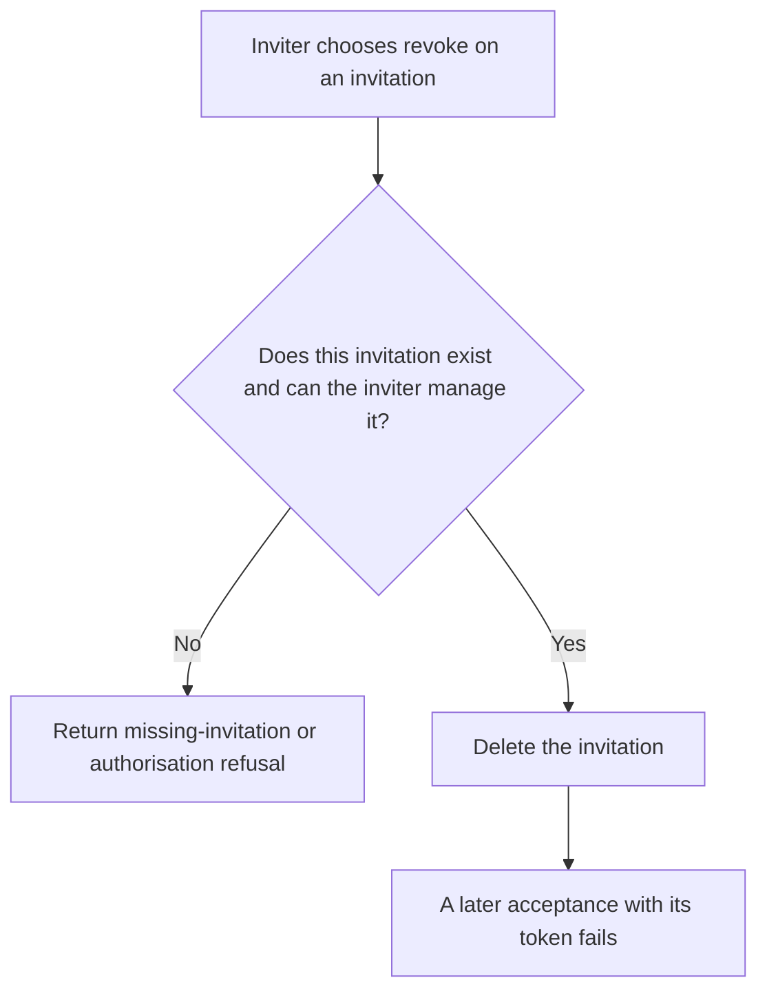
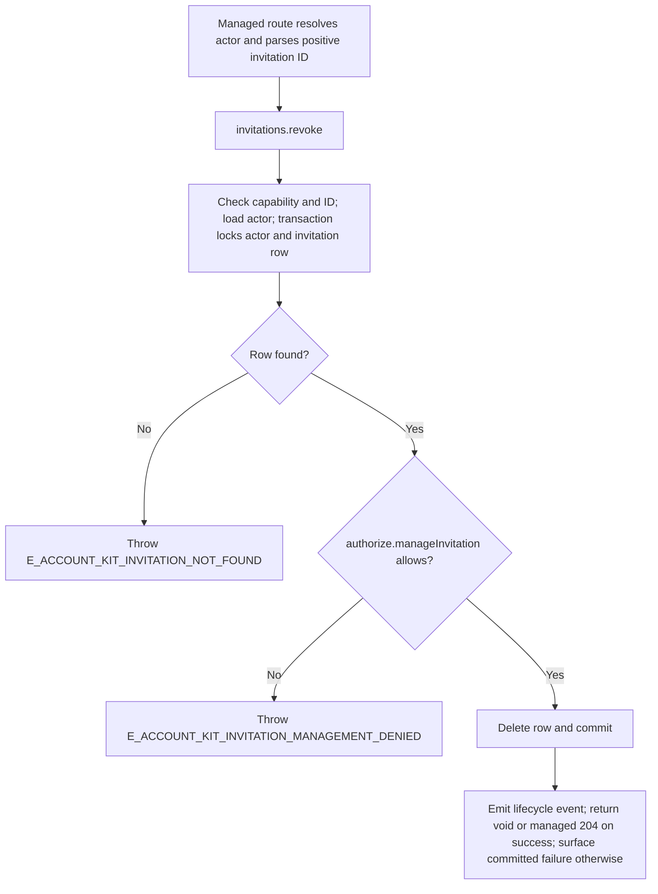

# US-ACCOUNT-12 — Revoke an invitation

As an authorised inviter, I want to cancel an outstanding invitation so that I can prevent its token from granting membership.

**Status:** Current when the host explicitly enables the opt-in `invitations` capability
**Access:** Host authorisation callback must permit managing this invitation.
**Entry:** Host calls `invitations.revoke` or mounts `account.invitation.revoke` (DELETE `account/invitations/:id`, active access by default).
**Documentation:** [usage.md](../docs/guide/usage.md)
**Source:** [`src/invitation_management.ts`](../src/invitation_management.ts)
**Coverage:** [`tests/invitations_revoke.spec.ts`](../tests/invitations_revoke.spec.ts)

## Acceptance criteria

- **Inputs and result:** `invitations.revoke({ actorId, invitationId })` returns `void`. `authorize.manageInvitation` must allow the actor; the invitation row with that id is locked and deleted, whether it is still pending or already expired, and its token can no longer be accepted. A missing row throws `E_ACCOUNT_KIT_INVITATION_NOT_FOUND`; a refusal from `manageInvitation` throws `E_ACCOUNT_KIT_INVITATION_MANAGEMENT_DENIED`.

- The transaction calls `manageInvitation(actor, invitation, { trx })`. Managed success returns 204. A lifecycle failure can surface after deletion commits.
- If the managed write recognises a committed follow-up failure, it returns 202 with `{ committed: true }`.

## User flow

## Code flow

**Code references:** [implementation](../src/invitation_management.ts), [`tests/invitations_revoke.spec.ts`](../tests/invitations_revoke.spec.ts), [managed revoke](../src/http/handlers_invitations.ts), [managed committed-failure response](../src/http/managed.ts)
