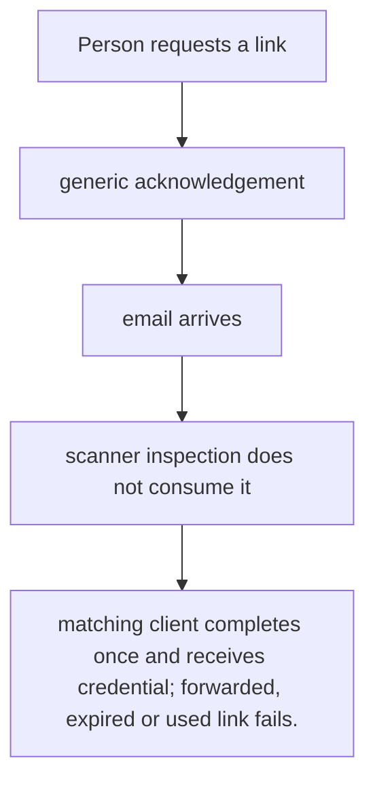
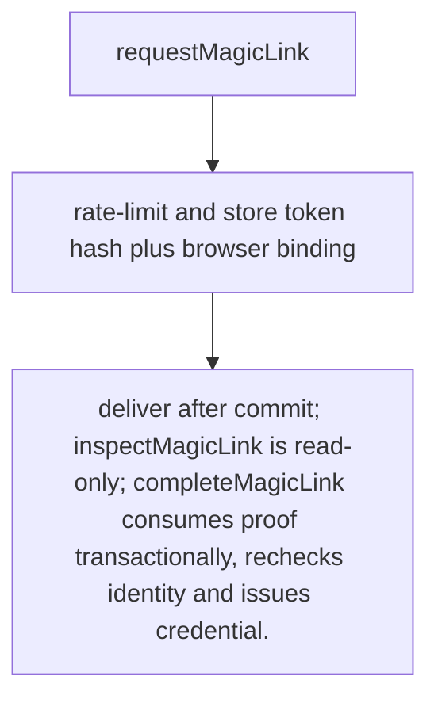

# US-ACCOUNT-13 — Sign in with an email link

As a prospective account holder, I want to request and complete an opt-in passwordless sign-in link so that I can sign in without entering a password.

**Status:** Current when `magicLinkLogin` is enabled
**Access:** Request uses generic acknowledgement and rate limits; completion must be bound to the requesting browser/app challenge.
**Entry:** Host calls `magicLink.request` and `magicLink.complete`, or explicitly enables managed routes.
**Documentation:** [magic-link.md](../docs/guide/magic-link.md)
**Source:** [`src/magic_link.ts`](../src/magic_link.ts)
**Coverage:** [`tests/magic_link.spec.ts`](../tests/magic_link.spec.ts), [`tests/magic_link_completion.spec.ts`](../tests/magic_link_completion.spec.ts)

## Acceptance criteria

- **Inputs and result:** email and client key to request; token and matching client challenge/verifier at completion. The host owns any screen, request parsing and presentation unless the entry explicitly names a managed route or command.
- matching client completes once and receives credential; forwarded, expired or used link fails.
- Refusal, expiry, stale state or post-commit delivery behavior follows the linked service contract; a committed mutation is not described as rolled back because a follow-up failed.

## User flow

## Code flow

Scope: this is the Account Kit service/command path. Host UI, route policy and external systems remain host-owned unless named.

**Code references:** [implementation](../src/magic_link.ts), [`tests/magic_link.spec.ts`](../tests/magic_link.spec.ts), [`tests/magic_link_completion.spec.ts`](../tests/magic_link_completion.spec.ts)
