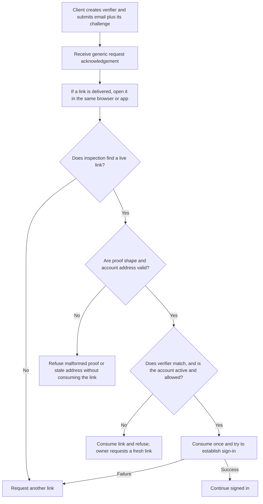
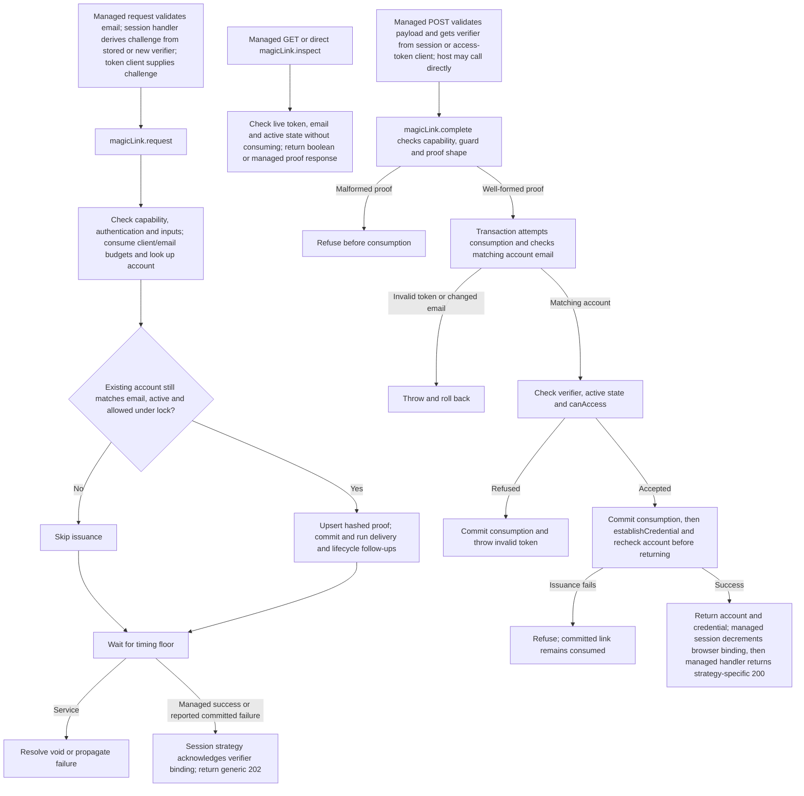

# US-ACCOUNT-13 — Sign in with an email link

As an existing account holder, I want to request and complete an opt-in passwordless sign-in link so that I can sign in without entering a password.

**Status:** Current when `magicLinkLogin` is enabled
**Access:** Issuance requires configured authentication and an existing active account allowed by the sign-in decision. Request uses generic acknowledgement and rate limits; completion must be bound to the requesting browser/app challenge.
**Entry:** Host calls `magicLink.request`, optional `magicLink.inspect`, then `magicLink.complete(input, guard)`, or mounts POST `auth/magic-link` and GET/POST `auth/magic-link/:token`.
**Documentation:** [magic-link.md](../docs/guide/magic-link.md)
**Source:** [`src/magic_link.ts`](../src/magic_link.ts)
**Coverage:** [`tests/magic_link.spec.ts`](../tests/magic_link.spec.ts), [`tests/magic_link_completion.spec.ts`](../tests/magic_link_completion.spec.ts)

## Acceptance criteria

- **Inputs and result:** `magicLink.request({ email, clientKey, clientChallenge })` returns `void`; it issues a link only for an existing active account allowed by sign-in policy. Unknown or denied addresses receive the same generic acknowledgement and do not create accounts. Challenge is a 43-character base64url SHA-256 digest of a verifier kept by the initiating client. `inspect({ token })` is non-consuming; `complete({ token, verifier }, guard)` returns account and credential. Inspection verifies matching current email and active status. A well-shaped completion with the wrong verifier consumes the link; an inactive account or denied `canAccess` check also consumes it. The owner must request a fresh link. Malformed proof and an address mismatch are refused without that consumption.
- Issuing a fresh magic link invalidates the older link for that account.
- Managed session routes require persistent AdonisJS session middleware. The browser keeps its session and the server derives the challenge and holds the verifier. Managed access-token clients send their own `clientChallenge` and `verifier`. Managed request returns the generic 202 and reports committed follow-up errors separately. Managed completion returns 200 with the represented account and a bearer token only in the access-token strategy.

## User flow

## Code flow

**Code references:** [implementation](../src/magic_link.ts), [`tests/magic_link.spec.ts`](../tests/magic_link.spec.ts), [`tests/magic_link_completion.spec.ts`](../tests/magic_link_completion.spec.ts), [managed magic link](../src/http/handlers_magic_link.ts), [session binding](../src/http/magic_link_session.ts), [credential issuance](../src/credential_issuance.ts)
