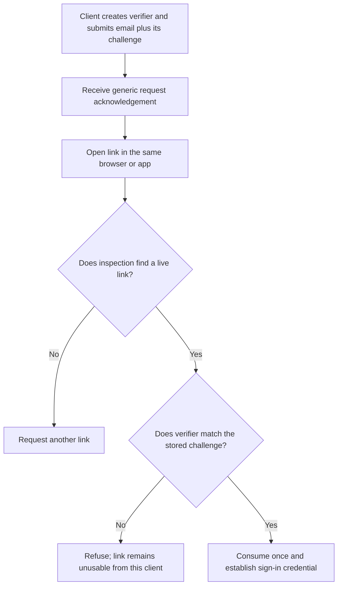
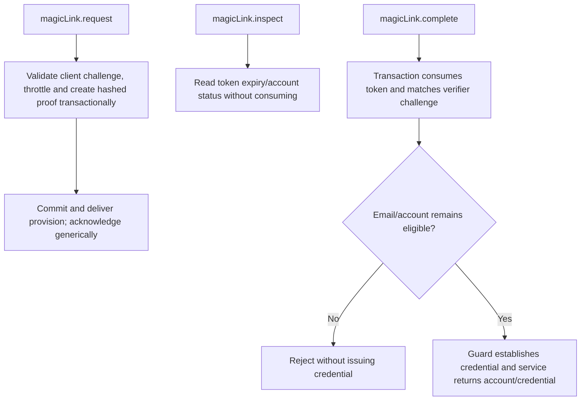

# US-ACCOUNT-13 — Sign in with an email link

As an existing account holder, I want to request and complete an opt-in passwordless sign-in link so that I can sign in without entering a password.

**Status:** Current when `magicLinkLogin` is enabled
**Access:** Links are issued only to existing active accounts allowed by sign-in policy. Request uses generic acknowledgement and rate limits; completion must be bound to the requesting browser/app challenge.
**Entry:** Host calls `magicLink.request` and `magicLink.complete`, or explicitly enables managed routes.
**Documentation:** [magic-link.md](../docs/guide/magic-link.md)
**Source:** [`src/magic_link.ts`](../src/magic_link.ts)
**Coverage:** [`tests/magic_link.spec.ts`](../tests/magic_link.spec.ts), [`tests/magic_link_completion.spec.ts`](../tests/magic_link_completion.spec.ts)

## Acceptance criteria

- **Inputs and result:** `magicLink.request({ email, clientKey, clientChallenge })` returns `void`; it issues a link only for an existing active account allowed by sign-in policy. Unknown or denied addresses receive the same generic acknowledgement and do not create accounts. Challenge is a 43-character base64url SHA-256 digest of a verifier kept by the initiating client. `inspect({ token })` is non-consuming; `complete({ token, verifier }, guard)` returns account and credential.

## User flow

## Code flow

Scope: this is the Account Kit service/command path. Host UI, route policy and external systems remain host-owned unless named.

**Code references:** [implementation](../src/magic_link.ts), [`tests/magic_link.spec.ts`](../tests/magic_link.spec.ts), [`tests/magic_link_completion.spec.ts`](../tests/magic_link_completion.spec.ts)
