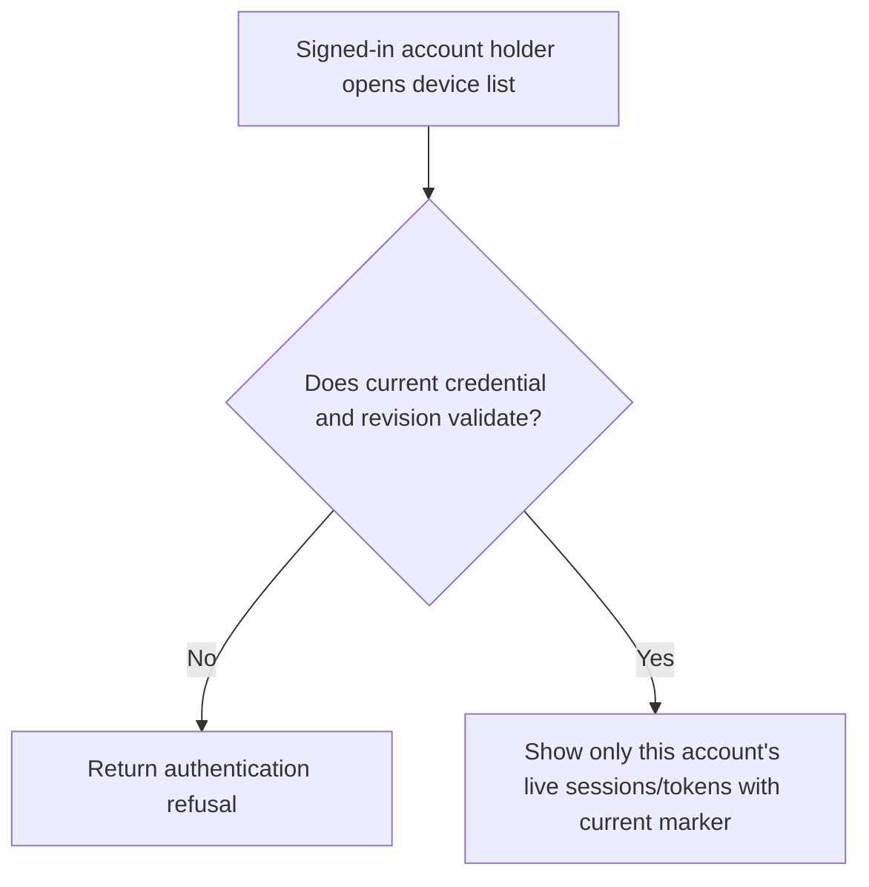
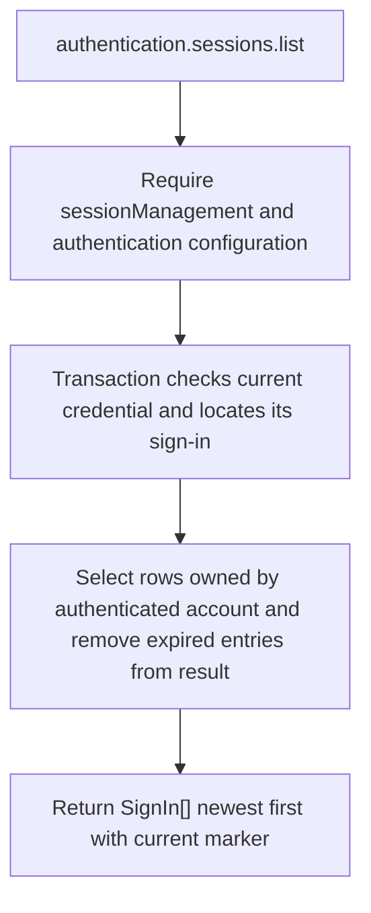

# US-ACCOUNT-14 — Review signed-in devices

As a signed-in account holder, I want to see the account’s recorded sign-ins so that I can identify sessions that should be revoked.

**Status:** Current when `sessionManagement` is enabled and `authentication` is configured
**Access:** Authenticated current account; feature requires configured authentication and session management.
**Entry:** Host calls `authentication.sessions.list({ current })`; optional managed device routes.
**Documentation:** [signed-in-devices.md](../docs/guide/signed-in-devices.md)
**Source:** [`src/session_management.ts`](../src/session_management.ts)
**Coverage:** [`tests/session_management.spec.ts`](../tests/session_management.spec.ts)

## Acceptance criteria

- **Inputs and result:** `authentication.sessions.list({ current })` returns the caller’s live sign-ins newest first, each with `id`, label, timestamps and a `current` marker. `current` must include userId plus the selected guard’s revision/tokenId/sessionHandle identifiers.

## User flow

## Code flow

Scope: this is the Account Kit service/command path. Host UI, route policy and external systems remain host-owned unless named.

**Code references:** [implementation](../src/session_management.ts), [`tests/session_management.spec.ts`](../tests/session_management.spec.ts)
