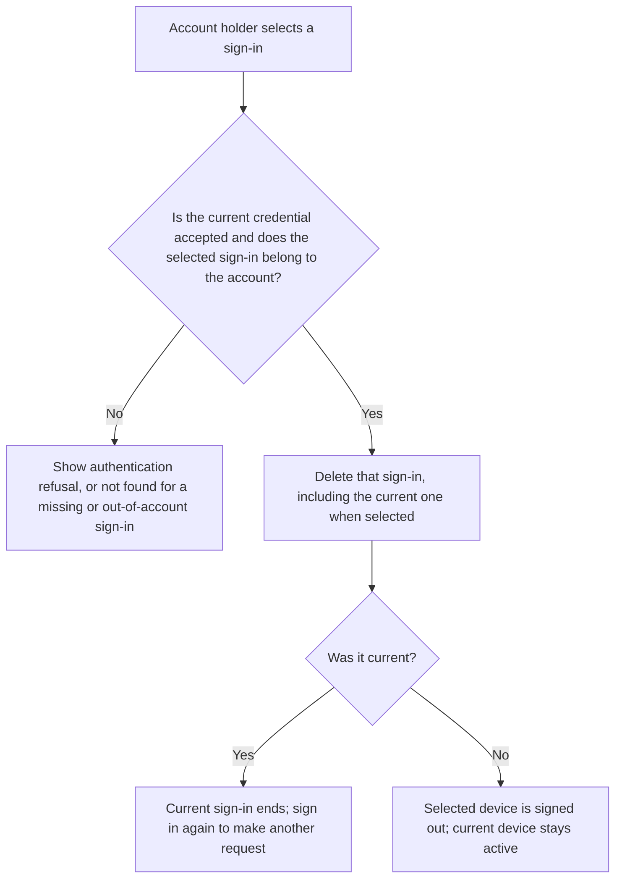
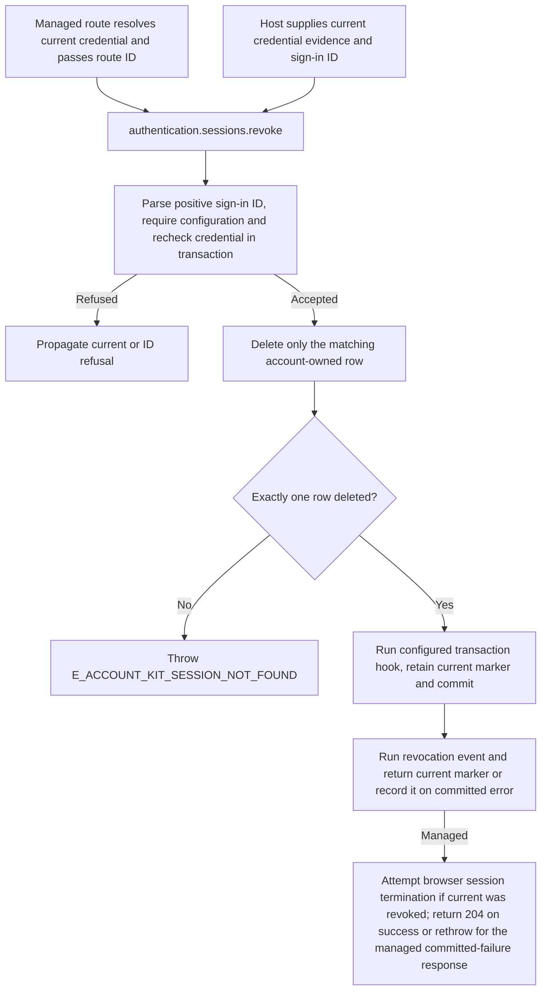

# US-ACCOUNT-15 — Sign out a selected device

As a signed-in account holder, I want to revoke one of my recorded sign-ins so that I can end access from a device I no longer trust.

**Status:** Current when `sessionManagement` is enabled and `authentication` is configured
**Access:** Authenticated current account; target id is scoped to the account. The service allows revoking the current sign-in and reports that fact.
**Entry:** Host calls `authentication.sessions.revoke({ current, id })` or mounts `account.sessions.revoke` (DELETE `account/sessions/:id`, limited access).
**Documentation:** [signed-in-devices.md](../docs/guide/signed-in-devices.md)
**Source:** [`src/session_management.ts`](../src/session_management.ts)
**Coverage:** [`tests/session_management.spec.ts`](../tests/session_management.spec.ts)

## Acceptance criteria

- **Inputs and result:** `authentication.sessions.revoke({ current, id })` returns `{ current: boolean }`. It deletes only the caller’s matching sign-in; `current: true` means the target was the credential used for this request.
- Managed success returns 204. For a revoked current browser session, the handler attempts session termination after commit, including on a committed follow-up failure. Token revocation is complete through row deletion.
- If the managed write recognises a committed follow-up failure, it returns 202 with `{ committed: true }`.

## User flow

## Code flow

**Code references:** [implementation](../src/session_management.ts), [`tests/session_management.spec.ts`](../tests/session_management.spec.ts), [managed sessions](../src/http/handlers_session_management.ts), [session termination](../src/http/session_end.ts), [managed committed-failure response](../src/http/managed.ts)
