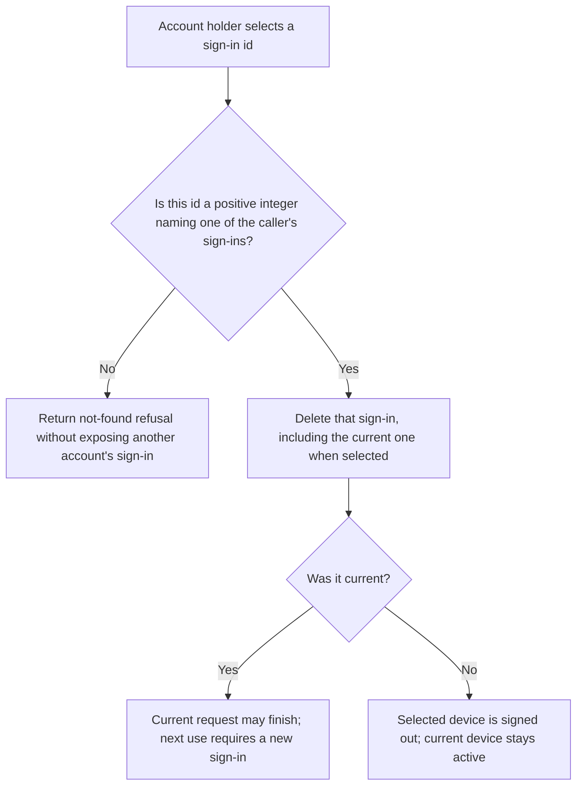
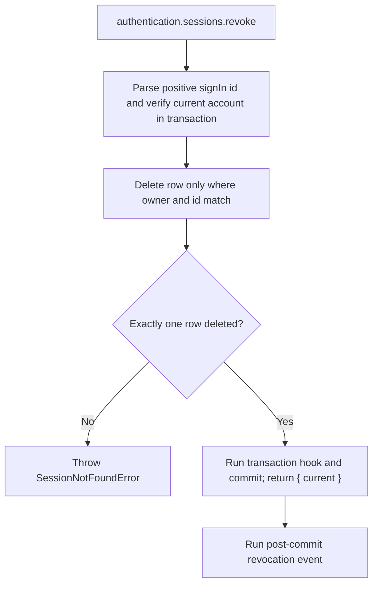

# US-ACCOUNT-15 — Sign out a selected device

As a signed-in account holder, I want to revoke one of my recorded sign-ins so that I can end access from a device they no longer trust.

**Status:** Current when `authentication.sessions` (requires `sessionManagement`) is enabled
**Access:** Authenticated current account; target id is scoped to the account. The service allows revoking the current sign-in and reports that fact.
**Entry:** Host calls `authentication.sessions.revoke({ current, id })`; optional managed route.
**Documentation:** [signed-in-devices.md](../docs/guide/signed-in-devices.md)
**Source:** [`src/session_management.ts`](../src/session_management.ts)
**Coverage:** [`tests/session_management.spec.ts`](../tests/session_management.spec.ts)

## Acceptance criteria

- **Inputs and result:** `authentication.sessions.revoke({ current, id })` returns `{ current: boolean }`. It deletes only the caller’s matching sign-in; `current: true` means the target was the credential used for this request.

## User flow

## Code flow

Scope: this is the Account Kit service/command path. Host UI, route policy and external systems remain host-owned unless named.

**Code references:** [implementation](../src/session_management.ts), [`tests/session_management.spec.ts`](../tests/session_management.spec.ts)
