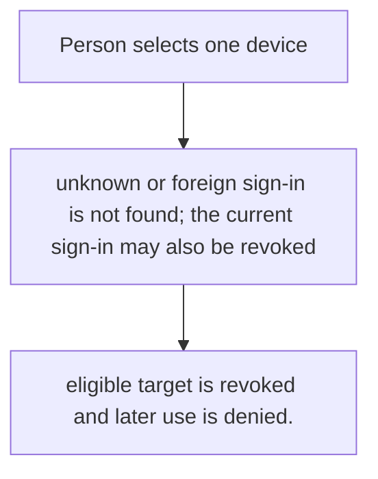
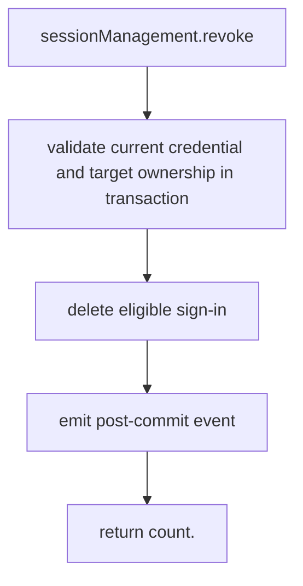

# US-ACCOUNT-15 — Sign out a selected device

As a signed-in account holder, I want to revoke one of their other recorded sign-ins so that I can end access from a device they no longer trust.

**Status:** Current when `sessionManagement` is enabled
**Access:** Authenticated current account; target must belong to same account and not be the current credential where prohibited.
**Entry:** Host calls `sessionManagement.revoke({ current, signInId })`; optional managed route.
**Documentation:** [signed-in-devices.md](../docs/guide/signed-in-devices.md)
**Source:** [`src/session_management.ts`](../src/session_management.ts)
**Coverage:** [`tests/session_management.spec.ts`](../tests/session_management.spec.ts)

## Acceptance criteria

- **Inputs and result:** current credential and selected sign-in identifier; result includes affected count. The host owns any screen, request parsing and presentation unless the entry explicitly names a managed route or command.
- eligible target is revoked and later use is denied.
- Refusal, expiry, stale state or post-commit delivery behavior follows the linked service contract; a committed mutation is not described as rolled back because a follow-up failed.

## User flow

## Code flow

Scope: this is the Account Kit service/command path. Host UI, route policy and external systems remain host-owned unless named.

**Code references:** [implementation](../src/session_management.ts), [`tests/session_management.spec.ts`](../tests/session_management.spec.ts)
