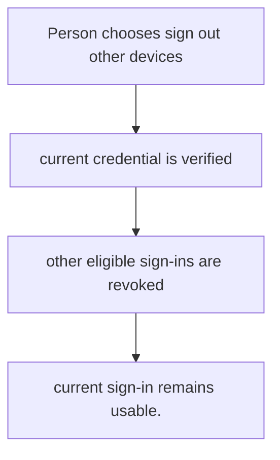
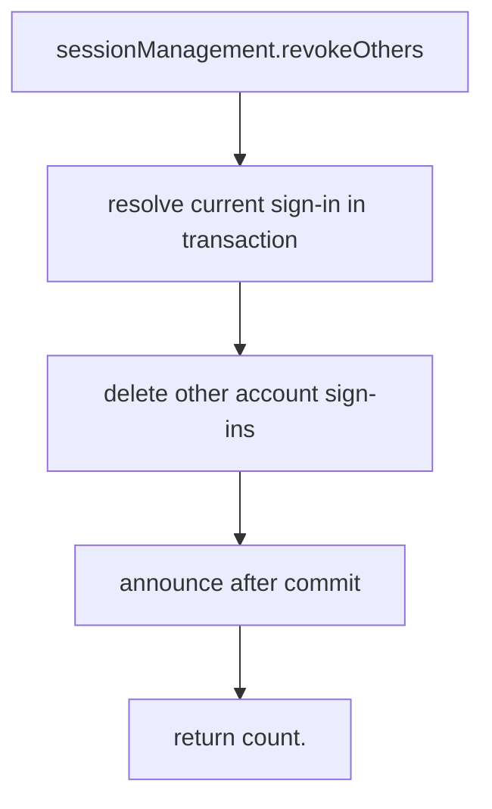

# US-ACCOUNT-16 — Sign out other devices

As a signed-in account holder, I want to end every other recorded sign-in so that I can keep the credential performing the action available.

**Status:** Current when `sessionManagement` is enabled
**Access:** Authenticated current account; operation excludes the current sign-in.
**Entry:** Host calls `sessionManagement.revokeOthers({ current })`; optional managed route.
**Documentation:** [signed-in-devices.md](../docs/guide/signed-in-devices.md)
**Source:** [`src/session_management.ts`](../src/session_management.ts)
**Coverage:** [`tests/session_management.spec.ts`](../tests/session_management.spec.ts)

## Acceptance criteria

- **Inputs and result:** current credential; returns count of other sign-ins removed. The host owns any screen, request parsing and presentation unless the entry explicitly names a managed route or command.
- current sign-in remains usable.
- Refusal, expiry, stale state or post-commit delivery behavior follows the linked service contract; a committed mutation is not described as rolled back because a follow-up failed.

## User flow

## Code flow

Scope: this is the Account Kit service/command path. Host UI, route policy and external systems remain host-owned unless named.

**Code references:** [implementation](../src/session_management.ts), [`tests/session_management.spec.ts`](../tests/session_management.spec.ts)
