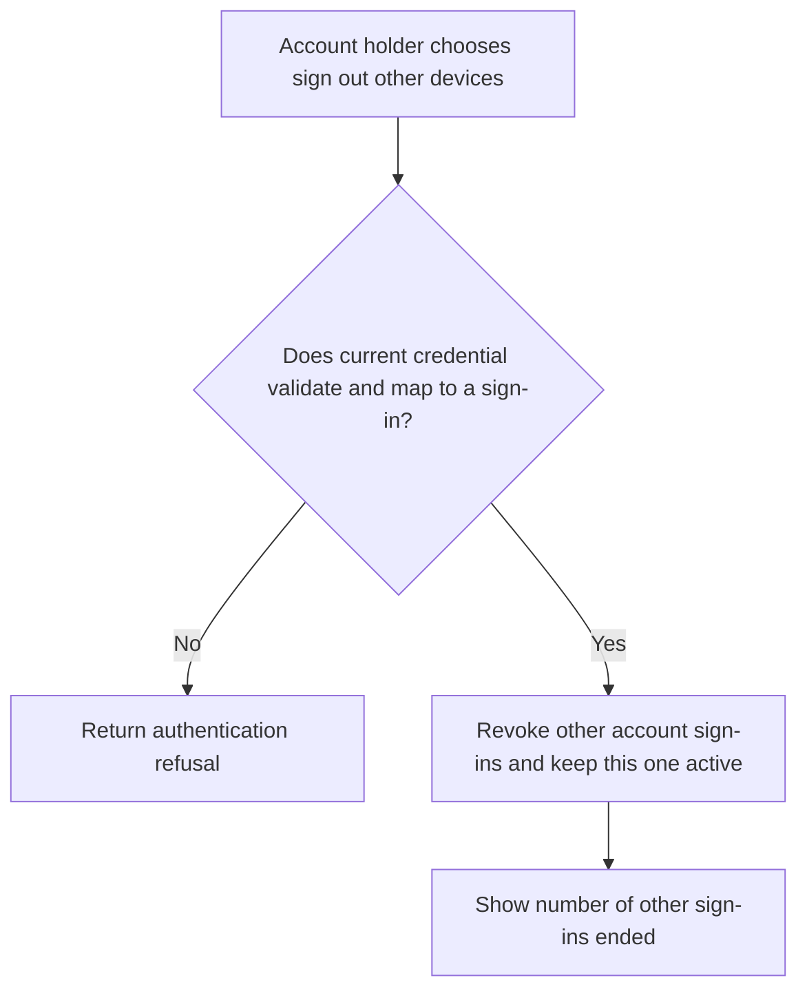
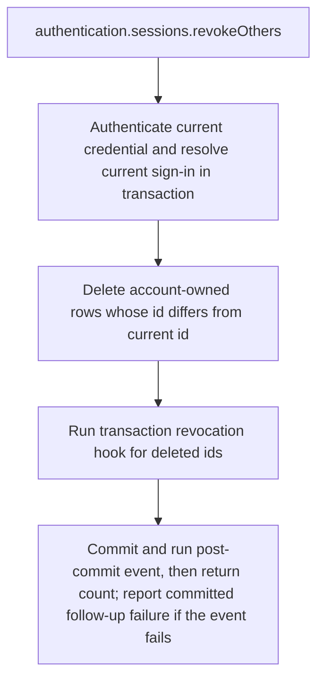

# US-ACCOUNT-16 — Sign out other devices

As a signed-in account holder, I want to end every other recorded sign-in so that I can keep the credential performing the action available.

**Status:** Current when `sessionManagement` is enabled and `authentication` is configured
**Access:** Authenticated current account; operation excludes the current sign-in.
**Entry:** Host calls `authentication.sessions.revokeOthers({ current })`; optional managed route.
**Documentation:** [signed-in-devices.md](../docs/guide/signed-in-devices.md)
**Source:** [`src/session_management.ts`](../src/session_management.ts)
**Coverage:** [`tests/session_management.spec.ts`](../tests/session_management.spec.ts)

## Acceptance criteria

- **Inputs and result:** `authentication.sessions.revokeOthers({ current })` returns `{ count }`. It deletes other sign-in rows owned by the current account and preserves the sign-in that authenticated the action.

## User flow

## Code flow

Scope: this is the Account Kit service/command path. Host UI, route policy and external systems remain host-owned unless named.

**Code references:** [implementation](../src/session_management.ts), [`tests/session_management.spec.ts`](../tests/session_management.spec.ts)
