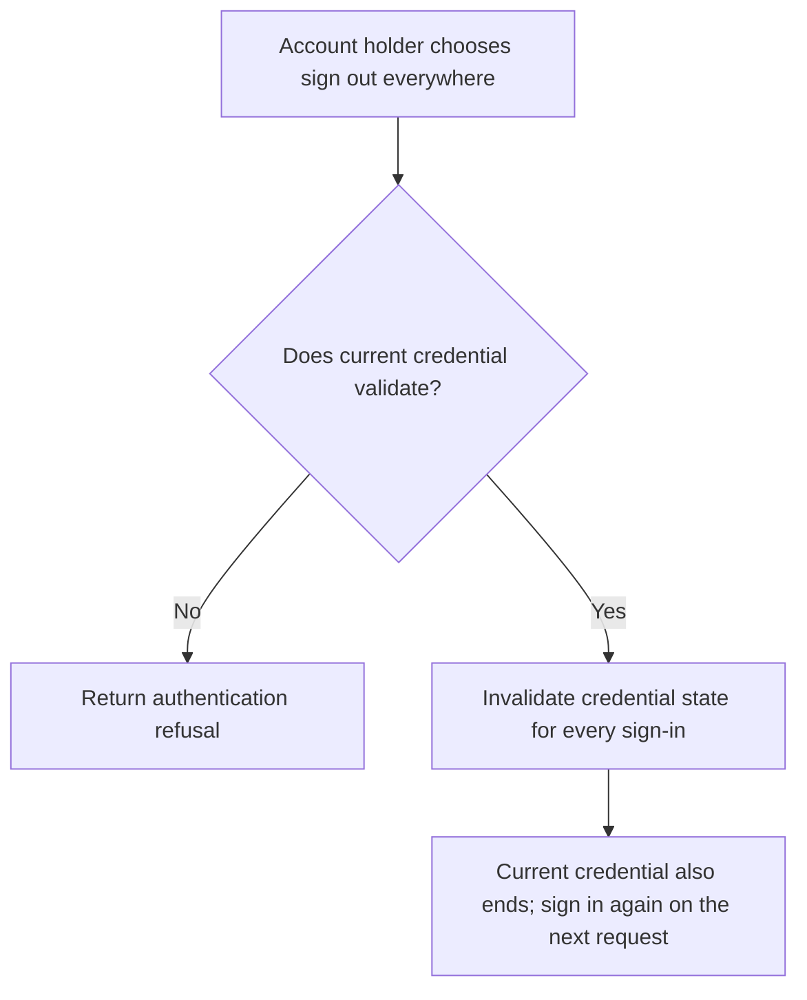
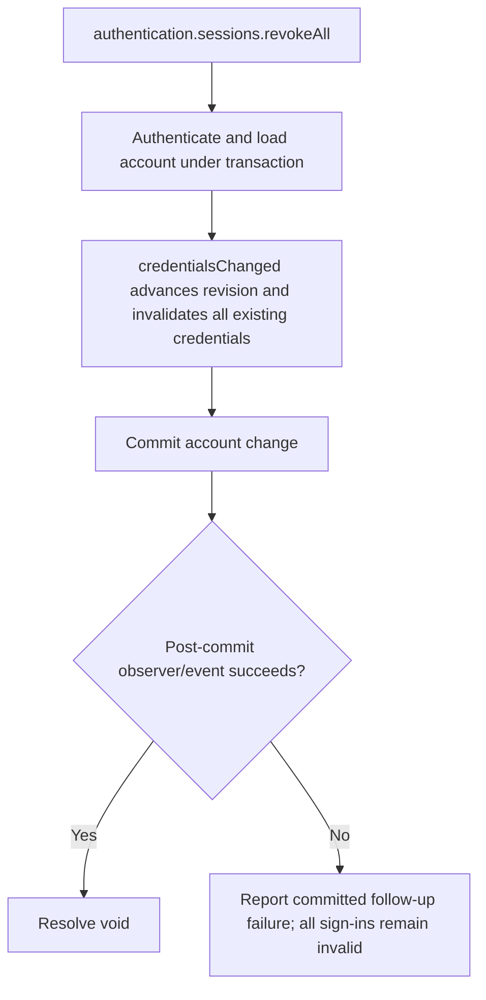

# US-ACCOUNT-17 — Sign out everywhere

As a signed-in account holder, I want to revoke every recorded sign-in so that I can require a fresh sign-in on each device.

**Status:** Current when `authentication.sessions` (requires `sessionManagement`) is enabled
**Access:** Authenticated current account; action may end the credential used for this request.
**Entry:** Host calls `authentication.sessions.revokeAll({ current })`; optional managed route.
**Documentation:** [signed-in-devices.md](../docs/guide/signed-in-devices.md)
**Source:** [`src/session_management.ts`](../src/session_management.ts)
**Coverage:** [`tests/session_management.spec.ts`](../tests/session_management.spec.ts)

## Acceptance criteria

- **Inputs and result:** `authentication.sessions.revokeAll({ current })` returns `void`. It changes credential revision so every existing session/token, including the current one, must authenticate again.

## User flow

## Code flow

Scope: this is the Account Kit service/command path. Host UI, route policy and external systems remain host-owned unless named.

**Code references:** [implementation](../src/session_management.ts), [`tests/session_management.spec.ts`](../tests/session_management.spec.ts)
