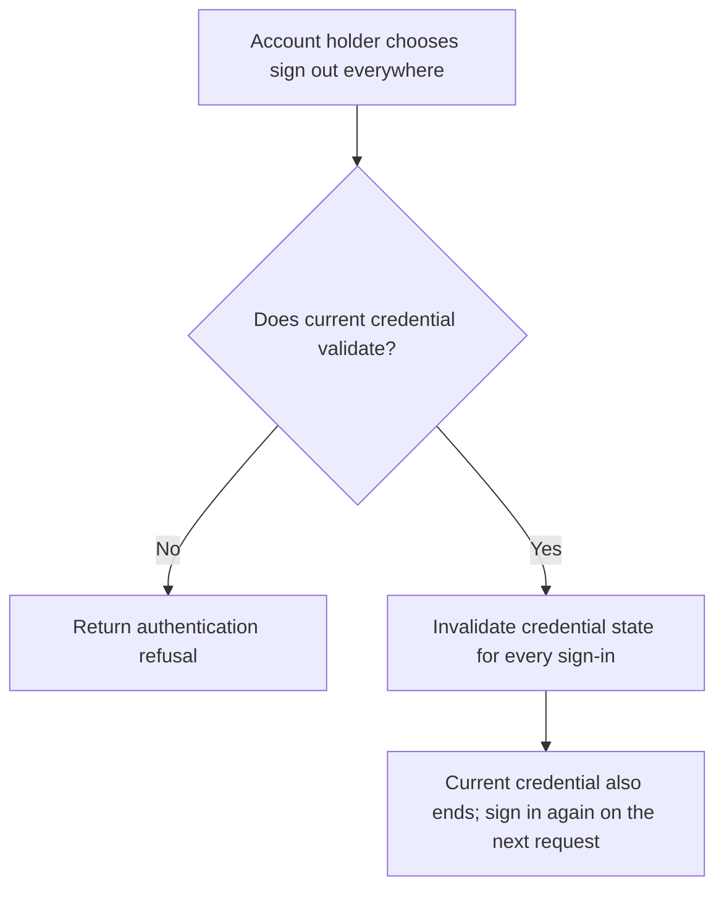
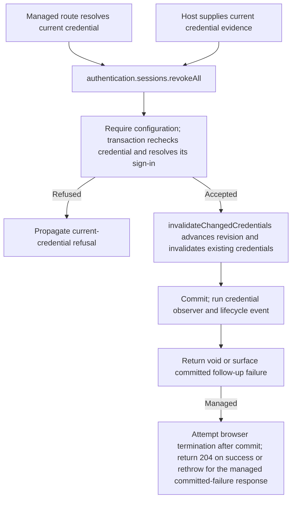

# US-ACCOUNT-17 — Sign out everywhere

As a signed-in account holder, I want to revoke every recorded sign-in so that I can require a fresh sign-in on each device.

**Status:** Current when `sessionManagement` is enabled and `authentication` is configured
**Access:** Authenticated current account; action may end the credential used for this request.
**Entry:** Host calls `authentication.sessions.revokeAll({ current })` or mounts `account.sessions.revokeAll` (POST `account/sessions/revoke-all`, limited access).
**Documentation:** [signed-in-devices.md](../docs/guide/signed-in-devices.md)
**Source:** [`src/session_management.ts`](../src/session_management.ts)
**Coverage:** [`tests/session_management.spec.ts`](../tests/session_management.spec.ts)

## Acceptance criteria

- **Inputs and result:** `authentication.sessions.revokeAll({ current })` returns `void`. It changes credential revision so every existing session/token, including the current one, must authenticate again.
- Managed success returns 204. The managed browser handler attempts session termination after commit, including when a post-commit follow-up fails.
- If the managed write recognises a committed follow-up failure, it returns 202 with `{ committed: true }`.

## User flow

## Code flow

**Code references:** [implementation](../src/session_management.ts), [`tests/session_management.spec.ts`](../tests/session_management.spec.ts), [managed sessions](../src/http/handlers_session_management.ts), [session termination](../src/http/session_end.ts), [credential mutation](../src/credential_revision.ts), [managed committed-failure response](../src/http/managed.ts)
