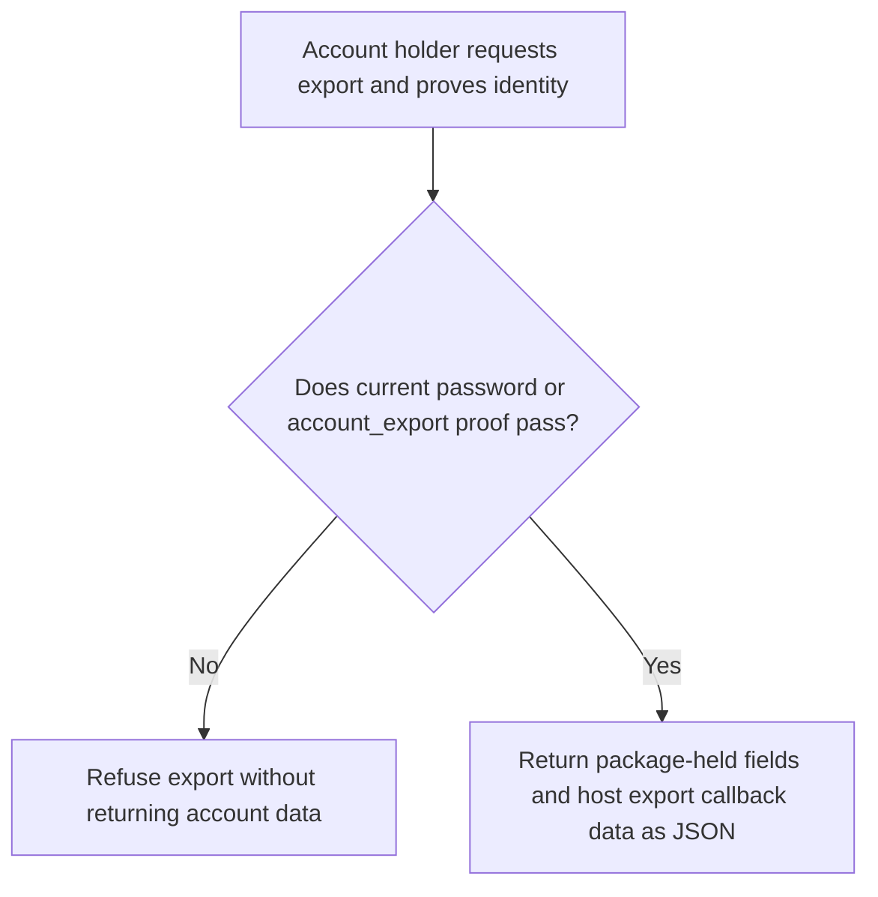
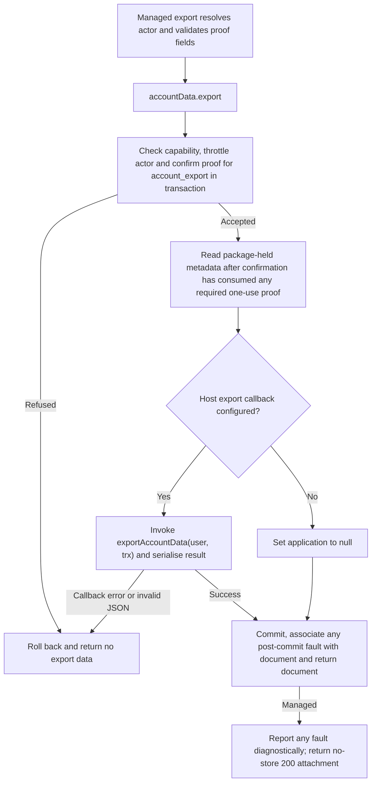

# US-ACCOUNT-18 — Export account data

As an account holder, I want to download a JSON export of account data so that I can receive package-held and host-supplied account information.

**Status:** Current when `dataExport` is enabled
**Access:** Recent password/sign-in proof required. The host may supply `exportAccountData`; without it, the export's `application` value is `null`.
**Entry:** Host calls `accountData.export` or mounts `account.data.export` (POST `account/export`, limited access).
**Documentation:** [account-data.md](../docs/guide/account-data.md)
**Source:** [`src/account_export.ts`](../src/account_export.ts)
**Coverage:** [`tests/account_export.spec.ts`](../tests/account_export.spec.ts)

## Acceptance criteria

- **Inputs and result:** `accountData.export({ actorId, currentPassword?, recentProof? })` returns the version 1 JSON export. Password accounts prove the current password; password-less accounts use purpose-bound `account_export` proof and require `socialAuthentication`. When supplied, `exportAccountData` contributes application data; otherwise `application` is `null`. The operation also consumes the user throttle budget and, for social-only proof, consumes a one-use proof transactionally; it does not change account fields.

- The callback receives the current user and transaction and must return JSON-serialisable data. Managed success returns the document as a 200 `account-export.json` attachment with `Cache-Control: no-store`. If a transaction follow-up fails after the document is complete, the managed handler records a diagnostic and still sends the export.

## User flow

## Code flow

**Code references:** [implementation](../src/account_export.ts), [`tests/account_export.spec.ts`](../tests/account_export.spec.ts), [managed account data](../src/http/handlers_account_data.ts), [actor confirmation](../src/actor_confirmation.ts)
